# Job Tree: Per-Tree Committer Design

| | |
|---|---|
| Status | Proposed, for implementation review |
| Component | `components/spider-storage` (Huntsman storage service) |
| Code baseline | `oss-main @ 278d06f` |
| Related | Notion "Job Tree" design doc (Spider / Design Doc (Huntsman)); benchmark data in `claude/job-tree/04-bench/results-db.md` (experiments A0-A10) and `results-cache.md` (B1-B5); harness in `claude/benchmarks/job-tree/` |

Storage paths are relative to `components/spider-storage/src/` unless prefixed. `spider-core/...` means `components/spider-core/src/...` and `spider-proto/...` means `components/spider-proto/...`. Line numbers refer to the baseline commit. Decisions that are still open are listed in §18. Points where this document resolves an ambiguity in its source material are listed in "Notes on this document" at the end, each with the sections it affects.

---

## 1. Overview

### 1.1 Job trees

A running task can create child jobs through the TDL API `create_child_job`. The task hands the serialized child task graphs and inputs to storage as part of its success report. The jobs then form a tree:
- **Single root.** The root is the only job a user submits, and the only job that the external job RPCs accept.
- **Single parent.** Every non-root job has exactly one parent and inherits the parent's resource group.
- **Completion propagation.** A job with children completes only after all of its children have succeeded. Its commit task, if it has one, runs after that.
- **Failure propagation.** If a child fails, its parent fails, and so on up to the root.
- **Root-only cancellation.** Cancelling the root cancels the whole tree, top-down.
- **Deterministic child creation.** A task must create the same children when it re-executes, just as every task must already produce the same outputs. Recovery relies on this.

### 1.2 What this document specifies

Today every job state transition touches exactly one job. It flows from the cache to the DB under that job's lock, in a one-row DB transaction (§2). Job trees need transitions that touch many jobs. This document defines a consistent cache-DB state of a job tree and the transactional updates of that state for cancellation, completion propagation and failure recovery, including recovery across a storage session restart.

The design in one paragraph: every tree has **one writer**, a long-running per-tree **committer** task that lives from the tree's creation until the tree is quiescent. Every job-level event of the tree is sent to that committer over the tree's channel: a job's last regular task finishing, a commit or cleanup task finishing, a terminal task failure, or a root cancel. The committer works in rounds called **tree state transactions**. Each one takes the events that have arrived, lets a **pure planner** convert them into ordered DB operations over an in-memory model of the tree, writes those as **one fenced DB transaction** with exact from-state guards, then applies the result to the cached job control blocks and replies. **A plain job is a tree of size 1** and takes the same path.

Properties that follow:
- Registration, a success cascade of any depth, a failure with tree abort, and a root cancel are each one DB transaction. No half-propagated state is ever durable, so a restart only rebuilds the cache. A non-fatal repair pass at startup is kept as a safety net.
- The planner decides "the last child has finished" from an in-memory counter. It needs no DB read, no parent row lock, no probe of sibling states and no row lock order across jobs.
- A one-row session fence stops a superseded storage process from committing after its replacement has recovered.
- Every fatal error wakes every waiter and exits the process non-zero within a deadline. Report handlers run in spawned tasks, so a dropped RPC cannot strand a job.
- The schema grows by one job state, two columns, one index and one table. The DB layer gains one write method.

### 1.3 What the committer is for

**It serializes the job-level state changes of one tree, and that serialization is how those changes stay correct.** Every completion, failure, registration and cancel in a tree becomes an event on the tree's channel, and the tree's one committer, a long-running task, plans those events one after another. The planner therefore always decides against a settled tree: no other change of the same tree is in flight while it plans. Two consequences follow:
- **"Last child done" needs no DB read and no parent-row lock.** The planner decrements the parent's in-memory counter of active children, and exactly one completion takes it to 0.
- **A race between two job-level changes of the tree is settled by planning order.** For example, when a cancel and a completion race, the cancel is planned first, and the completion is then planned against the cancelled tree and answered `Stale` (§10.6 (b)). A cancel is always planned first; §7.5 gives the reasons.

**It is not the mechanism for every race.**

| Race | Resolved by | Read |
|---|---|---|
| Job-level changes within one tree: completion, failure, registration, cancel | The committer's serialization: events planned in arrival order, a cancel always first | §6, §7.5, §10.6 (b) and (f) |
| Task-level races: straggler reports, instance registration or a retry re-enqueue versus a cancel, siblings' last successes on the task counter | The JCB and TCB locks and their state checks, as today | §10.2, §10.3, §10.6 (a), (c), (d) and (e) |
| A superseded storage process that keeps committing | The session fence | §11.3 |
| Cache–DB divergence | Not a race. The exact from-state guard on every state UPDATE detects it, the error is fatal, and the restart rebuilds the cache. | §9.4 |
| Changes in different trees | Nothing to resolve: each tree has its own committer, and trees proceed in parallel | §5.1, §14.3 |

**Serialization alone would be slow, so the committer also groups.** Writing one event per DB transaction capped one tree at about 1,065 completions/s in the benchmark (A3). So each round of the committer takes the events that have arrived for its tree as one **tree state transaction**: it plans the events together, writes them in one DB transaction, then applies the result to the cache, replies to each event and stages the follow-up work. With this group commit, one tree reached about 23,000 completions/s, the same as plain jobs with group commit (A3, §14.2). Grouping never waits: the committer, parked on the tree's channel, wakes as soon as one event arrives, so at low load a tree state transaction holds one event and costs one DB transaction.

Serialization makes the committer correct; grouping makes it fast.

**Three terms used throughout.**
- **Tree state transaction:** the operation unit of one committer round, and a **single DB transaction**. In one round the committer takes the events that have arrived (at most 256), plans them together into one plan, writes the plan as one DB transaction, then applies it to the cache, replies to each event and stages the follow-up work. Two edge cases keep this definition exact. A round in which every event is `Stale` has an empty plan and skips its DB transaction. A registration whose DB transaction is rolled back for a deterministic payload error leaves nothing written; the parent's failure, together with the round's other events, forms the *next* tree state transaction (§6.2).
- **Plan and planner:** the planner is the pure function that takes the list of events of one tree state transaction and converts them into **ordered** operations that construct its DB transaction. The ordering is explicit at both levels. The events are planned cancel first, then in arrival order, with at most one registering parent last (§7.5). The resulting DB operations run as the fence, then the guarded UPDATE groups, then the INSERT chunks (§9.4). The cache-apply order (deepest first, root last), the replies and the publications are derived from the same plan.
- **Overlay:** a view of the tree, built on top of the current tree state with the plan incrementally applied. Each event is planned against it, so later events see the effects of earlier events of the same tree state transaction. It is discarded after planning: the tree state itself changes only when the committed plan is applied (§7.4).

[§5.2](#52-inside-a-tree-event-channel-committer-and-planner) draws this machinery for one tree: the event channel, the committer and the planner, and how they interact.

### 1.4 Goals and non-goals

Goals, in priority order:
1. **Simplicity.** One mechanism for every multi-job transition, testable as a pure function.
2. **Performance of parent-child transitions**, guided by measurement: no regression for plain jobs, per-tree throughput at the level of independent plain jobs with group commit, and propagation cost that is flat in tree depth.
3. **Surviving a storage session restart**: a process crash or restart, a session bump and a cache rebuild, including a crash at any point of a multi-job transition and a superseded process that keeps running.

Non-goals:
- Priority policy, such as bounding a child's priority by its parent's.
- Eager child outputs. A parent's commit task sees only the parent's own outputs. This design only has to keep a later lazy fetch possible (§6.3).
- Scheduler fairness between trees or resource groups.
- The TDL API shape, beyond the name `create_child_job`.
- Subtree or sibling cancellation, for example top-N early termination of a search. §6.5 shows how the planner extends to it.

### 1.5 Where to find the three required answers

| Question | Short answer | Sections |
|---|---|---|
| **Cancellation:** how are many jobs' states updated, from the cache to the DB? | The root's `CancelRoot` event is planned first in the tree's next tree state transaction. The planner takes every non-terminal job from memory, one fenced DB transaction deactivates the tree, the cache is applied deepest first and root last, and the client is answered after the apply. | [§4.6](#46-walkthrough-d-cancelling-a-root), [§6.5](#65-root-cancellation-cleanup-tasks-and-jobs-mid-commit), [§8.3](#83-the-atomicity-unit), [§11.1](#111-crash-point-table) |
| **Completion propagation:** how does a child's completion reach its ancestors? | The committer decrements the parent's in-memory counter. The event that takes it to 0 unblocks the parent in the same DB transaction, recursively. A failure fails the ancestor chain and aborts every other abortable job, also in one DB transaction. | [§4.5](#45-walkthrough-c-the-last-child-of-a-blockingonchildren-parent), [§6.3](#63-success-and-the-completion-cascade), [§6.4](#64-failure-propagation-and-tree-abort), [§6.6](#66-commit-and-cleanup-task-completion) |
| **Failure recovery:** what happens on a crash or restart? | Every durable state is consistent because every multi-job state change commits within one DB transaction. A restart fences the old process, reloads the rows, rebuilds the counters and runs a repair pass as a safety net. Dropped RPCs, fatal errors, superseded processes and orphaned DB transactions are each covered. | [§11](#11-fault-tolerance-failure-recovery), [§7.7](#77-poison-on-abnormal-exit), [§10.10](#1010-why-a-dropped-rpc-future-cannot-strand-a-job) |

### 1.6 How to read this document

- §1.3 says what the committer is for, and which races it does and does not resolve.
- §2 and §3 give the background and the vocabulary: today's code path and its defects, and the job states.
- **§4 follows concrete requests end to end**, from the gRPC call to the cache and the DB and back. Read it before the rest.
- §5 to §7 are the reference for the mechanism: the components and the inside of one tree (§5.2), the flow of every operation, and the committer's internals.
- §8 and §9 state the consistency model and the interfaces: the invariants, the DDL, the SQL and the Rust signatures.
- **§10 is the locking chapter:** every lock and state check of the JCBs and TCBs, the lock order, the lock sequence of every operation, and concurrent requests resolved step by step.
- §11 to §18 cover fault tolerance, retention, limits, performance, testing, rollout, alternatives and open questions.
- "Notes on this document" lists the points where this document resolves an ambiguity in its source material, each with the sections it affects.

---

## 2. Background

### 2.1 Today's single-job transition path

Every job-level transition runs the same template. `SharedJobControlBlock::cancel` (`cache/job.rs:624-643`) is a typical example:
1. Take the job's JCB (job control block) write lock and validate the cached state (`write_cancellable`, `cache/job.rs:1029-1034`, with `ensure_cancellable` at 1193-1204).
2. Run a one-row DB transaction: `BEGIN`, `SELECT state ... FOR UPDATE` (`fetch_job_state_for_update`, `db/mariadb.rs:922-937`), `is_valid_transition`, `UPDATE`, `COMMIT`. The same shape is used by `start` (218-238), `set_state` (240-248), `commit_outputs` (250-299), `cancel` (301-314) and `fail` (316-343).
3. Set the cached state.
4. Publish follow-up work into a bounded inbound-queue lane (here `send_cleanup_ready`), still under the write lock.
5. Release the lock.

Consequences of the template:
- The cached state equals the DB state whenever the JCB write lock is free. The cache is a write-through projection of the DB.
- Task-level progress is never persisted: TCB (task control block) states, intermediate values, retry counters and instance pools live only in memory. Only job-level checkpoints are durable.
- Regular task success is split into two phases. Phase A runs under the JCB read lock: the TCB success, the successor decrements, the `fetch_sub` of `num_incomplete_tasks` and the publication of ready successors (`cache/job.rs:381-409`). If that was the last task, the read lock is dropped and phase B re-takes the write lock to commit the outputs (`cache/job.rs:411-430`). `fail_task_instance` has the same shape: phase A at 540-587, phase B at 589-605.

Fatal-error escalation:
- Every `DbError` raised inside a JCB method becomes `CacheError::Internal` (`cache/error.rs:18-22`).
- The gRPC error handlers cancel the service token on `CacheError::Internal` and on `DbError::CorruptedDbState` (`default_error_handler`, `grpc.rs:396-445`). The task-instance handler runs in strict mode and also cancels on every other unexpected error (`grpc.rs:227`).
- So a DB error, including a deadlock or a lock-wait timeout, crashes storage. The next process rebuilds the cache from the DB.

### 2.2 Restart and recovery today

- `connect` creates the tables and bumps the session with `INSERT INTO sessions () VALUES ()` (`db/mariadb.rs:60-103`; the bump is at 95-100).
- `recover_job_cache` (`state/runtime.rs:218-249`) loads every row in `Ready`, `Running`, `CommitReady` or `CleanupReady` (`get_recoverable_jobs`, `db/mariadb.rs:410-429`) and rebuilds one JCB per row. A `Running` job restarts from its first task (`cache/job.rs:136-141`). `CommitReady` and `CleanupReady` jobs get only their termination task (`cache/job.rs:142-172`).
- The server starts serving. Then `resend_ready_tasks` republishes all ready work (`bin/grpc_server.rs:98-109`).
- Task-instance RPCs from an older session fail `validate_session` (`state/service.rs:804-809`) with NOT_FOUND. The scheduler flushes its state when it sees a newer session (`spider-scheduler/src/core_impl/resource_group_round_robin/implementation.rs:220-249`).
- **No DB transaction checks the session.** A superseded process that keeps running keeps committing.
- After a fatal error, `main` returns `Ok(())`, so the process exits with code 0 (`bin/grpc_server.rs:111-119`). Compose's default restart policy `on-failure:3` (`tools/deployment/spider-compose/compose.yaml:12`) then does not restart it.

### 2.3 Why multi-job transitions break this path

Job trees need transitions that touch many jobs at once:
- **Registration.** When a parent's regular tasks finish, the parent leaves `Running` and its children become visible. Both must happen together.
- **Completion propagation.** A child's success may complete its parent, which may complete the grandparent, and so on. Of several siblings that finish concurrently, exactly one must observe "last child".
- **Failure propagation.** A child's failure fails every ancestor and makes the rest of the tree's work useless.
- **Cancellation.** A root cancel must deactivate every descendant.

With today's primitives there are two ways to build these, and both are costly:
- **Hold several JCB locks and lock several rows in one DB transaction.** This needs a global lock order (the original draft used ancestor-first row locking) and a proof that it is deadlock-free. It serializes the tree on the DB, and it needs a helper that applies a durable state to other cached JCBs.
- **Chain single-job steps.** Every intermediate state then becomes durable, so recovery has to recognize and resume half-propagated trees.

Several places in today's code also assume that one transition touches one job:
- the cache GC enqueue covers only the RPC's own job (`state/service.rs:812-818`);
- `cancel_job` treats a non-terminal job that is missing from the cache as fatal (`state/service.rs:241-249`);
- the JCB validators return fatal `Internal` errors for states they never expected to see, where a tree needs a stale-state error.

### 2.4 Existing defects this design fixes

The following defects exist in today's code, independent of job trees; each is reachable today and is tracked as a GitHub issue with its full analysis and a standalone proposed fix. Job trees make several of them more likely. PR 0 ([§16.1](#161-prs)) fixes those that do not depend on the committer; the last column links to where this design addresses each one.

| # | Issue | Addressed in |
|---|---|---|
| 1 | [#514](https://github.com/y-scope/spider/issues/514): Cancelling a `Ready` job that has a cleanup task shuts down the storage service and leaves the job uncancelled | [§3.4](#34-transition-table-changes), `abort_target` in [§6](#6-operation-flows) |
| 2 | [#518](https://github.com/y-scope/spider/issues/518): Cancelling a `CommitReady` job that has no cleanup task shuts down the storage service, because `JobState::is_valid_transition` rejects `CommitReady` → `Cancelled` | [§3.4](#34-transition-table-changes), [§6.5](#65-root-cancellation-cleanup-tasks-and-jobs-mid-commit) |
| 3 | [#513](https://github.com/y-scope/spider/issues/513): `TaskGraph::recover_from_commit_ready` drops the job's cleanup task, so cancelling a `CommitReady` job after a storage restart shuts down the storage service | [§9.5](#95-cache-structure-changes) |
| 4 | [#516](https://github.com/y-scope/spider/issues/516): A terminal task failure that races `cancel_job` shuts down the storage service, or overrides the acknowledged cancel and skips the job's cleanup task | [§6.4](#64-failure-propagation-and-tree-abort) |
| 5 | [#517](https://github.com/y-scope/spider/issues/517): `SharedJobControlBlock::fail_task_instance` leaves the failed job's other tasks `Running`, leaking their task instance pool entries and re-dispatching them until their execution manager dies | [§6.4](#64-failure-propagation-and-tree-abort) |
| 6 | [#515](https://github.com/y-scope/spider/issues/515): `JobOrchestration::get_job_outputs` shuts down the storage service when called on a cached job that has not succeeded, instead of returning `FAILED_PRECONDITION` | [§10.9](#109-stale-duplicate-and-late-reports) |
| 7 | [#522](https://github.com/y-scope/spider/issues/522): A dropped storage RPC future (e.g., an execution manager exiting mid-report) can leave the job cache half-updated and the job stuck in `Running` until a storage restart | [§10.10](#1010-why-a-dropped-rpc-future-cannot-strand-a-job) |
| 8 | [#523](https://github.com/y-scope/spider/issues/523): `spider-storage` awaits inbound-queue sends while holding job control block locks and the job-cache map lock, so a full commit or cleanup lane can stall a job or deadlock the whole service until a restart | [§7.6](#76-the-publisher), [§12](#12-retention-and-cache-gc) |
| 9 | [#520](https://github.com/y-scope/spider/issues/520): The storage session is only checked in memory, so a superseded `spider-storage` process keeps committing job transitions after its replacement recovers, causing re-executed jobs and fatal shutdowns | [§11.3](#113-the-session-fence) |
| 10 | [#521](https://github.com/y-scope/spider/issues/521): `spider-storage` exits with status 0 after a fatal error, so Docker Compose's default `on-failure:3` restart policy never restarts it | [§7.8](#78-graceful-and-bounded-shutdown), [§16.1](#161-prs) |
| 11 | [#519](https://github.com/y-scope/spider/issues/519): `ReportTaskSuccess` requests over tonic's default 4 MiB decode limit are rejected by storage and dropped by the execution manager, leaving the job stuck in `Running` | [§9.6](#96-proto-and-grpc-changes), [§6.2](#62-registration) |

---

## 3. Terminology and job states

### 3.1 Glossary

| Term | Meaning |
|---|---|
| Job tree, tree | A root job and every job whose `root_id` is that root. |
| Root | The user-submitted job of a tree. Its `parent_id` and `root_id` are both NULL. |
| JCB | Job control block: `SharedJobControlBlock` / `JobControlBlock` (`cache/job.rs:43-52, 830-842`). The cached state of one job, behind a `tokio::sync::RwLock`. |
| TCB | Task control block: `SharedTaskControlBlock` (`cache/task.rs:274-277`) for a regular task, and `SharedTerminationTaskControlBlock` for a commit or cleanup task. |
| TrCB | Tree control block: the new per-tree `TreeControlBlock`, holding the root id and the sender of the tree's event channel. Every JCB of the tree holds a clone. |
| `TreeState` | The new in-memory structure of a tree's non-terminal jobs: parent links, depth, commit and cleanup flags, and per-parent active-child counters. It holds no job states; those stay in the JCBs. The tree's committer task owns it, so it needs no lock. |
| Event (`TreeEvent`) | A job-level fact delivered to a tree's committer (§7.1). Every event comes from exactly one RPC, whose body waits for the reply. Task-level progress that does not finish a job never becomes an event. |
| Event channel | The tree's unbounded `tokio::sync::mpsc` channel of `Pending { event, reply }`. The JCBs hold its sender, through the TrCB; the committer owns its receiver. |
| Committer | The long-running per-tree task. It is spawned with the tree's `TreeControlBlock`, by `register_job` or by recovery, receives the tree's events, processes them in tree state transactions, and exits when the tree is quiescent. Exactly one runs per live tree. |
| Tree state transaction | The operation unit of one committer round, and a single DB transaction: the events the committer takes in one round, planned together into one plan, written as one DB transaction, then applied to the cache, replied to and staged. A round whose events are all `Stale` has an empty plan and skips the DB transaction (§1.3). |
| DB transaction | The SQL statements from BEGIN to COMMIT. A tree state transaction is exactly one, or none when its plan is empty. |
| Planner | The pure, synchronous function that takes the list of events of one tree state transaction, with their collected inputs and `TreeState`, and converts them into ordered operations that construct the DB transaction. Events are planned cancel first, then in arrival order, with one registering parent last; the DB operations are the fence, then the guarded UPDATE groups, then the INSERT chunks. |
| Overlay | A view of the tree, built on top of the current tree state (`TreeState` and the collected job states) with the plan incrementally applied. Later events see earlier events' effects through it. It is discarded after planning. |
| Plan | The planner's output: the ordered DB operations (row updates grouped by (from, to), then child inserts) and, derived from the same plan, the counter changes, the cache-apply order, the publications, the newly terminal jobs and one outcome per event. |
| Lane | One of the three bounded inbound-queue channels that the scheduler polls: task, commit and cleanup (`inbound_queue.rs:150-154`). |
| Publication, hint | An inbound-queue entry announcing ready work. Duplicates are tolerated, a stale one is rejected at instance creation, and a lost one is regenerated by `resend_ready_tasks`. |
| Publisher | The new runtime-owned task per lane that forwards staged publications into the lane. |
| Session | The storage session id, bumped by every storage process at startup. |
| Fence | The single `storage_fence` row. Every DB transaction that writes `jobs` takes a shared lock on it and checks that it holds this process's session id. |
| Zombie | A superseded storage process that is still running, for example during a rolling update or a network partition. |
| Prepared child | A validated child request with its prebuilt task graph, stored in the TCB of the task that created it until the parent registers its children. |
| Registration | The state change that moves one parent `Running → BlockingOnChildren` and inserts its whole child set, in one DB transaction. At most one parent registers per tree state transaction, and its child set, up to 10,000 jobs and 16 MiB, is never split across tree state transactions. |
| Skipped `CommitReady` job | A non-root `CommitReady` job that a cancel or a failure abort leaves alone so that its commit can finish (§6.5). |
| Quiescent tree | A tree with no non-terminal row (§8.5). Its committer exits. |
| EM | Execution manager. It registers task instances and reports their outcomes to storage. |
| PK | Primary key. |
| RR, RC | The REPEATABLE READ and READ COMMITTED isolation levels. |
| Exact guard | A `WHERE state = <planned from-state>` condition on an UPDATE, with a matched-row check. |

### 3.2 State classes

| Class | States | Use |
|---|---|---|
| Active | `Ready`, `Running`, `BlockingOnChildren`, `CommitReady` | The job can still succeed. A parent's counter counts its active children. |
| Abortable | `Ready`, `Running`, `BlockingOnChildren` | The states that a cancel or a failure abort interrupts. A non-root `CommitReady` job is deliberately not abortable (§6.5). |
| Inactive | `CleanupReady`, `Succeeded`, `Failed`, `Cancelled` | `CleanupReady` is non-terminal: it waits for its cleanup task. |
| Terminal | `Succeeded`, `Failed`, `Cancelled` | Never loaded at recovery. |

Only a root can be `Ready`: children are inserted directly in `Running` and need no `start_job`.

### 3.3 Job state machine

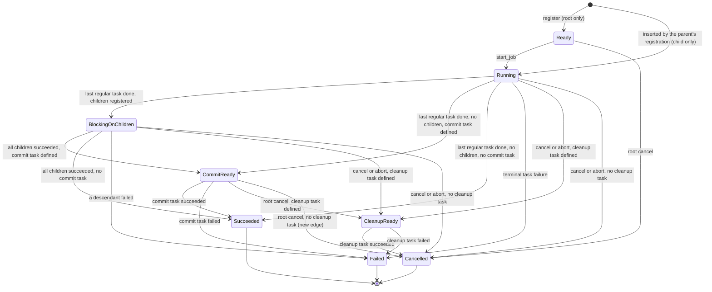

Notes on the diagram:
- "Abort" means the deactivation of the rest of a tree after a failure (§6.4).
- `CommitReady → CleanupReady` and `CommitReady → Cancelled` apply only to a root. A cancel or abort skips a non-root `CommitReady` job (§6.5).
- The startup repair pass (§11.4) uses the same edges. Its last-resort rule R5 moves any non-terminal row to `Failed`, or a `Ready` row to `Cancelled`.

### 3.4 Transition-table changes

`BlockingOnChildren` is appended as the last variant of `JobState` (`spider-core/src/job.rs:8-16`), so the MySQL ENUM only gains a value at its end. `is_valid_transition` (`spider-core/src/job.rs:34-44`) becomes:

```rust
pub const fn is_valid_transition(from: Self, to: Self) -> bool {
    match to {
        Self::Ready => false,
        Self::Running => matches!(from, Self::Ready),
        Self::BlockingOnChildren => matches!(from, Self::Running),                              // new
        Self::CommitReady => matches!(from, Self::Running | Self::BlockingOnChildren),          // + BlockingOnChildren
        Self::CleanupReady => {
            matches!(from, Self::Running | Self::CommitReady | Self::BlockingOnChildren)        // + BlockingOnChildren
        }
        Self::Succeeded => {
            matches!(from, Self::Running | Self::CommitReady | Self::BlockingOnChildren)        // + BlockingOnChildren
        }
        Self::Failed => matches!(
            from,
            Self::Running | Self::CommitReady | Self::CleanupReady | Self::BlockingOnChildren  // + BlockingOnChildren
        ),
        Self::Cancelled => matches!(
            from,
            Self::Ready | Self::Running | Self::CleanupReady | Self::CommitReady               // + CommitReady
                | Self::BlockingOnChildren                                                       // + BlockingOnChildren
        ),
    }
}
```

- `CommitReady → Cancelled` is the cancel edge for a `CommitReady` root without a cleanup task. It fixes the fatal cancel of [#518](https://github.com/y-scope/spider/issues/518).
- `Ready → CleanupReady` stays invalid. Cancelling a `Ready` root always targets `Cancelled`, because no task has run, even when it defines a cleanup task.
- `is_terminal` is unchanged: `BlockingOnChildren` is non-terminal.

---

## 4. How a request flows, end to end

This section follows concrete requests through the storage service, from the gRPC call to the cache and the DB and back, before the later sections describe each piece in detail. Existing functions are cited at the baseline commit. Files and functions that this design adds are marked *new*. Each step says which lock is held, what is awaited, and what the gRPC caller is waiting for.

### 4.1 The layers a request crosses

Today a storage RPC crosses these layers, and the whole path runs inside the RPC's future:

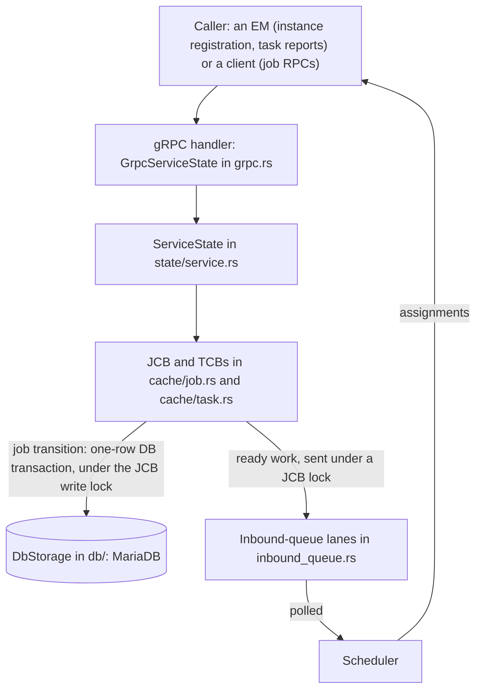

| Layer | Code | Role today |
|---|---|---|
| gRPC handler | `GrpcServiceState` (`grpc.rs`), one `async fn` per RPC, for example `report_task_success` (`grpc.rs:640-682`) | Unpacks the request, awaits the service function, and maps errors to a gRPC status. A fatal error cancels the service token (`grpc.rs:396-445`). |
| Service | `ServiceState` (`state/service.rs`) | Checks the storage session (`validate_session`, `state/service.rs:804-809`), finds the job in `JobCache` (`state/job_cache.rs:82-93`), and enqueues terminal jobs for cache GC (`state/service.rs:812-818`). |
| Cache | `SharedJobControlBlock` (`cache/job.rs`) and the TCBs (`cache/task.rs`) | Validates the job's state under its JCB lock and updates task state. For a job transition it also writes the DB and publishes ready work, still under that lock. |
| DB | `DbStorage` (`db/protocol.rs`), implemented by `MariaDbStorageConnector` (`db/mariadb.rs`) | One one-row DB transaction per job transition. |
| Lanes | `InboundQueueSenderHandle` (`inbound_queue.rs:150-154`) | Three bounded channels of ready work: task, commit and cleanup. |
| Scheduler | `spider-scheduler`, through the `InboundQueueService` poll RPCs | Drains the lanes and hands assignments to EMs. |

This design inserts eight pieces into that path. In the order a request meets them:
1. **Spawned handler body.** The service function's body runs as a task in the runtime's `TaskTracker`. The RPC future only awaits its result, so a dropped RPC can no longer interrupt a half-done cache update.
2. **`submit`** (*new*, `cache/tree.rs`). When the body detects a job-level transition, it hands an **event** to the job's tree. Every JCB holds a clone of its tree's `TreeControlBlock` (*new*, `cache/tree.rs`), which holds the sender of the tree's unbounded event channel. `submit` is synchronous: it sends the event together with a one-shot reply channel, and the send never waits.
3. **The committer** (*new*, `state/tree_committer.rs`). One long-running task per tree, spawned when the tree is created and exiting when the tree is quiescent. It takes the events that have arrived as one tree state transaction and runs the remaining steps for it. Exactly one committer runs per tree, so it is the tree's only writer.
4. **The planner** (*new*, `cache/tree.rs`). A pure function that converts the tree state transaction's events into ordered DB operations, and derives from them the counter changes, the publications and one reply per event.
5. **`apply_tree_transition`** (*new*, `db/mariadb.rs`). Writes the whole plan in one DB transaction, which first checks the storage session fence.
6. **Apply.** After COMMIT, the committer sets each changed job's cached state under that job's JCB write lock, one job at a time. This becomes the only place where a cached job state changes.
7. **Reply.** The committer answers each event through its reply channel. The spawned body returns, and so does the RPC.
8. **The publisher** (*new*, `state/tree_committer.rs`). One task per lane forwards staged ready work into the bounded lanes, so no lock is ever held across a lane send.

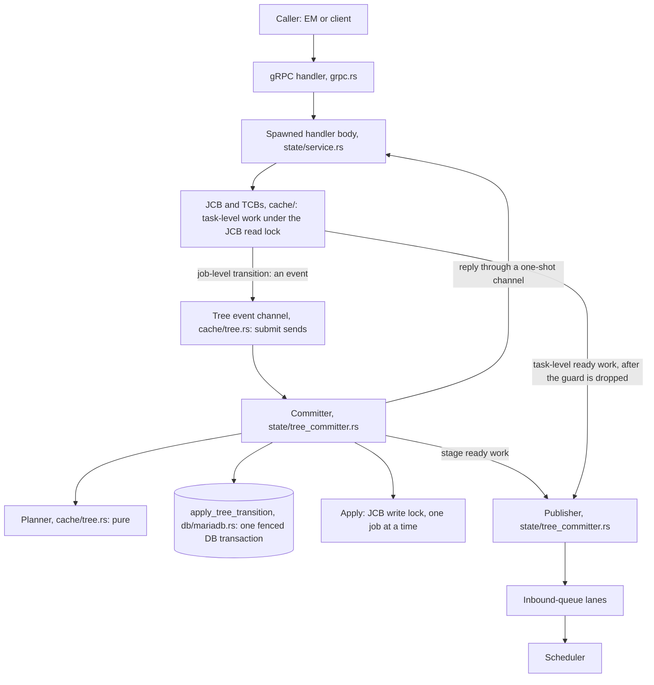

[§5.2](#52-inside-a-tree-event-channel-committer-and-planner) opens up pieces 2 to 4 for one tree: what the `TreeControlBlock` holds, how events reach the committer, the committer's lifecycle and the planner's flow.

### 4.2 Two kinds of work

Every RPC does one of two kinds of work, or both.

**Task-level progress stays as today.** A task instance is registered; a task succeeds but is not its job's last regular task; a task fails and has a retry left. Each of these runs under the job's JCB **read** lock and the task's TCB mutex, writes no DB row and produces no event. Only two things change: the body runs in a spawned task, and ready work is staged with the publisher after the read guard is dropped, instead of being sent into a lane under it.

**A job-level transition becomes an event.** Starting a job, a job's last regular task finishing, a commit or cleanup task finishing, a task failing with no retry left, and a cancel all change a job's state. Each becomes an event for the job's tree, and the RPC waits until the tree's committer has written the transition to the DB and applied it to the cache.

| RPC (gRPC service) | Service function | Event | When |
|---|---|---|---|
| `RegisterJob` (JobOrchestration) | `register_job` (`state/service.rs:150-191`) | never | Inserts the root row in its own fenced DB transaction (BEGIN, fence, INSERT, COMMIT), then creates the root's JCB, the tree's channel and a one-node `TreeState`, and spawns the tree's committer. |
| `StartJob` | `start_job` (`state/service.rs:201-214`) | always: `Start(root)` | A non-root id is rejected first. |
| `CancelJob` | `cancel_job` (`state/service.rs:231-253`) | for a cached root: `CancelRoot(root)` | A non-root id gets INVALID_ARGUMENT. An evicted terminal root is answered from the DB without an event. |
| `GetJobState`, `GetJobOutputs`, `GetJobError` | `get_job_state`, `get_job_outputs`, `get_job_error` (`state/service.rs:266-309`) | never | Read the JCB under its read lock, or the DB on a cache miss. |
| `RegisterTaskInstance` (TaskInstanceManagement) | `create_task_instance` (`state/service.rs:335-360`) | never | Task-level: registers the instance in the TCB and in the task-instance pool. |
| `ReportTaskSuccess` for a regular task | `succeed_task_instance` (`state/service.rs:377-406`) | sometimes: `RegularTasksDone(j)` | Only when it was the job's last regular task. If the job's tasks created children, the event is a registration. Otherwise the report is task-level. |
| `ReportTaskSuccess` for the commit task | `succeed_commit_task_instance` (`state/service.rs:422-445`) | always: `CommitDone(j)` | |
| `ReportTaskSuccess` for the cleanup task | `succeed_cleanup_task_instance` (`state/service.rs:461-484`) | always: `CleanupDone(j)` | |
| `ReportTaskFailure`, any lane | `fail_task_instance` (`state/service.rs:499-526`) | sometimes: `TerminalFailure(j, lane, msg)` | Only when the task has no retry left. Otherwise the retry is staged for re-dispatch, task-level. |
| `PollReadyTasks`, `PollReadyCommitTasks`, `PollReadyCleanupTasks` (InboundQueue) | `poll_ready_tasks`, `poll_commit_ready_tasks`, `poll_cleanup_ready_tasks` (`state/service.rs:604-661`) | never | Drain the lanes without touching the job cache. |
| Resource-group, EM-liveness, scheduler-registration and session RPCs | unchanged | never | |

`grpc.rs` sends a success report to the regular, commit or cleanup function according to its task id (`grpc.rs:654-676`). Every event comes from exactly one of these RPCs, whose body waits for the reply. Startup repair is not an event: it runs the planner directly, before the tree's committer exists (§11.4).

### 4.3 Walkthrough A: a task success that is not the job's last

**Request path:** `ReportTaskSuccess` → `report_task_success` → `ServiceState::succeed_task_instance` → `SharedJobControlBlock::succeed_task_instance` (phase A) → reply. No event and no DB access.

**Setup:** job J is `Running` and still has regular tasks to finish. An EM reports that one of them succeeded.

1. **`report_outcome` in the EM** (`spider-execution-manager/src/runtime.rs:640-657`). The EM runs it in a spawned task (`spider-execution-manager/src/runtime.rs:421-433`), so the EM's main loop does not wait for it. It sends `ReportTaskSuccess` with no deadline and only logs the result.
2. **`GrpcServiceState::report_task_success`** (`grpc.rs:640-682`). Holds: nothing. It unpacks the request and calls `succeed_task_instance`.
   - New: the service function's body is spawned into the runtime's `TaskTracker`, and the handler awaits only its result, raced against the service token.
   - Today: the handler awaits the body inline.
3. **`ServiceState::succeed_task_instance`** (`state/service.rs:377-406`), in the spawned body. Holds: nothing. It checks the session (`validate_session`), deserializes the outputs, and finds J with `JobCache::get` (`state/job_cache.rs:82-93`), which holds the map's read lock only for the lookup.
4. **`SharedJobControlBlock::succeed_task_instance`** (`cache/job.rs:375-409`). Takes J's JCB **read** lock through `read_running`, which checks that J is `Running`. Awaits: only a writer of J, which in this design is the committer applying a transition of J. Other reports of J share the read lock.
5. **`SharedTaskControlBlock::succeed_task_instance`** (`cache/task.rs:329-376`). Takes the task's TCB mutex. Removes the instance and marks the task `Succeeded` without awaiting (`cache/task.rs:829-841`). Then writes the outputs and decrements each successor's count of unfinished parents, awaiting each successor's TCB mutex. Successors whose count reaches 0 become `Ready`, and their indices are returned.
6. **`fetch_sub` on J's `num_incomplete_tasks`** (`cache/job.rs:392`). The new count is not 0, so this was not J's last regular task, and there is no event. New: the decrement uses `AcqRel` instead of `Relaxed`; §10.6 (e) explains why.
7. **Publish the ready successors.**
   - New: the read guard is dropped first. Then `publisher.stage(...)` hands the task-lane entries to the publisher and returns at once.
   - Today: `send_task_ready(...).await` runs under the read guard (`cache/job.rs:401-403`) and waits there if the task lane is full.
8. **Reply.** The body returns `Running`, and the handler returns `Void`. The EM's report task completes.
9. **Later, off the request path:** the publisher's task-lane task sends the entries into the bounded lane, raced against the token, and the scheduler polls them.

The request holds J's JCB read lock and TCB mutexes, briefly, and touches no DB. The caller waits only for steps 3 to 7.

**Locks and races:** the lock sequence is the "`ReportTaskSuccess`, not the last task" row of [§10.5](#105-lock-sequences-per-operation); the TCB checks it passes are in [§10.3](#103-tcb-state-and-checks). A late report from another instance of the same task is [§10.6](#106-race-resolution-worked-examples) (a).

### 4.4 Walkthrough B: the last task of a plain job

**Request path:** `ReportTaskSuccess` → `succeed_task_instance` (phase A) → `submit(RegularTasksDone(J))` → committer: `collect_inputs` → `plan_regular_done` → `plan_success` → `apply_tree_transition` (BEGIN, fence, guarded UPDATE, COMMIT) → apply `CommitReady` → reply → stage J's commit task.

**Setup:** J is a plain job, that is, a tree of size 1: its `TreeState` holds only J, and its committer has been parked in `recv_many` since `register_job` spawned it. J is `Running`, defines a commit task and created no children. An EM reports that J's last regular task succeeded.

Steps 1 to 5 are those of walkthrough A. Then:

6. **`fetch_sub` reaches 0** (`cache/job.rs:392`): this was J's last regular task.
   - Today: phase A drops the read guard, and phase B takes the write lock with `write_running` (`cache/job.rs:411-413`) and writes the DB under it.
   - New: the read guard is dropped, and the body calls `submit` with no await in between.
7. **`submit(&jcb.tree, RegularTasksDone(J))`** (*new*). Sends the event, with a fresh one-shot reply sender, on the tree's unbounded channel through J's clone of the `TreeControlBlock`. The send takes no lock and never waits. It returns the reply receiver without awaiting anything.
8. **The body awaits the reply**, raced against the service token. From here on, the EM's report waits for the committer. Neither the body nor the RPC holds a lock or a DB connection while it waits.
9. **The committer wakes** (*new*, `run_committer`). Its `recv_many` returns the one event. The committer owns `TreeState`, so it takes no lock. `take_events` forms the tree state transaction; here it holds the one event.
10. **`run_tree_state_transaction` step 1, `collect_inputs`.** Takes J's JCB read lock, reads J's state (`Running`), reads J's outputs (`read_output_payloads`) and takes the prepared children of J's TCBs (none). Releases the lock.
11. **Step 2, `plan_events`.** Pure and synchronous. `plan_regular_done` finds no children and calls `plan_success`. J has a commit task, so the plan is `Running → CommitReady` with the outputs, plus a commit-lane publication for J.
12. **Step 3, `apply_tree_transition`.** Acquires a pool connection (await) and runs the one DB transaction below. The committer holds no JCB lock during it. Today `commit_outputs` runs BEGIN, `SELECT state … FOR UPDATE`, UPDATE and COMMIT (`db/mariadb.rs:250-299`), so the statement count is unchanged.

```sql
BEGIN;
SELECT `session_id` FROM `storage_fence` WHERE `id` = 0 LOCK IN SHARE MODE;   -- must equal this process's session id
UPDATE `jobs` FORCE INDEX (PRIMARY)
   SET `state` = 'CommitReady',
       `serialized_job_outputs` = CASE `id` WHEN :j THEN :outputs END
 WHERE `id` IN (:j) AND `state` = 'Running';                                -- must match exactly 1 row
COMMIT;
```

13. **Step 4, apply.** Takes J's JCB **write** lock, awaiting J's current readers, such as a concurrent instance registration. Sets J to `CommitReady` and runs `finalize()`, which drops the regular TCBs and keeps the outputs and the commit and cleanup TCBs. Releases the lock. J stays in `TreeState`, because it is not terminal.
14. **Steps 5 and 6.** There are no child JCBs to insert, and J is not terminal, so nothing is enqueued for cache GC. Without a commit task, J would have become `Succeeded`, left `TreeState` and been enqueued for GC here.
15. **Step 7, reply.** Sends `Ok(CommitReady)` through J's reply channel.
16. **Step 8, stage.** `publisher.stage(commit entry for J)` returns at once.
17. **The committer loops.** Its buffer is empty, so it parks in `recv_many` again. J is not terminal, so the tree is not quiescent and the committer stays; it exits only once J is terminal. Had more events arrived during the DB transaction, `recv_many` would have returned them at once as the next tree state transaction.
18. **The RPC returns.** The body receives `CommitReady`, and the handler returns `Void` to the EM.
19. **Later:** the publisher's commit-lane task sends J's entry into the commit lane. The scheduler dispatches J's commit task, and the EM's `RegisterTaskInstance` for it reads J under the JCB read lock and finds `CommitReady`.

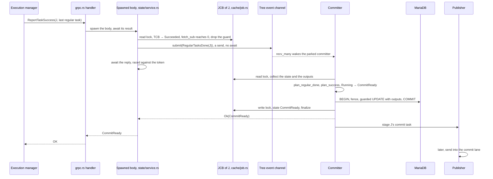

| Aspect | Today | New |
|---|---|---|
| Handler body | Runs inline in the RPC future | Spawned in the `TaskTracker`; the RPC awaits a reply raced against the token |
| Phase A | JCB read lock, TCB success, `fetch_sub` | Unchanged |
| Ready successors | Sent into the task lane under the read guard | Staged with the publisher after the guard is dropped |
| Last task detected | Drop the read lock, take the write lock (`write_running`, phase B) | Drop the read lock, `submit(RegularTasksDone)` with no await in between |
| Who writes the DB | The RPC future, holding J's JCB write lock | The tree's committer, holding no JCB lock |
| DB statements | BEGIN, `SELECT … FOR UPDATE`, UPDATE, COMMIT | BEGIN, fence `SELECT … LOCK IN SHARE MODE`, guarded UPDATE, COMMIT |
| Cache update | Under the same write lock, after COMMIT | In the committer's apply, under J's write lock, after COMMIT |
| Commit-task publication | `send_commit_ready` under the write lock | Staged with the publisher after the apply |
| Cache GC enqueue | Service layer, for the RPC's own job only | Committer, for every job that became terminal |
| What the EM's report waits for | The DB transaction and the lane send | The channel, the DB transaction and the apply, never a lane send |

**Locks and races:** the lock sequences are the "`ReportTaskSuccess`, the last task" and "Tree state transaction" rows of [§10.5](#105-lock-sequences-per-operation). A straggler failure of the last task is [§10.6](#106-race-resolution-worked-examples) (a), a concurrent `CancelJob` is (b), and two siblings finishing at once is (e).

### 4.5 Walkthrough C: the last child of a `BlockingOnChildren` parent

**Request path:** `ReportTaskSuccess` (C2's last task) → phase A → `submit(RegularTasksDone(C2))` → `plan_success` → `climb_after_success` → `unblock(P)` → `unblock(R)` → one DB transaction with three guarded UPDATEs → apply C2, then P, then R → reply → stage R's commit task.

**Setup:** a three-level tree.
- Root R is `BlockingOnChildren`, defines a commit task and has one child, P.
- P is `BlockingOnChildren`, has no commit task, and has two children, C1 and C2.
- C1 has `Succeeded`. C2 is `Running` and has no commit task.
- All four JCBs hold a clone of the same `TreeControlBlock`, so their events reach the same committer.

**Where the counters live.** `TreeState` holds, for each `BlockingOnChildren` job, its number of active children: P's is 1 (C2) and R's is 1 (P). The DB does not store them; a restart recomputes them from the loaded rows. Registration set them when it inserted the children (§6.2).

1. **Steps 1 to 9 of walkthrough B**, for C2. `submit` sends on `C2.tree`, the tree's channel, so the event reaches the tree's one committer.
2. **`collect_inputs`** reads C2's state and outputs, and the states of C2's ancestors P and R, one JCB read lock at a time.
3. **Planning.** The planner works against an *overlay*: the current tree state with the plan applied so far, so each step below sees the previous one.
   - `plan_success(C2)`: no commit task, so `Running → Succeeded` with the outputs.
   - `climb_after_success(C2)`: P is `BlockingOnChildren`. Its counter goes from 1 to 0, so `unblock(P)`. P has no commit task: `BlockingOnChildren → Succeeded`.
   - `climb_after_success(P)`: R is `BlockingOnChildren`. Its counter goes from 1 to 0, so `unblock(R)`. R has a commit task: `BlockingOnChildren → CommitReady`, plus a commit-lane publication. The climb stops.
4. **One DB transaction.** P and R take separate statements because their target states differ.

```sql
BEGIN;
SELECT `session_id` FROM `storage_fence` WHERE `id` = 0 LOCK IN SHARE MODE;
UPDATE `jobs` FORCE INDEX (PRIMARY)                                   -- C2, with its outputs
   SET `state` = 'Succeeded', `serialized_job_outputs` = CASE `id` WHEN :c2 THEN :outputs END,
       `ended_at` = CURRENT_TIMESTAMP
 WHERE `id` IN (:c2) AND `state` = 'Running';
UPDATE `jobs` FORCE INDEX (PRIMARY)                                   -- P
   SET `state` = 'Succeeded', `ended_at` = CURRENT_TIMESTAMP
 WHERE `id` IN (:p) AND `state` = 'BlockingOnChildren';
UPDATE `jobs` FORCE INDEX (PRIMARY)                                   -- R
   SET `state` = 'CommitReady'
 WHERE `id` IN (:r) AND `state` = 'BlockingOnChildren';
COMMIT;
```

5. **Apply, deepest first and root last:** C2, then P, then R, each under its own JCB write lock, one at a time. C2 and P are terminal and leave `TreeState`. R stays, with a counter of 0.
6. **GC** enqueues C2 and P. **Reply:** `Ok(Succeeded)` to C2's waiter. **Stage** R's commit task.
7. **Later**, R's commit task succeeds: `CommitDone(R)` moves R from `CommitReady` to `Succeeded`. R has no parent, so the climb ends there.

**What a concurrent reader sees.** `GetJobState(R)` returns `BlockingOnChildren` until step 5 applies R, which happens last. Once it returns `CommitReady`, C2 and P are already applied.

**A non-last sibling.** Had C1 still been running, the plan would have changed only C2's row and moved P's counter from 2 to 1. P's row would not have been touched.

**Locks and races:** the committer's collect and apply follow the "Tree state transaction" row of [§10.5](#105-lock-sequences-per-operation). Siblings that finish together are [§10.6](#106-race-resolution-worked-examples) (e), and a success that lands after a cancel or an abort is (f).

### 4.6 Walkthrough D: cancelling a root

**Request path:** `CancelJob` → `cancel_job` (root check) → `submit(CancelRoot(R))` → `plan_cancel`, first in its tree state transaction → one DB transaction, with one UPDATE per (from, to) group → apply deepest first, root last → reply with R's state → stage the cleanup tasks.

**Setup:** root R is `BlockingOnChildren` and has running descendants, some of which define cleanup tasks. A client calls `SpiderClient::cancel_job(R)` (`spider-client/src/client.rs:106-108`) and waits for the response.

1. **`GrpcServiceState::cancel_job`** (`grpc.rs:529-540`) awaits **`ServiceState::cancel_job`** (`state/service.rs:231-253`), which runs in a spawned body. Holds: nothing.
2. **Root check.** `JobCache::get(R)` hits, and `jcb.parent_id()` is `None`, so R is a root. A non-root id gets INVALID_ARGUMENT. On a cache miss, `get_state_and_parent` (*new*) reads the row:
   - a non-root gets INVALID_ARGUMENT;
   - a terminal root gets its state, as today;
   - a non-terminal root is fatal, as today, because a non-terminal root is always cached.
3. **`submit(&jcb.tree, CancelRoot(R))`**, then the body awaits the reply, raced against the token.
   - Today: `SharedJobControlBlock::cancel` takes R's write lock, runs a one-row DB transaction under it, and sends R's cleanup entry under it (`cache/job.rs:624-643`). It changes only R.
4. **Cancel first.** If a tree state transaction of the tree is in flight, the cancel waits for it: at most one. `take_events` then plans `CancelRoot` before every other queued event of the tree, including a failure that arrived earlier (§7.5 gives the reasons). Those events are planned against the cancelled tree and answered `Stale`, without a DB write.
5. **`collect_inputs`** reads every node's state, one JCB read lock at a time: about 0.3 ms for 10,000 jobs.
6. **`plan_cancel`.**
   - If R is already `CleanupReady` or terminal, the cancel gets today's stale error.
   - Otherwise the deactivation set is R plus every non-terminal job in `TreeState` that is `Ready`, `Running` or `BlockingOnChildren`. It comes from memory: no DB enumeration and no descendant row lock.
   - Each job's target is `abort_target`: `CleanupReady` if it defines a cleanup task, else `Cancelled`, and always `Cancelled` for a `Ready` job.
   - A non-root `CommitReady` job is skipped, so that its running commit can finish (§6.5).
7. **One DB transaction:** BEGIN, the fence, one guarded UPDATE per (from, to) group in chunks of at most 500 ids, COMMIT.

```sql
BEGIN;
SELECT `session_id` FROM `storage_fence` WHERE `id` = 0 LOCK IN SHARE MODE;
UPDATE `jobs` FORCE INDEX (PRIMARY) SET `state` = 'CleanupReady'
 WHERE `id` IN (:running_jobs_with_cleanup) AND `state` = 'Running';
UPDATE `jobs` FORCE INDEX (PRIMARY) SET `state` = 'Cancelled', `ended_at` = CURRENT_TIMESTAMP
 WHERE `id` IN (:running_jobs_without_cleanup) AND `state` = 'Running';
UPDATE `jobs` FORCE INDEX (PRIMARY) SET `state` = 'CleanupReady'
 WHERE `id` IN (:r, :blocked_jobs_with_cleanup) AND `state` = 'BlockingOnChildren';
-- … one statement per remaining (from, to) group, each with at most 500 ids
COMMIT;
```

8. **Apply, deepest first and root last.** For each job: JCB write lock, set the state, `cancel_non_terminal()`, `finalize()`, release. `cancel_non_terminal()` marks the job's regular and commit TCBs `Cancelled`, so the pool drops their live instances at its next GC pass; later reports from those instances already fail the JCB validator (§10.6 (c)). Jobs that became terminal leave `TreeState`.
9. **GC** enqueues every job that became `Cancelled`. **Reply:** the cancel's waiter gets R's new state, and the other events of the tree state transaction get `Stale`. **Stage** the cleanup tasks of the jobs that became `CleanupReady`.
10. **The RPC returns** R's state, `CleanupReady` or `Cancelled`. The cancel is durable for the whole tree and visible in the cache before the client hears about it. It never waited for the scheduler: a full cleanup lane delays only the publisher.

**Locks and races:** the lock sequences are the `CancelJob` and "Tree state transaction" rows of [§10.5](#105-lock-sequences-per-operation). Instance registration versus the cancel is [§10.6](#106-race-resolution-worked-examples) (c), a retry versus the cancel is (d), and a success submitted after the cancel committed is (b) and (f).

---

## 5. Architecture and components

This section is the reference map of the pieces that §4 introduced: where each one lives, what it holds, and how they connect.

### 5.1 Components

| Component | Lives in | Role |
|---|---|---|
| `TreeControlBlock` (TrCB) | `cache/tree.rs` | One per tree: the root id and the sender of the tree's event channel. Every JCB of the tree holds a clone, so a submit is a send that never waits. |
| Event channel | `cache/tree.rs` | One unbounded `tokio::sync::mpsc` channel per tree, carrying `Pending { event, reply }`. The JCBs hold its sender; the tree's committer owns its receiver. |
| `TreeState` | `cache/tree.rs` | Structure of the tree's non-terminal jobs: parent, depth, resource group, commit and cleanup flags, `active_children` per parent, and a strong reference to each non-terminal JCB. Owned by the tree's committer task, so it has no lock. |
| Planner and overlay | `cache/tree.rs` | `plan_events`, the per-event planners, the shared steps `unblock` and `fail_blocked`, `plan_repair`, and `check_invariants` for the property tests and a debug-build assertion. Pure and synchronous: no DB, no `JobCache`, no await. |
| Committer | `state/tree_committer.rs` | `run_committer` and `run_tree_state_transaction`. One long-running task per tree, spawned with the tree's TrCB by `register_job` or recovery and exiting when the tree is quiescent. Per round: receive, collect inputs, plan, write one DB transaction, apply, insert child JCBs, enqueue GC, reply, stage publications. |
| `apply_tree_transition` | `db/mariadb.rs` | The one new DB write method: a fenced DB transaction of PK-addressed UPDATEs with exact guards plus multi-row child INSERTs (§9.4). |
| Per-lane publisher | `state/tree_committer.rs` | One task per lane, owned by the runtime. Forwards staged publications into the bounded lanes, off every lock and off every tree's serial section (§7.6). |
| Spawned handler bodies | `state/service.rs` | `report_task_success`, `report_task_failure`, `cancel_job` and task-instance creation run their bodies in the runtime's `TaskTracker`. The RPC future only awaits the result (§10.10). |
| Recovery and repair | `state/runtime.rs` | Groups the recovered rows into trees, rebuilds `TreeState`, repairs inconsistent trees, and spawns each tree's committer before serving (§11.2, §11.4). |

`cache/` keeps importing nothing from `state/`. `submit` is a plain send on the TrCB's sender and lives in `cache/tree.rs`. `run_committer` lives in `state/tree_committer.rs`, because it needs the DB, the `JobCache`, the GC and the publisher, and `register_job` and recovery spawn it.

### 5.2 Inside a tree: event channel, committer and planner

§5.1 lists the components, and §5.3 shows how data moves between the layers. This subsection opens up one tree. It shows what the tree's parts hold and who touches each part, how events travel from the RPC handler bodies to the tree's committer, how the committer task lives and ends, and how the planner turns the events of one tree state transaction into a plan. §7 specifies each piece; the four diagrams below are its map.

**Structure: what holds what, and who touches it.**

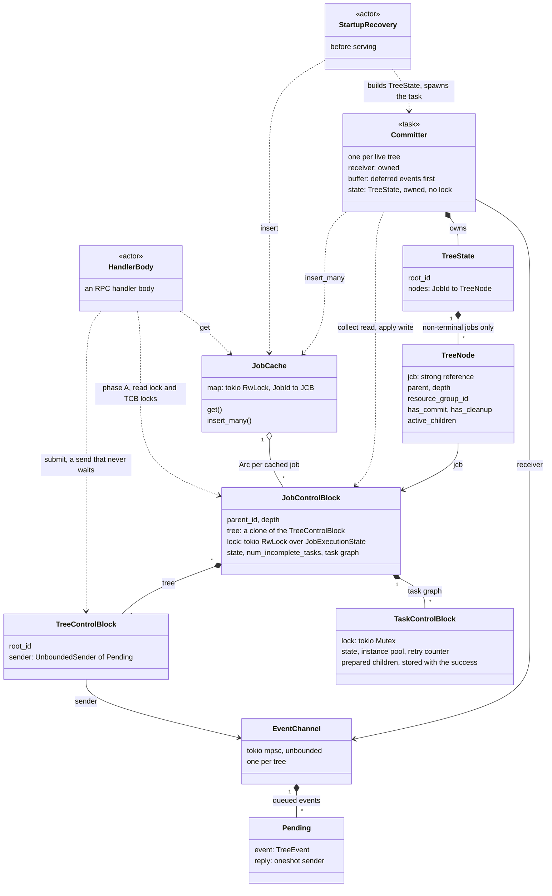

How to read it:
- A filled diamond is ownership: the owner holds the part by value or behind its lock. The hollow diamond is the job map's `Arc` per cached job. A plain arrow is a reference.
- **The tree side has no lock.** The committer task owns `TreeState` and the channel's receiver, so no other task can reach either. Every JCB holds a clone of the `TreeControlBlock`, that is, a sender of the tree's channel. `TreeState` holds strong references to the non-terminal JCBs. Nothing refers back to `TreeState`, so there is no reference cycle (§9.5).
- **Dashed arrows go from an actor to the parts it touches**, labelled with the access.
  - Handler bodies touch the tree only through `submit`, a send that never waits. Their task-level work stays on the JCB and its TCBs, where a success also stores its prepared children.
  - The committer reads JCBs and takes the prepared children out of the TCBs when it collects, and writes JCBs when it applies.
  - Startup recovery builds `TreeState`, the JCBs and the channel, then spawns the committer with `TreeState` and the receiver. `register_job` does the same for a new root.
  - The cache GC, not drawn, only removes terminal JCBs from the map (§12).
- §9.5 has the field definitions, and §10.1 the synchronization rules.

**Producers and the consumer: around the event channel.**

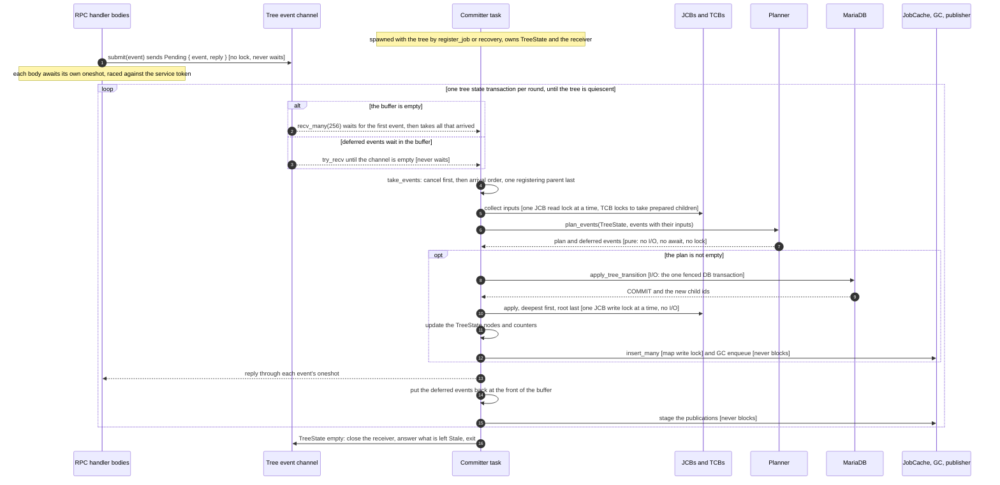

How to read it:
- **The only producers are the RPC handler bodies** (the spawned bodies of §10.10, and `start_job`). Every event comes from exactly one RPC, whose body waits for the reply, so the channel never holds more events than there are waiting callers. `submit` is a synchronous send on the tree's unbounded channel and never waits.
- **Each pass of the loop is one tree state transaction**, that is, one DB transaction. A round whose events are all `Stale` has an empty plan and skips the `opt` block: no DB transaction and no apply.
- **Brackets name the lock that a step holds, or say whether the step is pure or does I/O.** Only the DB transaction does I/O. The planner holds no lock and never awaits. `TreeState` needs no lock, because the committer owns it.
- **Receiving.** `recv_many` waits for at least one event, then takes everything already in the channel, up to 256, without waiting again. While deferred events wait in the buffer, the loop does not block: it appends new arrivals with `try_recv` and starts the next round at once.
- A failed step ends the task through the poison guard, as the lifecycle below shows. §7.2 and §7.3 give the code and the failure handling of every step.

**Committer lifecycle.**

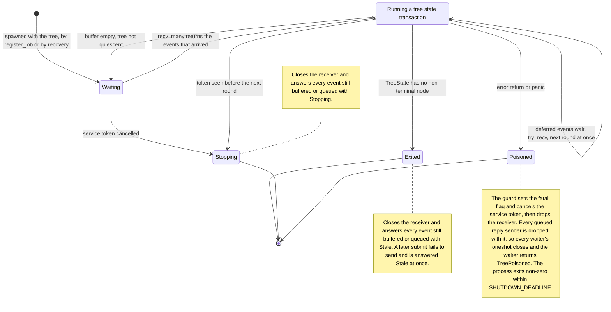

How to read it:
- **The task lives exactly as long as the tree.** It is spawned when the tree's `TreeControlBlock` is created and holds `TreeState` and the receiver until it exits, so a tree never has a second committer and never waits for one to start.
- **Exited** means quiescent: `TreeState` has no non-terminal node. That can be later than the root becoming terminal, because descendants' cleanups and skipped commits may still run (§8.5). A quiescent tree stays quiescent, because only a `Running` parent can add jobs. So the events that still arrive come from terminal jobs that are still cached, and `Stale` is their correct answer.
- **Stopping** is a normal exit. The round in flight finishes its DB transaction or fails it first.
- §7.2 has the loop, §7.7 the poison guard, and §7.8 the shutdown.

**Planner: from events to ordered DB operations.**

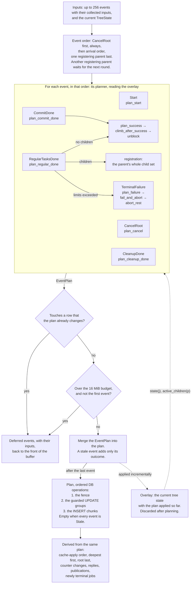

How to read it:
- **The planner is pure.** It reads the events, their collected inputs and `TreeState`, and returns a plan and the deferred events. It converts the list of events into ordered operations that construct the tree state transaction's DB transaction. The ordering is explicit at both levels: the event order at the top, the DB-operation order at the bottom.
- **Each event's planner reads the overlay**: the current tree state with the plan applied so far. So it sees every change that the earlier events of the same tree state transaction planned. That is how a cancel planned first makes a later completion `Stale`, and how sibling completions decrement the same in-memory counter one after another. The overlay is discarded after planning; `TreeState` changes only in the apply, after COMMIT.
- **One registering parent per tree state transaction.** Its whole child set, up to 10,000 jobs and 16 MiB, goes into this one plan and is never split across tree state transactions.
- **The two checks before the merge** are the deferral rules of §7.5:
  - "never touch a row twice" keeps every UPDATE a single `from → to` edge that an exact guard can check;
  - the payload budget keeps the DB transaction within the measured range.
- **Shared building blocks.** The success cascade and the failure abort are reused by repair at startup (§11.4), which calls the same `unblock` and enters the failure path at `fail_blocked`, without an event.
- §7.4 defines the overlay, §7.5 the ordering and deferral rules, §9.4 the operation order, and §6 each planner.

### 5.3 Data and control flow

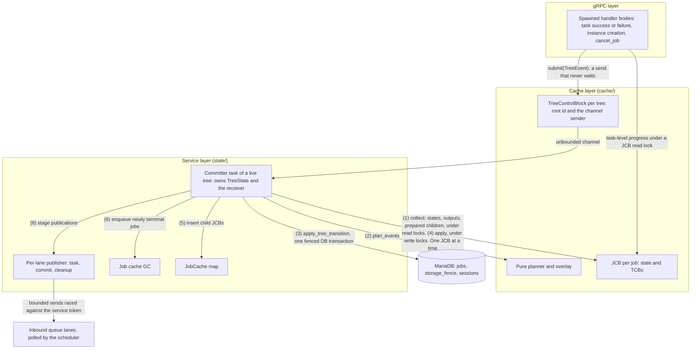

### 5.4 A plain job is a tree of size 1

`register_job` creates a root JCB together with a one-node `TreeState` and the tree's `TreeControlBlock`, and spawns the tree's committer, which exits once the job is terminal. Every running plain job therefore has one parked task and one channel, a few hundred bytes. Every transition of a plain job (start, last regular task done, commit done, cleanup done, terminal failure, cancel) is an event of that one-node tree. Its plan touches one row, and its DB transaction is BEGIN, fence, UPDATE, COMMIT: four statements, the same count as today's BEGIN, `SELECT ... FOR UPDATE`, UPDATE, COMMIT. So there is a single transition path. The JCB methods lose their DB calls (`cache/job.rs:248, 416, 460, 495, 602, 628`), and the job state is written only by the committer. PR 3 makes this change before any tree feature exists and gates it on H11 (§15). Walkthrough B (§4.4) follows one such transition step by step.

---

## 6. Operation flows

Each subsection below covers one operation: its request path, its planner, the DB statements, the cache apply, the replies and publications, and its races.

The planners are pure functions. Each reads the tree through the overlay `v`, the current tree state with the plan applied so far: `v.state(j)` is j's state as already changed by an earlier event of the same tree state transaction, or otherwise as collected from j's JCB; `v.active_children(p)` is p's counter, adjusted the same way; and a job that is no longer in `TreeState` reads as `Absent`. §7.4 defines the overlay precisely. Each planner returns an `EventPlan`: row updates, child inserts, counter changes, publications and one reply. `plan_events` merges the `EventPlan`s, in planning order, into the tree state transaction's plan.

The planners share these helpers:

```rust
/// Target state of a job that a cancel, an abort or a repair deactivates.
fn abort_target(v: &Overlay, j: JobId) -> JobState {
    if v.state(j) == Ready { Cancelled }                 // nothing ran; Ready → CleanupReady is invalid
    else if v.has_cleanup(j) { CleanupReady }
    else { Cancelled }
}

enum Lane { Regular, Commit, Cleanup }
// Lane::accepts(s): Regular ↔ Running, Commit ↔ CommitReady, Cleanup ↔ CleanupReady.
// Lane::stale_error(s): JobAlreadyTerminated(s) for a terminal s; otherwise JobNoLongerRunning,
// JobNoLongerCommitReady or JobNoLongerCleanupReady for the lane (also for Absent).
```

### 6.1 Plain job transitions

**Request path** (for example `StartJob`): `start_job` (`grpc.rs:516-527`) → `ServiceState::start_job` → `submit(Start(root))` → `plan_start` → BEGIN, fence, `UPDATE … Ready → Running`, COMMIT → apply `Running` → reply → stage the root's ready tasks. The other plain-job transitions in the table below take the same path with their own event and planner.

Every plain-job transition becomes an event of a one-node tree. Its plan updates one row, so the DB transaction is BEGIN, fence, UPDATE, COMMIT.

| Today | Event | Plan | Publication |
|---|---|---|---|
| `start` (`cache/job.rs:245-267`) | `Start(root)` | `Ready → Running`; stale `JobAlreadyStarted` otherwise | the root's ready tasks |
| Last regular task, phase B (`cache/job.rs:411-430`) | `RegularTasksDone(j)` without children | `plan_success`: `Running → CommitReady` or `Succeeded`, with outputs | the commit task, if `CommitReady` |
| `succeed_commit_task_instance` (`cache/job.rs:449-466`) | `CommitDone(j)` | `CommitReady → Succeeded` | — |
| `succeed_cleanup_task_instance` (`cache/job.rs:484-501`) | `CleanupDone(j)` | `CleanupReady → Cancelled` | — |
| `fail_task_instance`, phase B (`cache/job.rs:589-605`) | `TerminalFailure(j, lane, msg)` | the lane's state `→ Failed`, with the error | — |
| `cancel` (`cache/job.rs:624-643`) | `CancelRoot(root)` | `abort_target(root)` | the cleanup task, if `CleanupReady` |

```rust
fn plan_start(v: &Overlay, root: JobId) -> EventPlan {
    if v.state(root) != Ready { return EventPlan::stale(JobAlreadyStarted); }
    EventPlan::new().update(root, Ready, Running, None).publish_ready_tasks(root)
}
```

Publications are staged after the apply, so a hint never reaches the scheduler before the JCB shows the post-state. This preserves the guarantee that the comment at `cache/job.rs:258-261` gets today by publishing under the write lock.

### 6.2 Registration

**Request path:** `ReportTaskSuccess` carrying children → `ServiceState::succeed_task_instance` (decode, validate and prebuild the children in the spawned body) → `SharedJobControlBlock::succeed_task_instance` (phase A, read lock; the prepared children are stored in the TCB) → on the last task, `submit(RegularTasksDone(P))` → `plan_regular_done` → BEGIN, fence, UPDATE P `Running → BlockingOnChildren` with its outputs, INSERT the children `RETURNING id`, COMMIT → apply P, bind the child JCBs, `JobCache::insert_many` → reply `BlockingOnChildren` → stage the children's ready tasks.

**Step 1: service layer, before any cache mutation and outside every lock.** For each child request on a success report:
- Decode it with `ValidatedJobSubmission::create` (`job_submission.rs:70`).
- Build its `cache::task::TaskGraph` with `TaskGraph::create` (`cache/task.rs:59`), keeping copies of the compressed graph and inputs: `create` consumes the submission, and `into_parts` drops the compressed bytes (`job_submission.rs:134`). B2 measured the whole in-process construction at 21-26 µs per child with 10 tasks and 143 µs with 100 tasks, about 70 % of it decoding. That cost is paid on the report path, not in the tree's serial section.
- Enforce the limits (§13):
  - `depth(reporting job) + 1 ≤ MAX_DEPTH`, using the depth stored in the JCB;
  - children per report `≤ MAX_CHILDREN_PER_JOB`;
  - each child's compressed graph plus inputs `≤ max_child_bytes = min(4 MiB, max_allowed_packet / 2)`;
  - the report's children in total `≤ 16 MiB`, and the report's outputs within today's 4 MiB bound.
- Any violation, decode error or build error routes the report to `fail_task_instance` instead: a task failure. Child creation is deterministic, so the retries run out and the job fails through the normal terminal path.

Validation happens before the TCB flips to `Succeeded`, because a check that fails after the flip would be fatal.

**Step 2: JCB phase A** (`cache/job.rs:381-409`), run inside the spawned handler body (§10.10) and changed in three places:
1. `tcb.succeed_task_instance(id, outputs, prepared)` stores the prepared children in the TCB's critical section. A duplicate or rejected instance can never store any, because `InvalidTaskInstanceId` and `TaskAlreadyTerminated` fire first (`cache/task.rs:829-841`).
2. The ready successor indices are collected under the read guard. The guard is dropped, then `publisher.stage` takes them. A hint for a job cancelled in between is rejected at instance creation.
3. If `fetch_sub` reports the last task, the guard is dropped and `submit(RegularTasksDone(j))` runs with no await in between.

**Step 3: the committer plans it.** Step (1) of `run_tree_state_transaction` collects the outputs and the prepared children of all tasks in task-index order, so the child insertion order, and with it the child-id order, is the same on every re-execution.

```rust
fn plan_regular_done(v: &Overlay, j: JobId, outputs: Vec<TaskOutput>, kids: Vec<PreparedChild>) -> EventPlan {
    if v.state(j) != Running { return EventPlan::stale(JobNoLongerRunning); }        // cancelled or aborted meanwhile
    if kids.is_empty() { return plan_success(v, j, Some(outputs)); }                  // §6.3; today's commit_outputs
    if kids.len() > MAX_CHILDREN_PER_JOB || bytes(&kids) > MAX_JOB_CHILD_BYTES {       // totals across all reports of j
        return plan_failure(v, j, Lane::Regular, "child-job limit exceeded");
    }
    EventPlan::new()
        .update(j, Running, BlockingOnChildren, Some(outputs))
        .insert_children(j, v.root(), v.resource_group(j), kids)                      // children inserted as Running
        .counter(j, kids.len())
        .bind_prebuilt_jcbs()                                                         // infallible: graphs are prebuilt
        .publish_children_ready_tasks()
}
```

**Step 4: DB.** One row moves `Running → BlockingOnChildren` with its outputs, and k child rows are inserted with `RETURNING id`, chunked by bytes (§9.4). Measured (A6): 5-16 ms for k ≤ 10; 19.8 ms for 1,000 children of 1 KiB; 39.7 ms for 1,000 of 4 KiB, against 192 ms with single-row INSERTs; 74.7 ms for 1,000 of 16 KiB, the largest measured payload. `MAX_JOB_CHILD_BYTES` is 16 MiB so that no registration's DB transaction exceeds the measured range. Raising it requires rerunning gate H16 at the new cap (Q6).

**Step 5: deterministic DB errors (defence in depth).** The limits make errno 1153 (packet too large) and 1406 (data too long) unreachable, and the blob columns are `LONGBLOB` (`db/mariadb.rs:762-764`). If a tree state transaction that contains a registration still gets one of them from a statement before COMMIT:
- the DB transaction rolls back, so that tree state transaction wrote nothing. Nothing was applied and nobody was answered, so `TreeState` and the JCBs are unchanged;
- the committer replaces the registration with a failure of the same parent, `TerminalFailure(P, Regular, "child payload rejected by the database")`, which keeps the registration's reply sender, and drops the prepared children;
- it puts that event and the round's other events back at the front of its buffer, in their original order.

The next tree state transaction plans them, with its own single DB transaction: no tree state transaction ever runs a second DB transaction. A tree state transaction has at most one registering parent, so the culprit is unambiguous. Only errors that the server reports before COMMIT qualify; a failed or ambiguous COMMIT stays fatal. This turns a crash loop (a deterministic re-execution after every fatal restart) into a job failure.

**Step 6: cache apply.**
- The parent becomes `BlockingOnChildren`. `finalize()` drops its regular TCBs and keeps its outputs and its commit and cleanup TCBs.
- Each child JCB is bound to its returned id with state `Running`, `tree` set to this TrCB and `depth = depth(P) + 1`, and is added to `TreeState`.
- After every JCB guard is dropped, the children are inserted into `JobCache` (step 5), and their ready tasks are staged (step 8). Children need no `start_job`.

**Step 7: the child-id window.** Between COMMIT and the map insert, a child is durable but not cached. Nobody can address it, because its id has not been published. `cancel_job`'s cache-miss path reads `parent_id` and answers INVALID_ARGUMENT for any non-root, so the fatal "non-terminal but uncached" branch (`state/service.rs:241-249`) is never reached for a child.

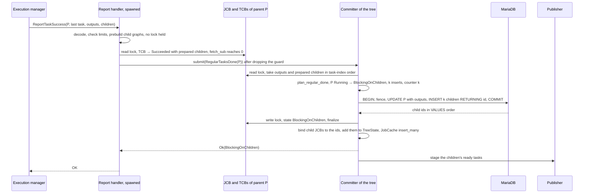

| Race | Outcome |
|---|---|
| Registration vs a root cancel | Serialized by the committer. Registration first: its children are in `TreeState`, and the cancel covers them. Cancel first: P is inactive, `RegularTasksDone` is `Stale`, and its prepared children are dropped. No child is ever inserted into a closed tree (I4). |
| Registration vs a failure elsewhere in the tree | The same: whichever is planned first wins, and the other is planned against its result. In one tree state transaction the failure is planned first (the registering parent goes last), aborts P, and the registration is `Stale`. |
| Two sibling tasks of P report children concurrently | Each stores its prepared children in its own TCB. The last task's `RegularTasksDone` collects all of them, and the per-job totals are checked once, in the planner. P's whole child set is inserted in one tree state transaction. |
| Two parents of the tree register in the same round | Only one parent registers per tree state transaction: the oldest. The other is deferred, with its collected inputs, to the next tree state transaction (§7.5). |
| Duplicate success report of the task that carries children | Rejected by the TCB before anything is stored. |
| Restart before the registration commits | P is `Running` in the DB; it re-executes and re-creates the same children (§11.1). |

### 6.3 Success and the completion cascade

**Request path:** `ReportTaskSuccess` for a job's last regular task (`RegularTasksDone(j)`) or for its commit task (`CommitDone(j)`) → phase A, or the commit TCB's success, under the JCB read lock → `submit` → `plan_success` → `climb_after_success` and `unblock` for each ancestor that completes → BEGIN, fence, UPDATE j, at most two grouped UPDATEs of ancestors, COMMIT → apply deepest first → reply → stage the commit task of every job that became `CommitReady`. Walkthrough C (§4.5) follows one cascade step by step.

A job succeeds in one of two ways: its last regular task finishes and it has no commit task and no children, or its commit task succeeds (`CommitDone(j)`).

```rust
fn plan_success(v: &Overlay, j: JobId, outputs: Option<Vec<TaskOutput>>) -> EventPlan {
    let mut p = EventPlan::new();
    let from = v.state(j);                                         // Running (regular done) or CommitReady (commit done)
    let to = if outputs.is_some() && v.has_commit(j) { CommitReady } else { Succeeded };
    p.update(j, from, to, outputs);
    if to == CommitReady { p.publish_commit(j); return p; }
    climb_after_success(v, &mut p, j);
    p
}

/// `cur` just became Succeeded: decrement its parent and unblock the parent if `cur` was its last
/// active child.
fn climb_after_success(v: &Overlay, p: &mut EventPlan, cur: JobId) {
    let Some(par) = v.parent(cur) else { return };                 // a root
    if v.state(par) != BlockingOnChildren { return; }              // a skipped CommitReady job under an aborted or
                                                                   // absent parent (I3, §7.4)
    let left = v.active_children(par) - 1;
    p.counter(par, left);
    if left == 0 { unblock(v, p, par); }                           // a non-last sibling leaves the parent row untouched
}

/// A BlockingOnChildren job whose children have all succeeded. Used by the cascade and by repair R2.
fn unblock(v: &Overlay, p: &mut EventPlan, par: JobId) {
    let to = if v.has_commit(par) { CommitReady } else { Succeeded };
    p.update(par, BlockingOnChildren, to, None);                   // outputs were stored at registration
    if to == CommitReady { p.publish_commit(par); }                // its commit task finishes it later
    else { climb_after_success(v, p, par); }                       // the ancestor succeeded: continue up
}
```

The recursion depth is bounded by `MAX_DEPTH`.

- **Concurrent siblings.** One committer plans the events of a tree one after another, against the overlay counter. Exactly one completion sees `left == 0`, without a DB read, a parent row lock or a probe. A9a measured 0 lost and 0 double parent transitions in 100 bursts of 64 siblings.
- **Where a cascade stops.** At the first ancestor that still has active children, or at one with a commit task. When that commit task succeeds, `CommitDone(par)` restarts the climb through `plan_success`.
- **DB cost.**
  - A tree state transaction of b sibling completions writes b child rows in one outputs UPDATE. The parent row is not touched unless the tree state transaction contains the last sibling.
  - A cascade through m ancestors adds at most two grouped UPDATEs to the same DB transaction: `BlockingOnChildren → Succeeded` for the intermediate ancestors and `BlockingOnChildren → CommitReady` for the top one.
  - Measured (A5): the cascade is flat in depth, 1.97 ms at D = 1 and 2.03 ms at D = 6. Designs that lock rows per level grew by 0.5-0.6 ms per level, and probe designs by 1.8-2.6 ms per level.
- **Cache apply.** Deepest first: the completing job, then each ancestor that changed. Jobs that became `Succeeded` leave `TreeState` and are GC-enqueued.
- **The parent's commit task** sees only the parent's own outputs, as today (`cache/job.rs:747-751`). Eager child outputs are out of scope, and nothing here precludes a lazy fetch later. That fetch would be `SELECT id, serialized_job_outputs FROM jobs WHERE parent_id = ? AND state = 'Succeeded'`, served by `job_parent`. "Success is earned" (I2) and tree-granular retention (§12) together guarantee that the rows exist when it runs.

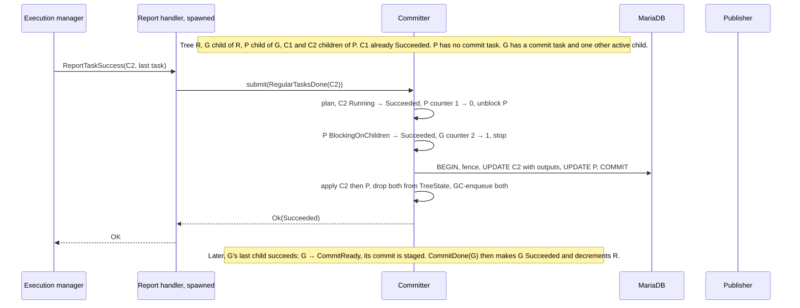

| Race | Outcome |
|---|---|
| Siblings complete in the same tree state transaction | Planned in arrival order against the overlay counter. Exactly one sees 0 and unblocks the parent. |
| Siblings complete in different tree state transactions | The counter lives in `TreeState` across tree state transactions. The parent row changes only with the last sibling. |
| Completion vs a sibling's failure in the same tree state transaction | Arrival order. Failure first: the completing job is aborted, so its event is `Stale`. Completion first: the job succeeds, then the failure fails the parent chain. |
| Completion vs a root cancel | Cancel first; the completion is `Stale` (`JobNoLongerRunning` or `JobNoLongerCommitReady`). |
| A skipped `CommitReady` job finishes after its parent was aborted (and perhaps evicted) | The parent reads as not `BlockingOnChildren` (or `Absent`), so the climb stops. The job becomes terminal and is GC-enqueued. |
| Duplicate or late success report | Rejected by the TCB (instance or terminal check) or by the JCB validator (§10.9). |

### 6.4 Failure propagation and tree abort

**Request path:** `ReportTaskFailure` → `ServiceState::fail_task_instance` → `SharedJobControlBlock::fail_task_instance` (phase A, read lock; the TCB has no retry left) → `submit(TerminalFailure(j, lane, msg))` → `plan_failure` → `fail_and_abort` → BEGIN, fence, UPDATE j to `Failed`, UPDATE its ancestor chain to `Failed`, one UPDATE per abort group, COMMIT → apply deepest first and root last, with `cancel_non_terminal` and `finalize` → reply `Failed` → stage the cleanup tasks of the aborted jobs.

A non-retryable failure of j in any lane triggers `TerminalFailure(j, lane, msg)`. The TCB's terminal failure is decided under the JCB read lock in `fail_task_instance` (`cache/job.rs:540-587`). The guard is dropped and the event is submitted; phase B (`cache/job.rs:589-605`) is gone.

```rust
fn plan_failure(v: &Overlay, j: JobId, lane: Lane, msg: &str) -> EventPlan {
    let from = v.state(j);
    if !lane.accepts(from) { return EventPlan::stale(lane.stale_error(from)); }  // a race with an abort is stale, not fatal
    fail_and_abort(v, j, from, msg)
}

/// A BlockingOnChildren job that can never succeed. Used by repair R4; no lane check.
fn fail_blocked(v: &Overlay, par: JobId, msg: &str) -> EventPlan {
    fail_and_abort(v, par, BlockingOnChildren, msg)
}

fn fail_and_abort(v: &Overlay, j: JobId, from: JobState, msg: &str) -> EventPlan {
    let mut p = EventPlan::new();
    p.update(j, from, Failed, None).error(msg);
    if from == CleanupReady || v.state_of_parent(j) != Some(BlockingOnChildren) {
        // A cleanup failure, a root, or a skipped CommitReady job: no propagation.
        if from == BlockingOnChildren { abort_rest(v, &mut p, j, &[]); }   // repair only: no descendant may stay active (I3)
        return p;
    }
    let chain: Vec<JobId> = v.ancestors(j).collect();                       // all BlockingOnChildren (I3), up to the root
    p.update_group(&chain, BlockingOnChildren, Failed)
     .error(format!("descendant job {j} failed: {}", truncate(msg)));
    abort_rest(v, &mut p, j, &chain);
    p
}

fn abort_rest(v: &Overlay, p: &mut EventPlan, j: JobId, chain: &[JobId]) {
    for r in v.abortable().filter(|r| *r != j && !chain.contains(r)) {   // Running or BlockingOnChildren elsewhere
        let to = abort_target(v, r);
        p.update(r, v.state(r), to, None);
        if to == CleanupReady { p.publish_cleanup(r); }
    }                                                                   // CommitReady jobs are left to finish (§6.5)
}
```

- **Ancestors** are all `BlockingOnChildren` (I3). They become `Failed` in one grouped UPDATE, root included. `get_job_error(root)` names the failing leaf.
- **Every other abortable job** is aborted in the same DB transaction: to `CleanupReady` if it defines a cleanup task, otherwise to `Cancelled`. Their work is useless once the root has failed, and their cleanups still release external resources.
- **A non-root `CommitReady` job is not aborted** (§6.5). It finishes its commit, and its outcome no longer propagates.
- **Cache apply.** For each job that leaves the active set: set the state, run `cancel_non_terminal()`, then `finalize()`, and drop its prepared children. Running the cancel on failure also fixes today's TCB leak on job failure.
- **In-flight instances** of aborted jobs: their TCBs are cancelled, the pool drops them on its next GC pass (`task_instance_pool.rs:390-420`), and their late reports are stale. Executors are not preempted, as today.
- **Failed jobs run no cleanup**, as today. Jobs aborted because a sibling failed do run theirs (Q8).
- **Measured (A5):** at D = 6, the root is `Failed` 3.43 ms after the failure is submitted and the tree is quiescent at 3.45 ms, in one DB transaction. Designs that abort the tree with per-job sweeps reached quiescence in 13.7-24.6 ms.

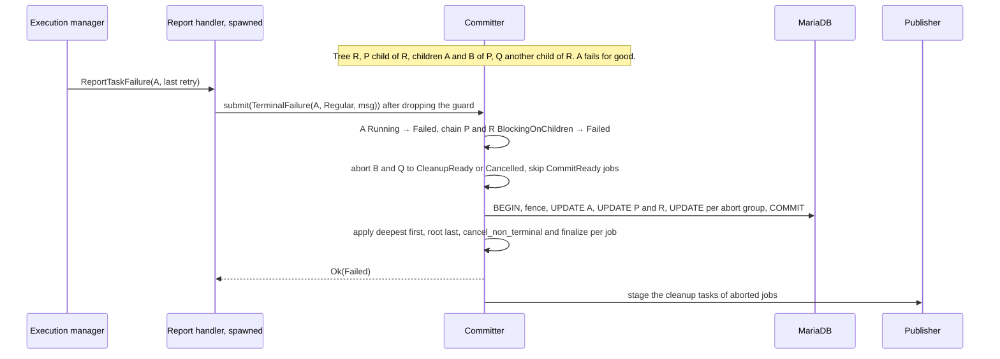

| Race | Outcome |
|---|---|
| Two siblings fail in the same tree state transaction | The first is planned. The second finds itself aborted or its parent already `Failed` and is answered `Stale`. Exactly one failure message reaches the root. |
| Failure vs a root cancel in the same tree state transaction | Cancel first; the failure is `Stale`. §7.5 gives the reasons and the user-visible outcome. |
| Failure vs a registration in the same tree state transaction | Registrations go last: the failure aborts the registering job, whose event is then `Stale`. |
| A terminal failure that races an abort committed in an earlier tree state transaction | The lane check answers `Stale`. Today the same race returns the fatal `UnexpectedJobTermination` (`cache/job.rs:589-601`). |
| The commit of a skipped `CommitReady` job fails | Only that job becomes `Failed`; its parent is inactive, so nothing propagates. |
| A retry re-enqueue staged for a job that is aborted meanwhile | The hint is rejected at instance creation (`JobNoLongerRunning`). |

### 6.5 Root cancellation, cleanup tasks and jobs mid-commit

**Request path:** `CancelJob` → `ServiceState::cancel_job` (root check) → `submit(CancelRoot(root))` → `plan_cancel`, first in its tree state transaction → BEGIN, fence, one UPDATE per (from, to) group, COMMIT → apply deepest first, root last → reply with the root's state → stage the cleanup tasks. Walkthrough D (§4.6) follows it step by step.

**API.** `cancel_job(id)` (`state/service.rs:231-253`):
- If the job is cached and is not a root, it returns `BadRequest`, mapped to INVALID_ARGUMENT.
- If it is not cached, it reads `get_state_and_parent`: a non-root gets INVALID_ARGUMENT; a terminal root gets `Ok(state)`, as today; a non-terminal root is fatal, as today, because a non-terminal root is always cached.
- Otherwise it calls `submit(CancelRoot(id))` and awaits the reply, which is the root's post-state.

```rust
fn plan_cancel(v: &Overlay, root: JobId) -> EventPlan {
    match v.state(root) {                                        // the stale mapping of ensure_cancellable (cache/job.rs:1193-1204)
        CleanupReady => return EventPlan::stale(JobCancellationAlreadyRequested),
        Cancelled => return EventPlan::stale(JobAlreadyCancelled),
        s if s.is_terminal() => return EventPlan::stale(JobAlreadyTerminated(s)),
        _ => {}
    }
    let mut p = EventPlan::new();
    for n in v.nonterminal().filter(|n| *n == root || v.is_abortable(*n)) {   // non-root CommitReady jobs are skipped
        let to = abort_target(v, n);
        p.update(n, v.state(n), to, None);
        if to == CleanupReady { p.publish_cleanup(n); }
    }
    p
}
```

How a cancel moves from the cache to the DB:
1. **Cancel first, always.** The `CancelRoot` is sent on the tree's channel, and the next tree state transaction plans it first, ahead of completions and failures that arrived earlier. §7.5 gives the reasons and the user-visible outcome when a failure races the cancel. The cancel waits for at most the one tree state transaction already in flight. The other events in the same tree state transaction become `Stale` without a DB write.
2. **The deactivation set comes from memory.** `TreeState` holds exactly the tree's non-terminal jobs (I5). No DB enumeration and no descendant row locks are needed.
3. **One fenced DB transaction** runs one PK-list UPDATE per (from, to) group, in chunks of 500 ids, each with a matched-row check.
4. **Apply deepest first, root last.** For each job: JCB write lock, set the state, `cancel_non_terminal()`, `finalize()`, release. Jobs that became terminal leave `TreeState`.
5. **Reply, then stage.** Every newly `Cancelled` job is GC-enqueued, the reply is sent, and the cleanup tasks are staged with the publisher. Delivering them into the deployed 256-entry cleanup lane can take as long as the scheduler takes to dispatch them, but that wait belongs to the publisher. It delays neither the reply, nor the tree's next tree state transaction, nor any other tree.

The response is sent after COMMIT and apply, so an acknowledged cancel is durable for the whole tree and visible in the cache, and it never waits for the scheduler.

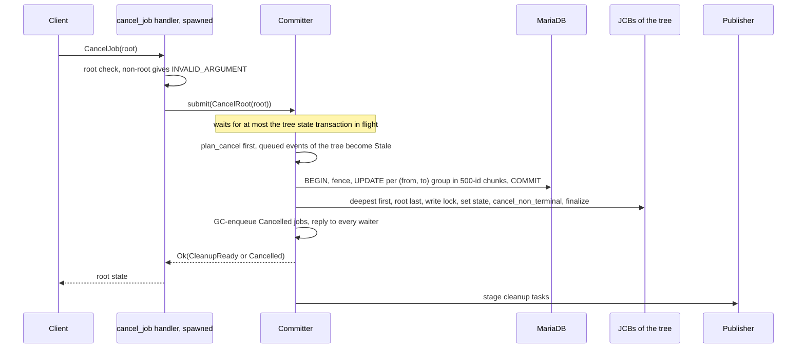

**Measured (A7a, B1):**
- N = 1,000 jobs: the DB transaction takes 21.0 [19.6, 24.1] ms. The sequential apply adds 7-8 % at 10 tasks per job: (DB + apply) / DB = 1.08 [1.07, 1.14].
- N = 10,000: 369 ms in the DB plus 25 ms of apply.
- Per-job sweeps acknowledge in 3.6-4.8 ms but reach quiescence 5-8x later: 139-212 ms at N = 1,000 and 1.13-1.79 s at N = 10,000.
- A 16-way parallel apply was 2.3-2.6x slower than the sequential one under the production TCB lifetime (B1), so the apply stays sequential.
- Under 300 completions/s of background load in the tree, the emulated single-DB-transaction cancel was acknowledged in 14.4 [10.6, 90.8] ms. The tail came from trials in which the tree was already saturated (A7b). Planning the cancel first targets that tail; gate H13 checks it.

**Cleanup tasks.**
- Cleanup tasks run independently per job. `CleanupDone(j)` is a single-row `CleanupReady → Cancelled` event, and a cleanup failure is `CleanupReady → Failed` for that job only, with no propagation (§6.6).
- **The root does not wait for its descendants' cleanups** (default, Q1). Its visible state is its own: `CleanupReady` while its own cleanup runs, then `Cancelled` or `Failed`. Tree quiescence is the derived property of §8.5.
- Behaviour changes, stated explicitly: cancelling a `Ready` root that has a cleanup task goes straight to `Cancelled`, because nothing ran; and jobs aborted in a failed tree run their cleanup, while `Failed` jobs still do not.

**Jobs mid-commit are not aborted** (default, Q2). A non-root `CommitReady` job has finished its regular work, and all of its children have succeeded. Its commit task may already be writing to an external system, such as the CLP metadata DB. Aborting it would start its cleanup concurrently with a commit that the executor is still running, because executors are not preempted. So cancel and failure abort both skip non-root `CommitReady` jobs:
- they finish to `Succeeded` or `Failed`;
- their parent is already inactive, so `plan_success` and `plan_failure` stop at them;
- they become terminal and are GC-enqueued, and the tree becomes quiescent afterwards.

A `CommitReady` **root** keeps today's cancel semantics: `CleanupReady` if it has a cleanup task, else the new `CommitReady → Cancelled` edge. Its children have all succeeded already. The alternative, "abort `CommitReady` descendants and treat their cleanup as the compensation", is one planner predicate away (Q2).

| Race | Outcome |
|---|---|
| Cancel vs registration | Serialized by the committer (§6.2). No child is ever inserted into a closed tree (I4). |
| Cancel vs a completion or failure in the same tree state transaction | Cancel is planned first; the others are answered `Stale` (`JobNoLongerRunning`, `JobNoLongerCommitReady`, `JobAlreadyTerminated`). §7.5 shows what each side sees. |
| Cancel vs a completion committed in an earlier tree state transaction | The cancel sees the post-state. A parent that became `CommitReady` is a skipped non-root, or a root with today's semantics. |
| Cancel vs in-flight task instances | Their TCBs are cancelled, their reports become stale, and the pool drops the entries. Running executors are not preempted, as today. |
| Cancel vs a full inbound lane | No reader holds a JCB guard across a lane send, and the committer never sends into a lane (§7.6, §10.4). A full lane delays only hint delivery; the apply and the reply proceed. |
| Two cancels, or a client retry | The second is planned against `CleanupReady` or a terminal state and gets today's stale errors (FAILED_PRECONDITION). |
| The client disconnects mid-cancel | The handler body and the committer are spawned tasks: COMMIT, apply, staging and GC all finish. |
| Cancel of a cached root whose tree is already quiescent | The committer has exited, so the send fails and the cancel is answered at once with the stale error for the root's terminal state (§7.2). |
| Cancel vs cache eviction | Active jobs are never GC-enqueued, so the cancel set is always cached. An evicted root is terminal, and the DB fallback returns its state. |
| Cancel vs a storage restart | Either the whole-tree DB transaction committed, and recovery loads only the `CleanupReady` and skipped jobs; or it did not, the tree is recovered intact, and the client's retry cancels it (`call_with_retry` retries UNAVAILABLE). |
| Cancel vs a zombie process | The zombie's DB transactions fail at the fence; the new process's cache equals the DB (§11.3). |
| Future subtree or sibling cancel | `plan_cancel` generalizes to "deactivate the subtree rooted at x and decrement its parent's counter in the same plan". I2 then admits a `Cancelled` child under a `BlockingOnChildren` parent, which the success rule reads as "not succeeded". Cancel-first already gives it priority. Not built now. |

### 6.6 Commit and cleanup task completion

**Request path:** `ReportTaskSuccess` or `ReportTaskFailure` for a commit or cleanup task → `succeed_commit_task_instance`, `succeed_cleanup_task_instance` or `fail_task_instance` → the termination TCB's success or final failure under the JCB read lock → `submit(CommitDone(j))`, `submit(CleanupDone(j))` or `submit(TerminalFailure(j, lane, msg))` → `plan_commit_done`, `plan_cleanup_done` or `plan_failure` → BEGIN, fence, UPDATE j, plus the ancestor UPDATEs when a commit completes a cascade, COMMIT → apply → reply → stage the commit tasks of ancestors that became `CommitReady`.

```rust
fn plan_commit_done(v: &Overlay, j: JobId) -> EventPlan {
    let s = v.state(j);
    if s != CommitReady { return EventPlan::stale(Lane::Commit.stale_error(s)); }
    plan_success(v, j, None)          // CommitReady → Succeeded, then climb; stops at once for a skipped job
}

fn plan_cleanup_done(v: &Overlay, j: JobId) -> EventPlan {
    let s = v.state(j);
    if s != CleanupReady { return EventPlan::stale(Lane::Cleanup.stale_error(s)); }
    EventPlan::new().update(j, CleanupReady, Cancelled, None)
}
```

- The TCB-level success is decided in the RPC under the JCB read lock (`read_commit_ready`, `read_cleanup_ready`), as the instance and terminal checks require. Then `submit` runs. Today both paths take the write lock and call `set_state` (`cache/job.rs:449-501`).
- A commit task failure with no retry left is `TerminalFailure(j, Commit, msg)`: `CommitReady → Failed`. It propagates when the parent is `BlockingOnChildren` (§6.4), and stops at the job when the parent is inactive (a skipped job) or when j is a root.
- A cleanup task failure is `TerminalFailure(j, Cleanup, msg)`: `CleanupReady → Failed`, with no propagation, because I4 already holds.
- Commit and cleanup tasks must stay idempotent, as today: a crash before COMMIT re-runs them (§11.1).

---

## 7. The committer

[§5.2](#52-inside-a-tree-event-channel-committer-and-planner) is the architecture view of this section: the structure of one tree's machinery, its producers and consumer, the committer's lifecycle and the planner's flow. This section specifies each piece.

### 7.1 Tree events

| Event | Raised by | Planned by |
|---|---|---|
| `Start(root)` | `start_job` | `plan_start` (§6.1) |
| `RegularTasksDone(j)` | phase A, when `fetch_sub` reports the job's last regular task | `plan_regular_done` (§6.2) |
| `CommitDone(j)` | commit task success, after the TCB accepted it under the JCB read lock | `plan_commit_done` (§6.6) |
| `CleanupDone(j)` | cleanup task success, likewise | `plan_cleanup_done` (§6.6) |
| `TerminalFailure(j, lane, msg)` | a task failure with no retry left, in the regular, commit or cleanup lane | `plan_failure` (§6.4) |
| `CancelRoot(root)` | `cancel_job` | `plan_cancel` (§6.5) |

Every event comes from exactly one RPC, whose body waits for the reply. So every queued event has one caller, and its reply, a poison (§7.7) and a shutdown (§7.8) each reach exactly that caller. Repair at startup uses the same planner but is not an event: it runs before the tree's committer exists.

### 7.2 `submit` and the committer loop

```rust
pub struct Pending {
    event: TreeEvent,
    reply: oneshot::Sender<Reply>,                    // Reply = Result<Outcome, StorageServerError>
}

/// Synchronous on purpose: no await between the caller's decision and the send.
pub fn submit(tree: &TreeControlBlock, event: TreeEvent) -> oneshot::Receiver<Reply> {
    let (tx, rx) = oneshot::channel();
    if let Err(SendError(p)) = tree.sender.send(Pending { event, reply: tx }) {
        let _ = p.reply.send(Ok(Outcome::TreeClosed));  // the committer has exited; see below
    }
    rx
}

struct Queued {
    pending: Pending,
    inputs: Option<EventInputs>,                      // set once collected; kept when the event is deferred
}

/// Spawned into the runtime's TaskTracker together with the tree: by register_job for a new root, and by
/// recovery for every recovered tree that is not quiescent. It owns `state` and the receiver.
async fn run_committer(mut state: TreeState, rx: mpsc::UnboundedReceiver<Pending>, env: TreeEnv) {
    let mut guard = PoisonOnAbnormalExit::new(rx, env.shutdown.clone());   // owns the receiver (§7.7)
    let mut buffer: VecDeque<Queued> = VecDeque::new();                    // deferred events first, then arrivals
    loop {
        if buffer.is_empty() {
            let mut arrivals = Vec::with_capacity(MAX_EVENTS);                 // MAX_EVENTS = 256
            tokio::select! {
                _ = guard.rx.recv_many(&mut arrivals, MAX_EVENTS) => {}        // waits for at least one event
                _ = env.shutdown.cancelled() => {}
            }
            buffer.extend(arrivals.into_iter().map(Queued::new));
        } else {
            while let Ok(p) = guard.rx.try_recv() {                            // deferred events wait: never block
                buffer.push_back(Queued::new(p));
            }
        }
        if env.shutdown.is_cancelled() {
            close_and_answer(&mut guard.rx, &mut buffer, || Err(StorageServerError::Stopping("storage is shutting down".into())));
            break;
        }
        let events = take_events(&mut buffer);                                   // §7.5: at most 256, in planning order
        match run_tree_state_transaction(&mut state, events, &env).await {
            Ok(requeue) => requeue.into_iter().rev().for_each(|q| buffer.push_front(q)),   // original order, at the front
            Err(_) => return,                                                    // the guard poisons the tree (§7.7)
        }
        if state.is_quiescent() {                                                // no non-terminal node left (§8.5)
            close_and_answer(&mut guard.rx, &mut buffer, || Ok(Outcome::TreeClosed));
            break;
        }
    }
    guard.disarm();
}

/// Closes the receiver, so that every later send fails, then answers every event still buffered or queued.
fn close_and_answer(rx: &mut mpsc::UnboundedReceiver<Pending>, buffer: &mut VecDeque<Queued>, reply: impl Fn() -> Reply) {
    rx.close();
    while let Ok(p) = rx.try_recv() {
        buffer.push_back(Queued::new(p));
    }
    for q in buffer.drain(..) {
        let _ = q.pending.reply.send(reply());
    }
}
```

`TreeEnv` bundles the DB connector, the `JobCache`, the GC handle, the publisher handle and the service shutdown handle (the cancellation token plus a "fatal" flag, §7.8).

**One committer per tree, for the tree's whole life.** `register_job` builds the root's JCB, a one-node `TreeState` and the tree's channel, and spawns `run_committer` with the `TreeState` and the receiver. Recovery does the same for every tree that still has a non-terminal job after repair (§11.2). The task owns `TreeState` outright, so `TreeState` has no lock, and a tree never has a second committer or a committer that must be started on demand.

**Submission.** Each JCB holds a clone of the tree's `TreeControlBlock`, that is, of the channel's `UnboundedSender<Pending>`. `submit` is a synchronous `send`, with no await. The channel is unbounded because a send then never waits, and its memory stays bounded anyway by the RPCs in flight: every queued event was sent by exactly one RPC and carries that RPC's reply sender.

**Receiving.** `recv_many(&mut arrivals, 256)` waits for at least one event, then takes everything already in the channel, up to 256, without waiting again. That is equivalent to one `recv().await` followed by `try_recv()` until the channel is empty or the limit is reached. Deferred events go to the front of the committer's local buffer with their collected inputs (§7.5). While that buffer is non-empty, the loop does not block: it appends the new arrivals with `try_recv` and starts the next round at once.

**Quiescent exit.** When `TreeState` has no non-terminal node left, the tree is quiescent. That can be later than the root becoming terminal, because descendants' cleanups and skipped commits may still run (§8.5). The committer then calls `rx.close()`, answers every event still buffered or queued, and exits. A later `submit` gets a send error and answers itself at once. Those events can only come from terminal jobs that are still cached and hold a sender: a quiescent tree stays quiescent, because only a `Running` parent can add jobs.

**`TreeClosed` becomes `Stale`.** Both the events drained at the quiescent exit and the sends that fail afterwards are answered `TreeClosed`. The service function turns that into `Stopping` if the service token is cancelled. Otherwise it returns the stale error for its job's cached state, which is terminal: the error the event's planner would have returned, for example `JobAlreadyTerminated`, or `JobAlreadyCancelled` for a cancel.

**Cost.** One parked task and one channel per live tree, including every running plain job: a few hundred bytes each. A parked task costs nothing until an event arrives, and waking it is an mpsc round trip (B3: 257 ns for an mpsc and oneshot round trip).

### 7.3 `run_tree_state_transaction`

One call is one tree state transaction: one round of the committer, and at most one DB transaction.

```rust
/// Returns the events to put back at the front of the buffer: the deferred ones, or after a rolled-back
/// registration, every event of the round.
async fn run_tree_state_transaction(state: &mut TreeState, events: Vec<Queued>, env: &TreeEnv)
    -> Result<Vec<Queued>, StorageServerError>
{
    let events = collect_inputs(state, events).await?;                // (1) inputs kept in each Queued
    let (plan, deferred) = plan_events(state, events);                // (2) pure and synchronous
    let ids = if plan.is_empty() {
        Vec::new()                                                     // every event is Stale: no DB transaction
    } else {
        match env.db.apply_tree_transition(plan.db()).await {          // (3) the one fenced DB transaction
            Ok(ids) => ids,
            Err(e) if e.is_deterministic_payload_error() && plan.has_registration() => {
                return Ok(plan.into_events_with_registration_failed(deferred));   // rolled back; §6.2, step 5
            }
            Err(e) => return Err(e.into()),                            // fatal: the guard poisons the tree (§7.7)
        }
    };
    apply(state, &plan, &ids).await?;                                  // (4) deepest first, root last
    env.job_cache.insert_many(plan.new_jcbs(&ids)).await?;             // (5)
    env.gc.enqueue_all(&plan.terminated);                              // (6)
    plan.reply_all();                                                  // (7)
    env.publisher.stage(plan.publications);                            // (8) never blocks
    #[cfg(debug_assertions)]
    assert_invariants(state).await;                                    // check_invariants on the post-state (§7.4)
    Ok(deferred)
}
```

| Step | What happens | Locks held | On failure |
|---|---|---|---|
| (1) collect inputs | Read the states of the events' jobs and their ancestors, or of every node when the tree state transaction holds a `CancelRoot` or a `TerminalFailure`. For `RegularTasksDone`, read the outputs and take the prepared children in task-index order. For `Start`, read the root's ready task indices, one TCB lock at a time. A deferred event keeps the inputs it already has. | One JCB read lock at a time. `TreeState` needs none: the committer owns it. | Internal error, fatal |
| (2) plan | `plan_events` converts the events into the plan's ordered DB operations against the overlay (§7.4). Stale events get `Stale` outcomes, and events that would touch a row twice, exceed the byte budget or be a second registering parent are deferred. An empty plan, with every event `Stale`, skips steps (3) to (6). | None | Cannot fail |
| (3) write | `apply_tree_transition` runs the plan's operations in their order: BEGIN, the fence, the guarded UPDATE groups, the INSERT chunks, COMMIT. The committer acquires its pool connection only here, so a tree uses at most one connection and its waiters hold none. | DB row locks until COMMIT | Deterministic payload error in a tree state transaction with a registration: the DB transaction rolls back, nothing is applied or answered, and the round ends. The registration is replaced by a failure of its parent, and every event of the round goes back to the front of the buffer, so the next tree state transaction plans them (§6.2, step 5). Any other `DbError` is fatal (§11.5). |
| (4) apply | For each changed job, in the plan's cache-apply order (deepest first, root last): JCB write lock, `apply_tree_state`, release. Bind child JCBs to the returned ids and add them to `TreeState`. Update counters, and drop newly terminal nodes. | One JCB write lock at a time, never across I/O | A from-state mismatch means divergence: fatal |
| (5) map insert | `JobCache::insert_many(children)` | Map write lock; no JCB lock | `JobAlreadyExists`: fatal |
| (6) GC | Enqueue every job that became terminal in the tree state transaction (§12). | — | Unbounded channel; cannot block |
| (7) reply | Each waiter gets its own outcome or `Stale`. The deferred events are returned to the loop, which puts them back at the front of its buffer in their original order. | — | — |
| (8) stage | Hand the publications to the per-lane publisher. | — | Never blocks |

The reply is sent after COMMIT and after the apply. An acknowledged transition is therefore durable and visible in the cache, and it never waits for the scheduler.

Step (4) is the only place where a cached job state changes. A future per-job state notification, such as the planned WaitJob long-poll, is therefore published there, under the same JCB write lock.

### 7.4 The planner and its overlay

The planner takes the list of events of one tree state transaction and converts them into **ordered** operations that construct its DB transaction. `plan_events(&TreeState, Vec<Queued>) -> (Plan, Vec<Queued>)` is synchronous and does no I/O. The ordering is explicit at both levels:
- **Event order** (§7.5): `CancelRoot` first, then arrival order, with at most one registering parent last.
- **DB-operation order** (§9.4): the plan holds the row updates `(job, from, to, outputs?, error?)`, grouped by (from, to) with the outputs groups first, and then the child inserts. `apply_tree_transition` runs them between BEGIN and COMMIT as the fence, then the guarded UPDATE groups, then the INSERT chunks.

Derived from the same plan:
- the counter changes;
- the cache-apply order, deepest first and root last;
- the publications, the newly terminal jobs, and one outcome per event.

A plan whose events are all `Stale` has no DB operations, and its tree state transaction skips the DB transaction.

The per-event planners are in §6. Success and failure share two building blocks that do no lane check, `unblock(P)` and `fail_blocked(P)`. The repair pass calls them directly (§11.4). The same module exports `check_invariants(&TreeState, states) -> Result<(), Violation>`. No event triggers it: it backs the planner property tests (§15), and debug builds assert it on the post-state after every tree state transaction.

**Overlay.** A view of the tree, built on top of the current tree state (`TreeState` and the job states collected in step (1)) with the plan incrementally applied. After each event is planned, its `EventPlan` is merged into the plan, and the next event reads the result. So later events see earlier events' effects, such as a cancel's deactivations or a sibling's counter decrement. `state(j)` returns the planned target if the plan already changes j, else the collected state. `active_children(p)` is the `TreeState` counter adjusted by the planned counter changes. The overlay never writes `TreeState` or a JCB, and it is discarded after planning: `TreeState` changes only in step (4), after COMMIT.

**Absent nodes.** A node that is not in `TreeState` is terminal and dropped, evicted by GC, or never loaded because it was terminal at the restart. For such a node, `state(x)` returns `Absent`. No lane accepts `Absent`, and every "is it `BlockingOnChildren`?" and "is it abortable?" test rejects it. The planner never errors or panics on a missing node. The case "a skipped `CommitReady` job C, whose aborted parent P was evicted, receives `CommitDone(C)`", before and after a restart, is a named property test.

### 7.5 How events are grouped into a tree state transaction

`take_events` and the planner together apply these rules:
1. **Cancel first, always.** If a `CancelRoot` is queued, it is planned first, ahead of every other event of the round, including completions and failures that arrived before it. The events behind it are planned against the cancelled tree and answered `Stale`. The reasons follow the rules.
2. **Arrival order otherwise.** Other events are planned in arrival order against the overlay. For example, a completion of a job that an earlier event of the same tree state transaction aborted is answered `Stale`, and the other events are unaffected.
3. **One registering parent per tree state transaction, planned last.** A `RegularTasksDone` that carries children is a registration. At most one *parent* registers per tree state transaction: the oldest queued one, planned after the round's other events. That parent's whole child set, up to 10,000 jobs and 16 MiB, is inserted at once, in this tree state transaction's one DB transaction, and is never split across tree state transactions. Any other registering parent is deferred to the next tree state transaction. This is safe because a registering job has no other pending event (all its tasks are done) and its children do not exist yet; only its order relative to other jobs' events changes. It keeps a burst of registrations in one wide tree from holding completions behind seconds of back-to-back registration DB transactions, and taking the oldest one keeps registrations from starving.
4. **Never touch a row twice.** An event whose plan would change a row that the tree state transaction already changes is deferred to the next tree state transaction, with its collected inputs. Every UPDATE is therefore a single `from → to` edge, which an exact guard can check.
5. **Caps.** At most 256 events per tree state transaction, the `recv_many` limit. The payload it writes (child blobs plus outputs) is capped at 16 MiB; the planner defers the events that would exceed it, and the first event of a tree state transaction is always admitted.
6. **Adaptive size.** The committer wakes as soon as one event arrives, so at low load a tree state transaction holds one event and the latency is one DB transaction. Under a burst, the events that arrive during one DB transaction form the next tree state transaction. In A3 at 64 concurrent reporters, a tree state transaction held 62.7 events on average.

**Why cancellation is always prioritized.**
- **Cancellation triggers the cleanup tasks to run, where defined.** A cancel deactivates every abortable job of the tree, the root included, to `CleanupReady` when the job defines a cleanup task. A failure planned first would instead make the failing job and its ancestor chain, root included, `Failed`, and `Failed` jobs run no cleanup (§6.4).
- **When a failure and a cancel race, the failure may itself have been caused by the user's explicit cancellation**, for example a task that fails because the user stopped its external work. Prioritizing the cancel then reflects the real cause.

Either order is also a valid serialization: neither event has been acknowledged yet, so planning the cancel first is indistinguishable from the cancel having arrived first. A secondary benefit is bounded cancel latency: a cancel waits for at most the one tree state transaction already in flight, however long the queue is (gate H13).

**User-visible outcome of a cancel and a failure in the same tree state transaction:**

| Who | Outcome |
|---|---|
| The tree | Deactivated as by the cancel alone. The root ends `Cancelled`: it goes to `CleanupReady` and its cleanup runs, or straight to `Cancelled` when it has no cleanup task. Every other abortable job is deactivated the same way, the failing job included, so their cleanups run too. |
| The failure report (`TerminalFailure`) | `Stale`, for example `JobNoLongerRunning`, mapped to FAILED_PRECONDITION. Its error message is only logged by the committer; it is not stored as any job's error. |
| The client's `CancelJob` | Succeeds, and returns the root's new state, `CleanupReady` or `Cancelled`. |

**What is atomic: each event, not each group.** Grouping and deferral never change what an event does:
- **An event is the atomic unit.** Each event is one job-level change from one caller, with its own reply: one success report, one cancel, one failure. Its whole effect is planned at once and written in one DB transaction: a registration with all its children, a cascade through all its ancestors, the deactivation of a whole tree. The planner never splits an event across tree state transactions. An event that would exceed the limits of §13 is rejected as a job failure, never split.
- **Deferral moves whole events.** Rules 3 to 5 may split the queued events across consecutive tree state transactions. A deferred event goes back to the front of the committer's buffer, in its original order, and is planned in full in the next tree state transaction, against the post-state of the previous one. If an earlier event invalidated it, for example a cancel, it is answered `Stale` at that point.
- **Grouping is a carrier, not a promise.** Independent events that share a tree state transaction do commit in its one DB transaction, but no caller is promised that. The outcome is the same as planning every event in its own tree state transaction, in planning order, which is plain serialization; grouping only saves DB transactions.
- **Nothing is acknowledged early.** An event's caller is answered only after the DB transaction that carries the event has committed and been applied, or, for an event answered `Stale`, at the end of its tree state transaction (§7.3). A crash between two tree state transactions leaves the deferred event unwritten and unacknowledged, which is the same as a crash before it was processed: its source re-reports or retries after the restart (§11.1).
- **No merging.** The planner never merges two tree state transactions, and events of different trees never share a DB transaction. Each tree has its own committer, so N independent plain jobs still commit as N DB transactions, as today.

### 7.6 The publisher

Publications are hints, so they must never hold up a tree.
- The publisher is one task per lane (task, commit, cleanup), owned by the runtime.
- `stage` pushes into an unbounded in-process staging queue and returns at once.
- Each lane task forwards entries into its bounded lane (`inbound_queue.rs:305-307`), with each send raced against the service token.
- A full lane therefore delays only the delivery of hints. It never delays a reply, an apply, or another tree's tree state transaction. One task per lane keeps a full cleanup lane (256 entries in the deployed configuration, `tools/deployment/spider-helm/values.yaml:79-80`) from delaying task-lane hints.
- Memory is bounded by the number of ready but undelivered tasks, which today's code would hold as parked senders.
- At shutdown the staged entries are dropped. `resend_ready_tasks` regenerates them at the next start.

Every other publisher of lane entries moves to `stage` as well, after dropping its JCB guard: phase A's ready successors, the retry re-enqueue in `fail_task_instance` (`cache/job.rs:550-553, 565-568, 580-583`) and `JCB::resend_ready_tasks` (`cache/job.rs:288-316`). The task-instance pool's own re-enqueue (`task_instance_pool.rs:459-481`) holds no JCB lock and is unchanged.

### 7.7 Poison on abnormal exit

```rust
/// Owns the tree's receiver. Any exit of the committer that is not disarmed, that is, an error return or a
/// panic, runs this Drop.
struct PoisonOnAbnormalExit {
    rx: mpsc::UnboundedReceiver<Pending>,
    shutdown: ShutdownHandle,
    disarmed: bool,
}

impl Drop for PoisonOnAbnormalExit {
    fn drop(&mut self) {
        if !self.disarmed {
            self.shutdown.fatal();   // sets the fatal flag, then cancels the service token (§7.8)
        }
        // `rx` is dropped after this body: every Pending still queued, and its reply sender, goes with it.
    }
}
```

- The guard runs on an error return and on unwind; the workspace does not set `panic = "abort"`.
- **Every waiter wakes.** Dropping the receiver drops every queued `Pending`. The committer's buffer and the events of the failing tree state transaction are dropped with the task's other locals. So every reply sender is dropped, every waiter's oneshot closes, and a waiter whose oneshot closes without a reply treats it as `TreePoisoned`. Every event comes from exactly one waiting RPC, so this reaches every caller with no bookkeeping.
- **Later submits.** The token is cancelled before the receiver is dropped, so a send that fails afterwards is answered `Stopping` (§7.2).
- Rule: **any exit of a committer other than a quiescent exit or a shutdown poisons the tree, wakes all its waiters and cancels the service. The process then exits non-zero within `SHUTDOWN_DEADLINE`.** No waiter is left holding a live oneshot that nobody will use.

### 7.8 Graceful and bounded shutdown

- **Token-raced waits.** Every RPC waits for its spawned body, and every body waits for its committer reply, with a `select!` against the service token. When the token fires, the wait returns `StorageServerError::Stopping`, which the gRPC handlers map to UNAVAILABLE. The job client's `call_with_retry` retries UNAVAILABLE (`spider-utils/src/grpc/retry.rs:135`).
- **No new tree state transactions after the token.** A waiting committer's `recv_many` is raced against the token, and a running committer checks the token before each round. The round in flight finishes its DB transaction or fails it. Then the committer closes its receiver, answers every buffered and queued event `Stopping`, and exits; a send that fails afterwards is answered `Stopping` too (§7.2). Every event has exactly one waiting caller, so every caller is answered.
- **Tracked tasks.** Committers, one per live tree, publisher tasks and spawned handler bodies run in a `tokio_util::task::TaskTracker` owned by the runtime. `Runtime::stop` closes the tracker and waits for it within its existing 30 s stop timeout (`state/runtime.rs:109-113, 203`), together with the pool and GC actors.
- **Deadline.** tonic's graceful shutdown waits for every connection to close, with no timeout (`tonic-0.14.6/src/transport/server/mod.rs:867-876`), and no client sets a deadline on its reports. So once the token has fired, `server.await` (`bin/grpc_server.rs:111-114`) is raced against `SHUTDOWN_DEADLINE` (10 s). On expiry the process exits non-zero at once.
- **Exit code.** The fatal path (`default_error_handler`, the committer guard, any `DbError::Fenced`) sets a process-wide fatal flag before it cancels the token. `main` exits non-zero if that flag is set, if the deadline expired, or if `Runtime::stop` fails. A SIGTERM or Ctrl-C shutdown that completes in time exits 0. Compose's `on-failure` policy then restarts the process after a fatal error, which it does not do today.

---

## 8. Consistency model

### 8.1 Sources of truth

| Tree state | Durable truth | Cache representation | After a restart |
|---|---|---|---|
| Job state | `jobs.state` | `JobExecutionState.state`, the only cached copy. Written only by the tree's committer, under that JCB's write lock. | reloaded |
| Parent link, tree membership | `jobs.parent_id`, `jobs.root_id` (new, immutable after INSERT, both NULL for a root) | `TreeState` node parent; `JobControlBlock.parent_id` and `tree`, a clone of the `TreeControlBlock` | reloaded |
| Depth | Derived: parent depth + 1 | `TreeState` node depth; also stored immutably in the JCB | recomputed in ascending id order |
| Has a commit or cleanup task | The task graph | `TreeState` node flags, copied from the graph when the JCB is built | recomputed from the decoded graph |
| Pending children of a `BlockingOnChildren` parent | **Not stored.** It equals the number of the parent's active children (I2). | `TreeState` node `active_children: u32` | recomputed from the loaded rows |
| Cancellation or failure intent | **Not a flag.** The cancel or abort deactivates every abortable job in the same DB transaction (I4). | — | reloaded |
| Child requests before registration | **None. Volatile by design.** | `PreparedChild` values in the TCB of the task that created them | discarded: the parent is still `Running`, re-executes and re-creates them |
| A parent's outputs while it is `BlockingOnChildren` | `jobs.serialized_job_outputs`, written by the registration's DB transaction | The output readers that `finalize()` keeps (`cache/task.rs:174-181`) | reloaded |
| Error message | `jobs.error_message` | — | DB only, as today |
| Storage session | `sessions` (the bump) and the new `storage_fence` row | `ServiceStateInner.session_id` | the new process bumps and fences (§11.3) |
| Task progress, retries, instance pools, publications | None, as today | TCBs, inbound queue | rebuilt; ready tasks resent |

`TreeState` holds structure only. The planner reads job states from the JCBs, at one uncontended `RwLock` read per job: 29.5 ns (B3), or 0.3 ms for a 10,000-job cancel. A second copy of the state in `TreeState` was rejected because it could drift.

### 8.2 Invariants

The DB satisfies I1-I4 at every committed instant, because every multi-job state change commits within one DB transaction. The cache satisfies I1-I4 whenever the tree's committer is waiting between tree state transactions.

- **I1 (shape).**
  - A non-root row has `parent_id` set and `root_id` equal to its tree's root. A root has `parent_id = root_id = NULL`.
  - Only a root can be `Ready`.
  - A parent's id is smaller than each of its children's ids (AUTO_INCREMENT, and a child is inserted after its parent exists). Ascending id order is therefore a topological order.
  - Children are inserted only by the DB transaction that moves their parent `Running → BlockingOnChildren`. A child set is frozen at registration.
- **I2 (blocking).** If a job P is `BlockingOnChildren`:
  - every child of P is `Succeeded` or active;
  - at least one child of P is active;
  - `active_children(P)` equals the number of P's active children.
  - Consequence, "success is earned": if a job that has children is `CommitReady` or `Succeeded`, every child is `Succeeded`. P leaves `BlockingOnChildren` for success only when its counter reaches 0, and then by I2 every child is `Succeeded`.
- **I3 (active chain).**
  - If a job is `Running` or `BlockingOnChildren`, every proper ancestor is `BlockingOnChildren`.
  - A non-root `CommitReady` job has a parent that is `BlockingOnChildren`, or inactive because a cancel or failure abort skipped the job (§6.5).
- **I4 (closed tree).** If the root is `CleanupReady` or terminal, no job of the tree is abortable. Skipped `CommitReady` descendants may still finish their commit.
- **I5 (cache and DB).**
  - *Committer waiting between tree state transactions:* every non-terminal row of the tree is in `TreeState` and in `JobCache`, and its JCB state equals its DB state.
  - *Tree state transaction in flight:* the DB may be ahead of the cache, but only between COMMIT and the end of the apply (§7.3, steps 3-5). The cache is never ahead of the DB.
  - *Closing that window:* the committer closes it, not the RPC that caused it. The committer is a spawned task, so dropping the RPC future cannot leave the cache behind (§10.10).
- **I6 (single writer).**
  - Within a process, only a tree's committer writes the tree's rows, and each live tree has exactly one committer.
  - Across processes, the session fence makes a superseded process unable to commit (§11.3).
  - The only other writers of `jobs` are `register`, which INSERTs a new root and is also fenced, and a future retention DELETE of quiescent trees (§12).

### 8.3 The atomicity unit

**A tree state transaction is a single DB transaction.** It holds up to 256 events of one tree, and every event's plan is part of that DB transaction, so each of these is atomic:
- registration: the parent moves to `BlockingOnChildren` with its outputs, and its k child rows are inserted;
- a completion cascade through any number of ancestors;
- a failure: the failing job and its ancestor chain become `Failed`, and every other abortable job of the tree is aborted;
- a root cancel: every abortable job of the tree is deactivated.

A tree state transaction whose events are all `Stale` writes nothing and skips its DB transaction. A registration rolled back for a deterministic payload error writes nothing either; its parent's failure commits in the next tree state transaction (§6.2).

Applying the result to the JCBs and publishing are not part of the unit:
- The apply is derived work. The committer always finishes it, or the process dies and the restart rebuilds the cache from the DB (I5).
- A publication is a hint handed to the publisher. A lost one is regenerated by `resend_ready_tasks` at the next start.

### 8.4 Visibility during a tree state transaction

At the DB level nothing is ever half done: a DB transaction has either committed or not. Inside the process, a tree state transaction passes through the phases below. The terms are defined per tree state transaction T:
- **Pre-state of T:** the tree's committed state that the planner reads when it plans T. For every job j that T changes, it is the state recorded as the update's `from`, which the exact guard requires to equal the DB row at COMMIT (§9.4). The child rows that T will insert do not exist yet. A tree's tree state transactions run one after another in its single committer, so T's pre-state is exactly the post-state of the tree's previous tree state transaction.
- **Post-state of T:** the pre-state with T's plan applied. Every job that T changes is in its update's `to` state, together with the outputs or error message that the update writes. Every child that T inserts exists in `Running`. The `TreeState` counters are adjusted.
- A job that T does not change has the same pre-state and post-state.
- **What "the cache" means here:** a job's JCB `state` field and the TCB side effects of its apply (`cancel_non_terminal`, `finalize`). `TreeState` is private to the committer, and readers never observe it.
- **An event's pre-state is relative to the tree state transaction that eventually plans it.** While the event waits in the channel or in the committer's buffer, earlier tree state transactions of the same tree may still commit, so the state a reader sees can advance before the event's own tree state transaction starts.

| Phase | DB | Cache | A concurrent reader sees |
|---|---|---|---|
| Queued | pre-state | pre-state | The pre-state. Task RPCs still validate against it. A report that T will invalidate is answered `Stale` later, by the planner (§10.9). |
| Planned, DB transaction open | pre-state; T's rows are locked by PK | pre-state | The pre-state. |
| Committed, applying (deepest first, root last) | post-state | Some jobs already in the post-state | For each job that T changes, either its pre-state or its post-state. The apply runs deepest first, so a reader who sees the post-state of a changed job also sees the post-state of every changed job deeper than it. The root is applied last when T changes it, so seeing the root's post-state means that the whole of T is applied. |
| Applied and replied, publications staged | post-state | post-state | The post-state. A publication is delivered later by the publisher, and storage rejects a stale one when an instance is created for it. |

### 8.5 Tree quiescence

A tree is **quiescent** when the root row and every row with `root_id = R` are terminal. Quiescence is derived and has no state of its own.
- With the default answers to Q1 and Q2 (§18), a terminal root does not imply a quiescent tree: descendants' cleanup tasks and skipped commits may still run after the root became terminal.
- The cache answers quiescence from `TreeState`: the tree is quiescent when `TreeState` has no node. The tree's committer then exits (§7.2).
- The DB answers it with `NOT EXISTS (SELECT 1 FROM jobs WHERE root_id = R AND state NOT IN ('Succeeded','Failed','Cancelled'))` together with a terminal root row, on a state-free `job_root(root_id)` index. The WaitJob and retention PRs add that index (§12, §16).
- Q1 offers the stronger alternative, "a terminal root implies a quiescent tree".

---

## 9. Data model and interfaces

### 9.1 DDL and the idempotent automatic upgrade

New installs extend `jobs_creation_query` (`db/mariadb.rs:754-780`) with the two columns and the index. `JobState::as_mysql_enum_decl()` picks up the new variant automatically.

The project has no migration framework, and `CREATE TABLE IF NOT EXISTS` does nothing to an existing table. So `connect` (`db/mariadb.rs:60-103`) runs an idempotent upgrade after its `CREATE TABLE` statements and before the session bump:

```sql
ALTER TABLE `jobs`
  ADD COLUMN IF NOT EXISTS `parent_id` BIGINT UNSIGNED NULL DEFAULT NULL,
  ADD COLUMN IF NOT EXISTS `root_id`   BIGINT UNSIGNED NULL DEFAULT NULL,   -- NULL for roots
  ADD INDEX  IF NOT EXISTS `job_parent` (`parent_id`);                       -- repair (§11.4); lazy child outputs later

-- Only if information_schema.COLUMNS.COLUMN_TYPE of jobs.state lacks 'BlockingOnChildren'.
-- Appending an ENUM value is a metadata-only change.
ALTER TABLE `jobs` MODIFY `state`
  ENUM('Ready','Running','CommitReady','CleanupReady','Succeeded','Failed','Cancelled','BlockingOnChildren')
  NOT NULL DEFAULT 'Ready';

CREATE TABLE IF NOT EXISTS `storage_fence` (
  `id`         TINYINT UNSIGNED NOT NULL PRIMARY KEY,
  `session_id` BIGINT UNSIGNED  NOT NULL
);
INSERT IGNORE INTO `storage_fence` (`id`, `session_id`) VALUES (0, 0);
```

- **No foreign key on `parent_id`.** It would add foreign-key S locks on the parent row and force a delete order on retention.
- **No `depth`, counter or flag columns.** Depth and the commit and cleanup flags are recomputed in memory at recovery. Columns `has_commit_task`/`has_cleanup_task` were considered so that recovery could skip decoding `BlockingOnChildren` graphs. They were rejected: decoding costs about 12-13 µs per row (B4, B4db), but `BlockingOnChildren` rows are parents, about 0.1 % of the rows in CLP's 1 : 1,000 shapes, so the saving is bounded by that share.
- **Index cost.** `job_parent` is maintained only at INSERT, because `parent_id` is immutable. One more secondary index measured 0.994 [0.951, 1.017] of today's single-row DB transaction at C = 1 and 1.046 [1.022, 1.080] at C = 64 (A1). Building the index on an existing table scans it once, at the first start of the new binary.
- **Forward-only upgrade.** An old binary would load `Running` children as roots and never load their `BlockingOnChildren` parents. A rollback is safe only when no non-terminal row has `parent_id IS NOT NULL` (runbook in §16.3, decision Q9).

### 9.2 The `storage_fence` table

`storage_fence` holds one row (`id = 0`) with the session id of the newest storage process that has completed its startup bump.
- Every DB transaction that writes `jobs` first reads that row with `LOCK IN SHARE MODE` and checks that it equals the process's own session id. A mismatch rolls back with the new `DbError::Fenced`, which is fatal for that process.
- `connect` sets the row to its new session id with an autocommit UPDATE, which takes an X lock and therefore waits for every in-flight DB transaction that holds the S lock.
- The protocol and its correctness argument are in §11.3.

### 9.3 `DbStorage` trait changes (`db/protocol.rs`)

```rust
pub struct JobStateUpdate {
    pub job_id: JobId,
    pub from: JobState,                     // exact guard
    pub to: JobState,
    pub outputs: Option<Vec<TaskOutput>>,   // set for Running → {BlockingOnChildren, CommitReady, Succeeded}
    pub error_message: Option<String>,      // set for → Failed
}

pub struct ChildJobInsert<'a> {
    pub parent_id: JobId,
    pub root_id: JobId,
    pub resource_group_id: ResourceGroupId, // inherited from the parent
    pub compressed_task_graph: &'a [u8],
    pub compressed_job_inputs: &'a [u8],
}

pub struct TreeTransition<'a> {
    pub updates: Vec<JobStateUpdate>,       // at most one update per job (§7.5)
    pub child_inserts: Vec<ChildJobInsert<'a>>,
}

#[async_trait]
pub trait InternalJobOrchestration: Clone + Send + Sync {
    /// Writes the DB part of one tree state transaction in one fenced DB transaction. Every update is guarded by its exact `from`
    /// state; a guard miss is `DbError::CorruptedDbState`. Returns the inserted child ids in input
    /// order.
    async fn apply_tree_transition(&self, transition: TreeTransition<'_>) -> Result<Vec<JobId>, DbError>;

    /// Now also loads `BlockingOnChildren` rows and projects `parent_id` and `root_id`.
    async fn get_recoverable_jobs(&self) -> Result<Vec<RecoverableJobContext>, DbError>;

    /// Repair only: whether `parent` has a child in `Failed` or `Cancelled`. Non-locking; served by
    /// `job_parent`.
    async fn has_failed_child(&self, parent: JobId) -> Result<bool, DbError>;

    // `start`, `set_state`, `commit_outputs`, `cancel` and `fail` (db/protocol.rs:151-239) become thin
    // wrappers over `apply_tree_transition` in PR 3 and are deleted in PR 9.
}

#[async_trait]
pub trait ExternalJobOrchestration {
    // `register` keeps its signature. It now runs BEGIN, the fence, the INSERT and COMMIT.

    /// The cache-miss path of the root-only external RPCs (§9.6).
    async fn get_state_and_parent(&self, job_id: JobId) -> Result<(JobState, Option<JobId>), DbError>;
}

// RecoverableJobContext (db/protocol.rs:20-26) gains:
//     pub parent_id: Option<JobId>,
//     pub root_id: Option<JobId>,

// DbError (db/error.rs) gains:
//     #[error("storage session {mine} is fenced off by session {current}")]
//     Fenced { mine: SessionId, current: SessionId },
// and a classifier `is_deterministic_payload_error()`: MySQL errno 1153 (packet too large) or 1406
// (data too long), reported by a statement before COMMIT (§6.2, step 5).
```

The `persistent(false)` setting on the repair reads matters. In A8, the same `NOT EXISTS` queries ran 10-20x slower (68-108 ms) on a connection whose prepared statement had first been planned against a small table.

### 9.4 `apply_tree_transition` SQL (the hot path)

```sql
BEGIN;                                                    -- REPEATABLE READ, the default

-- (f) Fence. Must return this process's session id; otherwise ROLLBACK and DbError::Fenced.
SELECT `session_id` FROM `storage_fence` WHERE `id` = 0 LOCK IN SHARE MODE;

-- (a) Updates that carry outputs: one statement per (from, to) group.
UPDATE `jobs` FORCE INDEX (PRIMARY)
   SET `state` = ?,
       `serialized_job_outputs` = CASE `id` WHEN ? THEN ? WHEN ? THEN ? … END
       [, `ended_at` = CURRENT_TIMESTAMP]                 -- only when `to` is terminal
 WHERE `id` IN (?, ?, …) AND `state` = ?;                 -- matched rows must equal the id count

-- (b) Other updates: one statement per (from, to, error_message) group.
UPDATE `jobs` FORCE INDEX (PRIMARY)
   SET `state` = ? [, `error_message` = ?] [, `ended_at` = CURRENT_TIMESTAMP]
 WHERE `id` IN (?, ?, …) AND `state` = ?;                 -- matched rows must equal the id count

-- (c) Child rows: multi-row, chunked.
INSERT INTO `jobs` (`resource_group_id`, `parent_id`, `root_id`, `state`,
                    `compressed_serialized_task_graph`, `compressed_serialized_job_inputs`)
VALUES (?, ?, ?, 'Running', ?, ?), … RETURNING `id`;

COMMIT;
```

- **Operation order.** The statements run in the plan's order (§7.4): the fence (f), then the guarded UPDATE groups, outputs groups (a) before the others (b), then the INSERT chunks (c).
- **Exact from-state guards.** A set guard such as `state IN valid_from(to)` would let a lagging plan overwrite a durable `CleanupReady` with `Failed`. An exact guard detects the divergence instead.
  - Matched-row counts are reliable because sqlx sets `CLIENT_FOUND_ROWS` (`sqlx-mysql-0.8.6/src/connection/stream.rs:47`).
  - A miss means that the cache diverged from the DB. It is returned as `DbError::CorruptedDbState`, which is fatal, and the restart rebuilds the cache.
  - A tree state transaction never updates a row twice (§7.5), so every guard is a single `from → to` edge.
- **`FORCE INDEX (PRIMARY)` on every guarded statement.** On `mariadb:10.11.16`, the deployment pin, `WHERE id = ? AND state = 'X'` can be planned as a range scan on the `job_state` index. It then takes next-key locks on that index, which caused deadlocks in the benchmark (2 for this design's unhinted SQL, 193 for a counter design; A10). With the hint on every guarded statement, this design's SQL had 0.
- **Chunking.** Each IN list holds at most 500 ids, below MariaDB's `in_predicate_conversion_threshold` of 1,000. Each statement's bound payload (outputs in (a), blobs in (c)) is at most `min(4 MiB, @@max_allowed_packet / 2)`, but every statement carries at least one row. `max_allowed_packet` is read once at connect. Chunking is only statement-level: every chunk of a tree state transaction runs between the same BEGIN and COMMIT, so the chunks commit together or not at all. A failed chunk, or a chunk whose matched-row count is wrong, stops the committer before COMMIT, and the DB transaction rolls back (§11.5). The DB transaction itself is not split: the benchmark committed a 16 MiB registration in a single DB transaction on `mariadb:10.11.16` with default settings (A6).
- **`INSERT … RETURNING id`** returns the ids in VALUES order, which A0 and A6 asserted. No `LAST_INSERT_ID` arithmetic and no `innodb_autoinc_lock_mode` probe is needed.
- **Statement count.** BEGIN, the fence, one statement per outputs group, usually one to three other groups, the insert chunks, and COMMIT. Each pool checkout adds two pings (A1: 2.05 per operation). A plain-job transition is BEGIN, fence, UPDATE, COMMIT.

### 9.5 Cache structure changes

**`JobControlBlock`** (`cache/job.rs:830-842`):
- gains the immutable fields `parent_id: Option<JobId>`, `depth: u32` and `tree: TreeControlBlock`, its own clone of the tree's root id and channel sender;
- loses its per-operation DB calls (`cache/job.rs:248, 416, 460, 495, 602, 628`) and the write-lock phases of `succeed_task_instance`, `fail_task_instance`, the commit and cleanup successes, and `cancel`;
- gains `apply_tree_state(from, to)`, run by the committer under the write lock. It checks `from` and sets the state. It runs `cancel_non_terminal()` for a job that is cancelled, aborted or failed, and `finalize()` for every job that leaves `Running` or is deactivated;
- gains `take_regular_done_inputs()`, which reads the outputs and takes the prepared children of every TCB in task-index order;
- decrements `num_incomplete_tasks` with `AcqRel` instead of `Relaxed`, because the last decrement no longer leads to a JCB write lock (§10.6 (e));
- gains an infallible constructor from a `PreparedChild`, with state `Running`.

**`TreeControlBlock` and `TreeState`** (`cache/tree.rs`):

```rust
#[derive(Clone)]
pub struct TreeControlBlock {              // every JCB of the tree holds a clone
    root_id: JobId,
    sender: mpsc::UnboundedSender<Pending>,// the tree's event channel; the committer owns the receiver
}

pub struct TreeState {                     // owned by the tree's committer task: no lock
    root_id: JobId,
    nodes: HashMap<JobId, TreeNode>,       // exactly the tree's non-terminal jobs (I5)
}

struct TreeNode {
    jcb: SharedJobControlBlock<..>,        // strong reference, dropped when the job becomes terminal
    parent: Option<JobId>,
    depth: u32,
    resource_group_id: ResourceGroupId,
    has_commit: bool,
    has_cleanup: bool,
    active_children: u32,                  // meaningful while the job is BlockingOnChildren
}
```

`TreeState` keeps strong references only to non-terminal JCBs, and a JCB holds only a channel sender, so nothing refers back to `TreeState`: there is no reference cycle. When the tree becomes quiescent, the committer exits and drops `TreeState` and the receiver. Terminal JCBs that are still cached keep a sender whose sends fail (§7.2).

**TCB.** `SharedTaskControlBlock::succeed_task_instance(id, outputs, prepared_children)` stores the children in the same critical section that flips the TCB to `Succeeded`. That is after the existing instance and terminal-state checks (`cache/task.rs:829-841`), so a duplicate or rejected report never stores children.

```rust
pub struct PreparedChild {
    pub graph: cache::task::TaskGraph,  // prebuilt outside every lock (§6.2)
    pub compressed_graph: Vec<u8>,      // persisted verbatim by the registration INSERT
    pub compressed_inputs: Vec<u8>,
}
```

**`TaskGraph`.**
- New `recover_blocked(outputs, commit_descriptor, cleanup_descriptor)` builds a graph with no regular tasks, the outputs from the row, and the optional commit and cleanup TCBs.
- `recover_from_commit_ready` keeps its cleanup TCB (today `cleanup_task: None`, `cache/task.rs:151`).

**`JobCache`.**
- New `insert_many` inserts several JCBs under one map write lock.
- `resend_ready_tasks` iterates a snapshot of the `Arc`s instead of holding the map read lock (§12).

### 9.6 Proto and gRPC changes

```protobuf
message ChildJobRequest {
  bytes compressed_serialized_task_graph = 1;
  bytes compressed_serialized_task_graph_input = 2;
}

message ReportTaskSuccessRequest {          // storage.proto:124-131
  // fields 1-6 unchanged
  repeated ChildJobRequest children = 7;    // new
}

enum JobState {                             // storage.proto:215-224
  // values 0-7 unchanged; CANCELLED = 7
  BLOCKING_ON_CHILDREN = 8;                 // new
}
```

- **Transport.** The `children` field is carried from the TDL through the task executor and the EM into `ReportTaskSuccessRequest`. TDL `create_child_job` collects the requests and refuses one that would exceed the per-report child budget.
- **Decode limit.** The storage server sets `max_decoding_message_size` explicitly on the task-instance management service (`bin/grpc_server.rs:65-67`) to 32 MiB: at most 16 MiB of children plus the task's outputs. Today no component sets it, so tonic's 4 MiB default (`tonic-0.14.6/src/codec/mod.rs:101`) would reject larger reports. The EM drops a rejected report (reports are fire-and-forget), so the job stays stuck, re-running only when its EM is declared dead ([#519](https://github.com/y-scope/spider/issues/519)).
- **Root-only external RPCs.** `StartJob`, `CancelJob`, `GetJobState`, `GetJobOutputs` and `GetJobError` reject a non-root id with INVALID_ARGUMENT (Q7). On a cache hit the check is `jcb.parent_id()`; on a miss it uses `get_state_and_parent`.
- **Rollout flag.** While `job_tree.enabled` is off, a success report with a non-empty `children` field is rejected with INVALID_ARGUMENT. No released TDL can populate the field before PR 8 (§16).
- **Clients.** A root can now report `BLOCKING_ON_CHILDREN`, so a client that submits jobs whose tasks create children must be upgraded with the feature. Other clients never see the new value.

---

## 10. Concurrency and locking

This chapter states the complete locking scheme of the cache and service layers:
- every lock, atomic and channel;
- the state checks that run under the JCB and TCB locks;
- the order in which locks nest;
- the exact lock sequence of every operation;
- how those locks and checks decide concrete races.

Each part describes today's code first and marks what this design changes with **Today:** and **New:**, as §4 does. Every claim about today's code is cited at the baseline commit.

### 10.1 Lock and synchronization inventory

**Today's primitives.**

| Primitive | Type and location | Guards | Users and mode | This design |
|---|---|---|---|---|
| Job map | `Arc<tokio::sync::RwLock<HashMap<JobId, SharedJobControlBlock>>>` (`state/job_cache.rs:26-33, 157-158`) | Which jobs are cached | Read: `get` holds it only for the lookup and the `Arc` clone (`state/job_cache.rs:82-93`); `resend_ready_tasks` holds it across every JCB's resend (`:133-138`). Write: `insert` (`:57-75`), `remove` and `remove_batch` (`:100-124`). | New `insert_many` (write). `resend_ready_tasks` holds the read lock only to copy the `Arc`s. |
| JCB lock | `tokio::sync::RwLock<JobExecutionState>` in `JobExecutionStateHandle` (`cache/job.rs:858-864`) | `JobExecutionState` (`cache/job.rs:1084-1095`): the job state, the task graph (regular TCBs, output readers, commit and cleanup TCBs), `num_incomplete_tasks` and the connectors | Read, through a validator (§10.2): instance creation, success and failure phase A, `resend_ready_tasks`, `get_outputs`. Read without a validator: `state()` (`cache/job.rs:210-212`). Write: every job transition (`start`, success phase B, commit and cleanup success, failure phase B, `cancel`). | Write only in the committer's apply, one JCB at a time. Read also in the committer's collect. |
| `num_incomplete_tasks` | `AtomicUsize` in `JobExecutionState` (`cache/job.rs:1091`) | The job's regular tasks that have not succeeded | Set when the JCB is built (`cache/job.rs:79-84, 136-180`). `fetch_sub(1, Relaxed)` in success phase A, under the JCB read lock (`cache/job.rs:392`). | `fetch_sub(1, AcqRel)`; §10.6 (e) explains why. |
| Instance-id allocator | `AtomicU64` in `TaskInstancePoolHandle` (`task_instance_pool.rs:171, 520`) | The next task-instance id | `fetch_add(1, Relaxed)` (`task_instance_pool.rs:177-179`) in instance creation, under the JCB read lock. Only uniqueness matters. | Unchanged |
| TCB lock | `Arc<tokio::sync::Mutex<TaskControlBlock>>` (`cache/task.rs:274-277`) | `TaskControlBlockBase`: state, instance pool and retry counter (`cache/task.rs:781-787`); plus `num_unfinished_parents`, the successor list, the input readers and the output writers (`:928-936`) | Under the job's JCB lock: instance registration, success, failure (§10.3), `cancel_non_terminal` and `get_all_ready_task_indices` (`cache/task.rs:184-205`). A parent's success also locks the parent's successors. Without any JCB lock: the pool actor's `is_terminal` and `force_remove_task_instance` (`task_instance_pool.rs:226-238`). | Also the committer's collect (to take prepared children) and apply (`cancel_non_terminal`). A success also stores the prepared children (§9.5). |
| Termination-TCB lock | `Arc<tokio::sync::Mutex<TerminationTaskControlBlock>>` (`cache/task.rs:553-555`) | A `TaskControlBlockBase` only (`cache/task.rs:1001-1003`) | Under the JCB lock: commit and cleanup instance registration, success and failure, and `cancel_non_terminal` of the commit task. Without a JCB lock: the pool actor. | Unchanged |
| Value slots | `SharedRw<ValuePayload>`, that is `Arc<tokio::sync::RwLock<Option<Vec<u8>>>>` (`cache/sync.rs:8`, `cache/io.rs:12`), one per dataflow dependency of the graph (`cache/task.rs:61-92`) | One value: a task output, which is also its consumers' input and possibly a job output | Write, through `Writer`: the producer's `write_outputs`, under the producer's TCB lock (`cache/task.rs:949-971`). Read, through `Reader`: a consumer's `fetch_inputs` at instance registration, under the consumer's TCB lock (`cache/task.rs:306, 986-994`); and `read_output_payloads` (`cache/task.rs:247-259`) under the JCB lock, in success phase B, commit-instance creation and `get_outputs`. | Read also in the committer's collect, under the JCB read lock. |
| Task-instance pool | A bounded `tokio::sync::mpsc` channel (`task_instance_pool.rs:521`; capacity 128 by default, `:90`) to an actor that owns its entry list and its live-EM set without a lock (`task_instance_pool.rs:273-283`) | Registered instances, for timeouts and dead EMs | Senders: instance creation, which awaits the send under the JCB read lock (`cache/job.rs:688-690, 743-745, 805-807`). The actor reads EM liveness from the DB, takes TCB locks one at a time, and sends into the lanes (`task_instance_pool.rs:336-370, 390-448, 459-481`). | Unchanged. It is the one remaining wait under a JCB lock (§10.8). |
| Inbound-queue lanes | Three bounded `async_channel` channels: task, commit and cleanup (`inbound_queue.rs:305-307`). Default capacities 65,536, 1,024 and 1,024 (`inbound_queue.rs:322-331`); deployed 1,048,576, 256 and 256. | Ready work for the scheduler | Senders await while the lane is full (`inbound_queue.rs:158-208`): today under a JCB lock (§10.5), and from the pool actor. Receivers: the poll RPCs, which hold no storage lock (`inbound_queue.rs:351-376`). | Only the publisher and the pool actor send. |
| Cache-GC channel | An unbounded `tokio::sync::mpsc` channel (`state/job_cache_gc.rs:118`) to an actor that owns its expiry queue | Terminated jobs waiting for eviction | `enqueue_terminated_job` never blocks (`state/job_cache_gc.rs:73-77`). On expiry the actor takes the map write lock (`state/job_cache_gc.rs:217-236`). | The committer enqueues every newly terminal job. |
| Scheduler-registration lock | `tokio::sync::Mutex<bool>` (`state/service.rs:840`) | Whether a scheduler was registered before | `register_scheduler` holds it across the DB registration (`state/service.rs:743-775`). The resend it triggers runs in a detached task (`state/service.rs:763`). | Unchanged |
| Service token | `CancellationToken` (`state/runtime.rs:155`) | Shutdown | Cancelled on the fatal path (`grpc.rs:396-445`) and on a signal (`bin/grpc_server.rs:79-95`) | Every wait races it (§7.8). |

**Primitives this design adds.**

| Primitive | Type | Guards | Users |
|---|---|---|---|
| Event channel | An unbounded `tokio::sync::mpsc` channel of `Pending`, one per tree (§9.5) | The tree's events that the committer has not received yet | Every JCB sends through its `TreeControlBlock` clone; a send never waits and takes no lock. Only the tree's committer receives. |
| Tree state | `TreeState`, owned by the committer task; no lock | Parents, depths, flags, counters and the non-terminal JCB references | Only the tree's committer, for the tree's whole life (§7.2). |
| Committer buffer | A `VecDeque<Queued>` local to the committer (§7.2) | Deferred events, with their collected inputs, and new arrivals | Only the committer. |
| Reply channel | One `tokio::sync::oneshot` per event (§7.2) | The event's outcome | The committer sends. The spawned handler body awaits it, raced against the token. |
| Publisher staging queue | One unbounded in-process queue per lane (§7.6) | Staged ready work | `stage` never blocks. The lane task awaits the bounded lane send, raced against the token. |
| Task tracker | `tokio_util::task::TaskTracker` (§7.8) | Spawned handler bodies, committers and publisher tasks | `Runtime::stop` waits for it. |

**Fairness.** tokio's `RwLock` and `Mutex` are fair: waiters are served in the order they asked, and a read lock is not granted while an earlier write request is waiting (`tokio-1.53.1/src/sync/rwlock.rs:41-45`, `tokio-1.53.1/src/sync/mutex.rs:112-114`). Three consequences matter below:
1. **A queued writer blocks every later reader.** A reader that waits while it holds a JCB read lock, on a full lane or on the pool channel, stalls not only the job's next writer but every RPC of that job that arrives after that writer.
2. **A writer cannot starve.** Today's transitions, and in this design the committer's apply, get the JCB write lock once the readers that arrived before them are done.
3. **A request that arrives after a writer sees the writer's result.** Its validator (§10.2) runs after the writer has released the lock. §10.6 relies on this repeatedly.

### 10.2 JCB state validators

Every JCB access except `state()` goes through an accessor on `JobExecutionStateHandle`. The accessor first acquires the lock, then runs a validator on the guarded state, and returns the guard only if the validator passes (`validate_and_read` and `validate_and_write`, `cache/job.rs:1045-1070`). Two properties follow:
- The validator sees the state as of the moment the lock was granted, that is, after every write that was granted earlier.
- Every state change happens under the write lock, so the state cannot change while the caller holds its guard.

A failed check is one of two error classes:
- **Stale** (`StaleStateError`): the request lost a race. The handlers map it to FAILED_PRECONDITION and do not stop the service (`grpc.rs:128-136, 196-204`).
- **Internal** (`CacheError::Internal`): the cache is inconsistent. The handlers cancel the service token (`grpc.rs:404-412`).

| Accessor | Lock | Accepts | Otherwise | Today's users | New |
|---|---|---|---|---|---|
| `read_state` (`cache/job.rs:872-874`) | read | any state (no validator) | — | `state()`, for `GetJobState` | Unchanged |
| `read_running` via `ensure_running` (`cache/job.rs:885-890, 1111-1119`) | read | `Running` | `Ready`: `JobNotStarted` (internal). Any other state: `JobNoLongerRunning` (stale). | Regular-instance creation (`cache/job.rs:669`), success phase A (`:382`), regular-task failure (`:543`), resend (`:291`) | Unchanged. `BlockingOnChildren` already yields `JobNoLongerRunning`. |
| `write_running` (`cache/job.rs:901-906`) | write | `Running` | as `read_running` | Success phase B (`cache/job.rs:413`) | Removed: the committer's apply replaces phase B. |
| `read_commit_ready` via `ensure_commit_ready` (`cache/job.rs:917-922, 1129-1141`) | read | `CommitReady` | Terminal or `CleanupReady`: `JobNoLongerCommitReady` (stale). `Ready` or `Running`: `UnexpectedJobState` (internal). | Commit-instance creation (`cache/job.rs:724`), commit failure (`:558`), resend (`:301`) | `BlockingOnChildren` is stale too. Commit success is now decided under this read lock. |
| `write_commit_ready` (`cache/job.rs:933-938`) | write | `CommitReady` | as `read_commit_ready` | Commit success (`cache/job.rs:454`) | Removed: commit success takes `read_commit_ready` and submits `CommitDone`. |
| `read_cleanup_ready` via `ensure_cleanup_ready` (`cache/job.rs:949-954, 1151-1163`) | read | `CleanupReady` | Terminal: `JobNoLongerCleanupReady` (stale). `Ready`, `Running` or `CommitReady`: `UnexpectedJobState` (internal). | Cleanup-instance creation (`cache/job.rs:786`), cleanup failure (`:573`), resend (`:308`) | `BlockingOnChildren` is stale too. Cleanup success is now decided under this read lock. |
| `write_cleanup_ready` (`cache/job.rs:981-986`) | write | `CleanupReady` | as `read_cleanup_ready` | Cleanup success (`cache/job.rs:489`) | Removed: cleanup success takes `read_cleanup_ready` and submits `CleanupDone`. |
| `read_succeeded` via `ensure_succeeded` (`cache/job.rs:965-970, 1172-1181`) | read | `Succeeded` | Any other state: `UnexpectedJobState` (internal) | `get_outputs` (`cache/job.rs:228`) | Any other cached state is stale ([#515](https://github.com/y-scope/spider/issues/515)). |
| `write_non_terminated` via `ensure_non_terminated` (`cache/job.rs:997-1002, 1213-1218`) | write | non-terminal | Terminal: `JobAlreadyTerminated` (stale), which `fail_task_instance` turns into the internal `UnexpectedJobTermination` unless the state is `Failed` (`cache/job.rs:593-601`) | Failure phase B (`cache/job.rs:589-592`) | Removed: a `TerminalFailure` event, decided by the planner's lane check (§6.4). |
| `write_ready` via `ensure_ready` (`cache/job.rs:1013-1018, 1227-1232`) | write | `Ready` | `JobAlreadyStarted` (stale) | `start` (`cache/job.rs:247`) | Removed: a `Start` event; `plan_start` returns the same stale error. |
| `write_cancellable` via `ensure_cancellable` (`cache/job.rs:1029-1034, 1193-1204`) | write | `Ready`, `Running`, `CommitReady` | `CleanupReady`: `JobCancellationAlreadyRequested`. `Cancelled`: `JobAlreadyCancelled`. Other terminal: `JobAlreadyTerminated`. All stale. | `cancel` (`cache/job.rs:626`) | Removed: a `CancelRoot` event; `plan_cancel` applies the same mapping and also accepts `BlockingOnChildren`. |

**New: the apply's write lock has no validator.** The committer takes a plain write lock and calls `apply_tree_state(from, to)` (§9.5). It checks that the cached state equals the plan's `from`. A mismatch means the cache diverged from the DB, which is fatal. The validators that stay are all read-side. They see the latest *applied* state, which may lag the DB between COMMIT and apply (I5, §8.2), but never leads it.

### 10.3 TCB state and checks

**Task states.** `TaskState` is `Pending`, `Ready`, `Running`, `Succeeded`, `Failed(msg)` or `Cancelled`. The last three are terminal (`spider-core/src/task/mod.rs:37-58`). A regular task starts `Pending` if it has parents, else `Ready` (`cache/task.rs:467-472`). A termination task (commit or cleanup) always starts `Ready` (`cache/task.rs:656-674`).

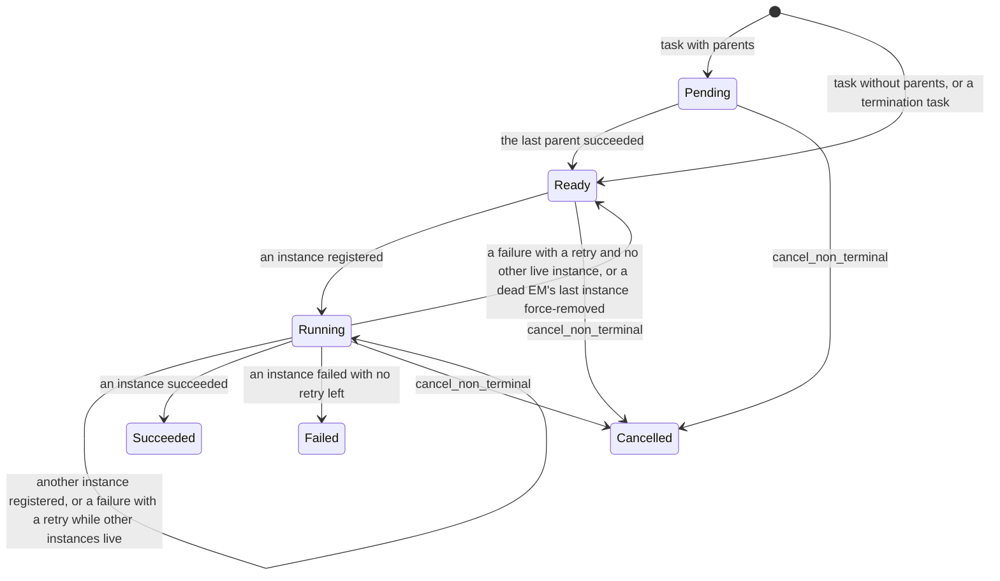

**Per-task bookkeeping**, all under the TCB lock:
- **Instance pool.** The ids of the task's live instances, at most `max_num_instances` of them; that limit is at least 1, and 1 by default (`cache/task.rs:678-735`; `spider-core/src/task/task_graph.rs:175-183`). An instance leaves the pool when it succeeds or fails, or when the pool actor force-removes it after its EM died. A report from an instance that has left the pool is rejected.
- **Retry counter.** Starts at `max_num_retry`, 0 by default. Each failure consumes one retry if any is left (`cache/task.rs:739-774`).
- **`num_unfinished_parents`** (regular tasks only). Starts at the number of parents. Each parent's success decrements it, and the task becomes `Ready` at 0 (`cache/task.rs:342-369`).

**Operations, their checks and their awaits.** Checks run in the order listed. "Stale" and "internal" are the error classes of §10.2.

| Operation | Function | Checks, in order | Effect | Awaits while holding the TCB lock |
|---|---|---|---|---|
| Register an instance (regular task) | `SharedTaskControlBlock::register_task_instance` → `TaskControlBlockBase::register_task_instance` (`cache/task.rs:292-310, 802-813`) | 1. Task terminal: `TaskAlreadyTerminated` (stale). 2. Task not `Ready` or `Running`, that is `Pending`: `TaskNotReady` (internal). 3. Pool full: `TaskInstanceLimitExceeded` (stale; `cache/task.rs:708-715`). | The id joins the pool; the task is `Running`. | Each input slot's read lock (`fetch_inputs`, `cache/task.rs:306, 986-994`) |
| Register an instance (termination task) | `SharedTerminationTaskControlBlock::register_task_instance` (`cache/task.rs:572-582`) | The same three checks | The same | None |
| Succeed (regular task) | `SharedTaskControlBlock::succeed_task_instance` → `TaskControlBlockBase::succeed_task_instance` (`cache/task.rs:329-376, 829-841`) | 1. Id not in the pool: `InvalidTaskInstanceId` (stale). The check removes the id when it is present, even if a later check fails. 2. Task terminal: `TaskAlreadyTerminated` (stale). 3. Task not `Running`: `TaskNotRunning` (internal). After the flip to `Succeeded`: 4. Output count mismatch: `TaskOutputsLengthMismatch` (internal). 5. Output slot already written: `TaskOutputAlreadyWritten` (internal; `cache/task.rs:949-971`). 6. For each successor: its unfinished-parent count already 0, or the successor terminal when it reaches 0: `TaskGraphCorrupted` (internal; `cache/task.rs:344-367`). | The task is `Succeeded`; outputs written; each successor's count decremented, and the successors that reach 0 become `Ready` and are returned. New: the prepared children are stored in the same critical section (§9.5). | Each output slot's write lock (`cache/task.rs:340, 963`), then each successor's TCB lock (`cache/task.rs:343`) |
| Succeed (termination task) | `SharedTerminationTaskControlBlock::succeed_task_instance` (`cache/task.rs:591-600`) | Checks 1 to 3 | The task is `Succeeded` | None |
| Fail, with a retry left | `fail_task_instance` → `TaskControlBlockBase::fail_task_instance` (`cache/task.rs:390-397, 614-624, 866-891`) | Checks 1 to 3, as for success, then `retry()` returns a non-zero count | The task is `Ready` if no other instance is live, else `Running`. The caller re-publishes it. | None |
| Fail, no retry left | The same | Checks 1 to 3, then `retry()` returns 0 | The task is `Failed(msg)`, and the caller fails the job | None |
| Force-remove an instance | `force_remove_task_instance` (`cache/task.rs:404-407, 631-634, 901-913`) | None | Removes the id. If it was present, the task is `Running` and the pool is now empty, the task goes back to `Ready`. Returns whether the id was present. | None |
| Cancel | `cancel_non_terminal` (`cache/task.rs:426-429, 637-640, 916-920`), called per job by `TaskGraph::cancel_non_terminal` (`cache/task.rs:184-191`) | None | A non-terminal task becomes `Cancelled`. The graph-level call locks each regular TCB in turn, then the commit TCB, but never the cleanup TCB, which a `CleanupReady` job still needs. The instance pool is left as it is. | None |
| Ready-task scan | `TaskGraph::get_all_ready_task_indices` (`cache/task.rs:196-205`) | None | Returns the indices of the `Ready` regular tasks | None; one TCB lock at a time |
| Finalize | `TaskGraph::finalize` (`cache/task.rs:174-181`) | None; it takes no TCB lock | Clears the graph's regular-TCB list. The outputs and the commit and cleanup TCBs stay. TCBs that pool entries still reference stay alive until the pool drops those entries. | — |

Two consequences of `finalize`:
- **Afterwards `get_task_control_block(i)` returns `None`** (`cache/task.rs:211-213`). A JCB method would then return the internal `TaskIndexOutOfBound`. That is unreachable: `finalize` runs only when a job leaves `Running`, and every caller that looks up a regular TCB first passes `read_running`, which then fails as stale.
- **A success awaits other locks while holding its TCB lock.** It waits for each output slot's write lock and each successor's TCB lock. A registration waits for each input slot's read lock. These are the only awaits under a TCB lock; §10.4 shows that they cannot cycle.

### 10.4 Lock order and nesting rules

**Today's order.** A task may take a lock only while it holds locks that come earlier in this list:
1. **The job map**, held across later locks only by `JobCache::resend_ready_tasks` (`state/job_cache.rs:133-138`). `get` clones the `Arc` and releases the map before the caller takes the JCB lock (`state/job_cache.rs:92`). `insert`, `remove` and `remove_batch` take no other lock.
2. **One JCB lock.** No code path holds two.
3. **One TCB or termination-TCB lock**, taken under the JCB lock, except in the pool actor, which takes it alone.
4. **Successor TCB locks**, taken by a success while it holds its own TCB lock, in successor order.
5. **Value-slot locks**: output writes under the producer's TCB lock, input reads under the consumer's TCB lock, and output reads under the JCB lock with no TCB lock.

Besides locks, a holder may wait on a channel or the DB:
- the pool send, under the JCB read lock;
- lane sends, under the JCB read or write lock, and under the map read lock in `resend_ready_tasks`;
- the DB transaction, under the JCB write lock.

**Why successor nesting cannot cycle.** `TaskGraph::create` builds TCBs from the highest task index down. `SharedTaskControlBlock::create` requires every child's TCB to exist already (`cache/task.rs:96-103, 480-488`). So every child has a larger index than its parent, and a success, which locks its own TCB and then its children's, always takes TCB locks in increasing index order. Two successes that share a child serialize on the child's lock. The child's own operations lock only larger indices, so they never wait for a parent's lock.

**This design's order.**
1. **One JCB lock at a time:** the committer's collect and apply, and every RPC path.
2. to 4. **TCB locks, successor TCB locks and value-slot locks**, as today.
5. **The job map**, now a leaf: no code path holds it together with any other lock. `resend_ready_tasks` copies the `Arc`s and releases it. The committer inserts child JCBs after it has dropped every JCB guard.

`TreeState` and the event channel are not locks. The committer owns `TreeState`, so no other task can reach it, and a channel send never waits.

**Rules this design adds:**
- Never two JCB locks at once.
- Never a JCB lock across DB I/O, a map wait, a lane send or a reply wait. A body calls `submit` only after it has dropped its guard, so its reply wait holds no JCB lock.
- The only remaining channel wait under a JCB lock is the pool send in instance creation (§10.8).

**Lock table.**

| Lock | Today: held across | New: held across | New: never held across |
|---|---|---|---|
| Job map, read | `get`: the lookup and the `Arc` clone. `resend_ready_tasks`: every JCB's resend, including lane sends. | `get`: unchanged. `resend_ready_tasks`: the `Arc` copy only. | Any JCB lock, any channel send |
| Job map, write | One insert or removal | The same, plus the committer's `insert_many` | Any JCB lock |
| JCB read | The validator, TCB operations, value-slot reads, `fetch_sub`, and either lane sends (success and failure phase A, resend) or the pool send (instance creation) | The same, except lane sends: ready work is staged after the guard is dropped. The pool send remains. | The map lock, a lane send, DB I/O, another JCB lock, a reply wait |
| JCB write | The DB transaction, the transition's TCB operations (`cancel_non_terminal`, `get_all_ready_task_indices`), value-slot reads and a lane send (`start`, success phase B, `cancel`) | One job's apply: the state, `cancel_non_terminal` and `finalize`. Only the committer takes it. | DB I/O, another JCB lock, the map lock, any channel send |
| TCB | One TCB operation, including value-slot writes and successor TCB locks (success) or value-slot reads (registration) | Unchanged, plus the committer's collect of prepared children | A JCB lock, the map lock, any channel send |
| Termination TCB | One base operation, with no inner await | Unchanged | Everything |
| Value slot | One read or write | Unchanged | Everything |
| Event channel | — | Not a lock: a send never waits, and only the committer receives | — |
| `TreeState` | — | Not a lock: owned by the committer task for the tree's whole life | — |
| DB row locks | Until COMMIT, taken under the JCB write lock | Until COMMIT, taken with no JCB lock | — |
| Fence row S lock | — | Until COMMIT | — |
| Scheduler-registration lock | The DB registration | Unchanged | Any JCB or map lock |

**In-process deadlock freedom.**
- **Every lock is taken in the order above.** No task requests a lock while it holds a later one, and successor locks follow increasing task indices. So no cycle of lock waits exists.
- **No JCB lock is held across a DB call, a map wait or a channel send,** except the pool send. The pool actor takes no JCB lock and nothing the committer holds (§10.8).
- **The committer's JCB write waits only for JCB readers.** No reader waits for anything the committer holds: readers never reach `TreeState`, their send never waits, and they await the reply only after dropping their guard. No reader waits for the scheduler, because every lane send goes through the publisher.
- **The committer itself waits only in `recv_many`, holding no lock,** or, while running a round, for one JCB lock, a pool connection or the map write lock, never for two at once.
- **Today's code has a stall that is not a lock cycle.** A reader parked on a full lane keeps its JCB read lock. The job's next writer queues behind it, and so does every later reader of the job, including EM registrations. If the scheduler's own buffer for that lane is also full, the lane may never drain ([#523](https://github.com/y-scope/spider/issues/523)). Taking lane sends out from under every lock removes it.

### 10.5 Lock sequences per operation

Each row lists the locks in the order they are taken; "awaits" names what is awaited while the listed locks are held. Every RPC path starts with `JobCache::get`, which holds the map read lock only for the lookup.

| Operation | Today | New |
|---|---|---|
| `RegisterTaskInstance`, regular task (`cache/job.rs:660-696`) | JCB read (`read_running`) → allocate the instance id → TCB lock: registration checks, then input-slot reads → TCB released → awaits the pool send under the JCB read lock → JCB released | Unchanged, inside a spawned handler body |
| `RegisterTaskInstance`, commit or cleanup task (`cache/job.rs:716-816`) | JCB read (`read_commit_ready` or `read_cleanup_ready`) → termination-TCB lock: registration checks → released → awaits the pool send under the JCB read lock → for a commit task, output-slot reads (`read_output_payloads`) → JCB released | Unchanged, inside a spawned handler body |
| `ReportTaskSuccess`, not the last task (`cache/job.rs:375-409`) | JCB read (`read_running`) → TCB lock → output-slot write locks, then successor TCB locks, each held by the TCB lock → TCB released → `fetch_sub` → awaits the task-lane send under the JCB read lock → JCB released | JCB read → TCB lock (also stores prepared children) → output slots and successors → TCB released → `fetch_sub` (`AcqRel`) → JCB released → `stage` (no lock) |
| `ReportTaskSuccess`, the last task (`cache/job.rs:375-431`) | Phase A as above, `fetch_sub` reaches 0 → JCB read released → JCB write (`write_running`) → output-slot reads → awaits the DB transaction under the JCB write lock → state set → awaits the commit-lane send under the write lock → `finalize` → JCB released | Phase A as above → JCB read released → `submit`: a channel send, no lock → awaits the reply with no lock held. The committer then runs the "Tree state transaction" row. |
| `ReportTaskFailure`, retry left (`cache/job.rs:542-586`) | JCB read (`read_running`, `read_commit_ready` or `read_cleanup_ready`) → TCB lock: failure checks, retry → TCB released → awaits the lane send under the JCB read lock → JCB released | The same, but the JCB read lock is released before `stage` |
| `ReportTaskFailure`, no retry left (`cache/job.rs:534-606`) | Phase A as above (the TCB becomes `Failed`) → JCB read released → JCB write (`write_non_terminated`) → awaits the DB transaction under the write lock → state `Failed` → released. No `cancel_non_terminal`, no `finalize`. | Phase A → JCB read released → `submit(TerminalFailure)` → awaits the reply. The committer's tree state transaction reads every node and applies the failure and the abort job by job. |
| Commit success (`cache/job.rs:449-466`) | JCB write (`write_commit_ready`) → commit-TCB lock: success checks → released → awaits the DB transaction under the JCB write lock → state `Succeeded` → released | JCB read (`read_commit_ready`) → commit-TCB lock: success checks → released → JCB read released → `submit(CommitDone)` → awaits the reply |
| Cleanup success (`cache/job.rs:484-501`) | As commit success, with `write_cleanup_ready`, the cleanup TCB and `Cancelled` | As commit success, with `read_cleanup_ready`, the cleanup TCB and `CleanupDone` |
| Commit or cleanup failure (`cache/job.rs:557-605`) | As the regular failure rows, with the termination TCB | As the regular failure rows, with the termination TCB |
| `CancelJob` (`cache/job.rs:624-643`) | JCB write (`write_cancellable`) → awaits the DB transaction under the write lock → state set → each regular TCB lock in turn, then the commit TCB's (`cancel_non_terminal`) → awaits the cleanup-lane send under the write lock → `finalize` → released | Root check (JCB read for `parent_id`, or the DB on a cache miss) → `submit(CancelRoot)` → awaits the reply. The committer reads every node and applies the cancel job by job. |
| `StartJob` (`cache/job.rs:245-267`) | JCB write (`write_ready`) → awaits the DB transaction under the write lock → state `Running` → each TCB lock in turn (`get_all_ready_task_indices`) → awaits the task-lane send under the write lock → released | `submit(Start)` → awaits the reply. The committer's collect reads the ready task indices under the JCB read lock, one TCB lock at a time. |
| `GetJobState`, `GetJobOutputs` (`cache/job.rs:210-232`) | JCB read (no validator, or `read_succeeded`) → for outputs, output-slot reads → released | Unchanged, except `read_succeeded`'s stale mapping |
| `resend_ready_tasks` (`state/job_cache.rs:133-138`, `cache/job.rs:288-316`) | Map read held throughout → for each JCB: JCB read via `read_running`, `read_commit_ready` or `read_cleanup_ready` → for a running job, each TCB lock in turn → awaits the lane send under the JCB read lock and the map read lock → JCB released | Map read → copy the `Arc`s → map released → for each JCB: JCB read → collect the entries (TCB locks one at a time) → JCB released → `stage` |
| Cache-GC eviction (`state/job_cache_gc.rs:217-236`) | Map write (`remove_batch`) only | Unchanged |
| `RegisterJob` (`state/service.rs:150-191`) | The DB INSERT with no lock → build the JCB (its locks are new and uncontended) → map write (`insert`) | The same, inside the INSERT's fenced DB transaction, plus the tree's channel, a one-node `TreeState` and the spawn of its committer |
| Pool actor (`task_instance_pool.rs:336-448`) | Per registration: the DB liveness read with no storage lock → for a dead EM, the TCB lock (`force_remove_task_instance`) → the lane send. Per GC tick: the DB read → for each entry, the TCB lock (`is_terminal`, `force_remove_task_instance`), one at a time → lane sends with no lock held. Never a JCB or map lock. | Unchanged |
| Tree state transaction (new; §7.2-§7.3) | — | No lock for `TreeState`, which the committer owns → **receive**: `recv_many`, or `try_recv` while deferred events wait, with no lock → **collect**: one JCB read lock at a time, with TCB locks to take prepared children and value-slot reads for outputs → **plan**, with no lock → **write**, skipped for an empty plan: a pool connection, with no JCB lock → **apply**: one JCB write lock at a time, deepest first, with TCB locks inside for `cancel_non_terminal` → **map insert** (`insert_many`), with no JCB lock → GC send → reply sends → deferred events back to the front of the local buffer → `stage` |

### 10.6 Race resolution, worked examples

Each example lists the interleaving step by step and names the lock or the check that decides it. "Stale" means a `StaleStateError`, so the caller gets FAILED_PRECONDITION. The EM drops a report or an assignment that storage rejects that way (`spider-execution-manager/src/runtime.rs:490-499, 640-657`).

**(a) A straggler fails the last task's instance after the task succeeded.** Job J is a plain job, `Running`. Its last regular task T succeeded through instance i1, as in walkthrough B. Now a failure report for T arrives. It comes either from i1 itself (a duplicate or late report) or from a second instance i2 of T (possible when `max_num_instances` is at least 2, for example after a soft-timeout re-enqueue).
1. **Before the success is applied.** This covers phase A, the channel, and the success's tree state transaction until its apply is granted J's write lock. J's cached state is still `Running`.
   1. The failure report takes J's JCB read lock; `read_running` passes.
   2. It takes T's TCB lock. For i1, the pool check fails, because the success removed i1 (`cache/task.rs:830`): `InvalidTaskInstanceId` (`cache/task.rs:871-873`), stale. For i2, the pool check removes i2, then the terminal check fails because T is `Succeeded`: `TaskAlreadyTerminated` (`cache/task.rs:874-876`), stale.
   3. The retry logic never runs, because these checks come first.
   4. The pool actor drops i2's entry at its next GC pass, because T is terminal (`task_instance_pool.rs:404-407`).
   5. Result: T stays `Succeeded`, J is unaffected, the success's tree state transaction proceeds, and the failure report gets FAILED_PRECONDITION.
2. **Once the apply has requested J's write lock.** The failure report's read request queues behind the apply (fairness, §10.1), so it is decided as in the next case.
3. **After the apply.** J is `CommitReady`. `read_running` fails with `JobNoLongerRunning`, stale, before any TCB is touched. This matters because `finalize` has already removed T from J's graph, so a TCB lookup would have returned the internal `TaskIndexOutOfBound` (§10.3).
4. **Today:** the same three cases, with phase B's `write_running` in place of the apply. A straggler that got its read lock before phase B asked for the write lock delays phase B until the straggler releases it.

**(b) A `CancelJob` concurrent with walkthrough B.** J is a plain job, `Running`, with a commit task. Its last task T is finishing, and a client cancels J.
1. **The cancel is applied before phase A.**
   1. The cancel's apply sets J to `CleanupReady` or `Cancelled`. It runs `cancel_non_terminal`, which marks T `Cancelled` but leaves T's instance pool as it is, and `finalize`.
   2. The success report's `read_running` fails with `JobNoLongerRunning`, stale.
   3. The instance's result is lost; no event is produced. The pool drops the instance's entry at its next GC pass, because T is terminal.
2. **The cancel has committed in the DB but not yet been applied when phase A runs** (new only).
   1. If phase A holds J's read lock first, the cancel's apply waits for it.
   2. Phase A completes: T is `Succeeded`, `fetch_sub` reaches 0, the guard is dropped, and `RegularTasksDone(J)` is submitted. It queues behind the cancel's tree state transaction, which is still running in the tree's one committer.
   3. The apply then sets J to `CleanupReady` or `Cancelled`. `cancel_non_terminal` leaves T, already `Succeeded`, unchanged and cancels the commit TCB. The cancel is answered.
   4. The next tree state transaction plans `RegularTasksDone(J)` against J's cancelled state: `plan_regular_done` requires `Running`, so the event is answered `Stale` and nothing is written ((f) below).
   5. If phase A asked for the read lock after the apply asked for the write lock, it waits and then fails `read_running`, as in case 1.
3. **Both events are in the same tree state transaction.** `CancelRoot` is planned first (§7.5). `RegularTasksDone(J)` is then planned against the cancelled overlay and answered `Stale`. Its DB transaction contains only the cancel.
4. **The cancel arrives while the success's tree state transaction is running, during its DB transaction or its apply.**
   1. The cancel waits in the tree's channel: the tree's one committer is still running the success's tree state transaction.
   2. The success's tree state transaction commits J as `CommitReady`, applies it, answers the report and stages J's commit task.
   3. The next tree state transaction plans `CancelRoot` against a `CommitReady` root: `CleanupReady` if J has a cleanup task, otherwise `Cancelled` through the new edge (§3.4).
   4. The apply cancels the commit TCB and runs `finalize`.
   5. The fate of J's commit task depends on how far it got:
      - **Staged or queued, not yet dispatched:** when it is dispatched, the registration's `read_commit_ready` fails with `JobNoLongerCommitReady`, stale, and the EM drops the assignment.
      - **Already running:** it is not preempted. Its success report fails `read_commit_ready` with `JobNoLongerCommitReady`, stale, and its result is discarded. If J has a cleanup task, that task may run while the late commit is still running. This is today's root semantics; skipping mid-commit jobs (Q2) applies to non-roots only.
      - **Already finished**, with `CommitDone(J)` applied: J is `Succeeded`, and the cancel is answered with the stale `JobAlreadyTerminated`.
      - **`CommitDone(J)` queued in the same tree state transaction as the cancel:** the cancel is planned first, and `CommitDone` is `Stale`.
5. **Today:**
   - A cancel whose write request precedes phase B's wins; phase B's `write_running` then fails with `JobNoLongerRunning`.
   - A cancel that comes after phase B finds J `CommitReady`. Without a cleanup task that is the fatal `CommitReady → Cancelled` ([#518](https://github.com/y-scope/spider/issues/518)).

**(c) Instance registration versus a cancel.**
1. **Registration first.** The registration holds J's JCB read lock from its validator to the end of its pool send (`cache/job.rs:669-694`). The cancel's apply, or today the cancel, waits for it. Then `cancel_non_terminal` marks the task `Cancelled`.
2. **The new instance is not stopped.** It runs on its EM, because executors are not preempted. Its report fails the JCB validator (`JobNoLongerRunning`, stale), and the pool drops its entry at the next GC pass.
3. **Cancel first.** The registration's `read_running` fails with `JobNoLongerRunning`, stale, and the EM drops the assignment. A registration that asks for the lock while the cancel's write request is queued waits, then fails the same way.
4. **New only: the commit-to-apply window.** The cancel can commit in the DB before the registration's read lock, while the cache still shows `Running` (I5). The registration then succeeds and the case is "registration first".
5. **Termination tasks** behave the same way with `read_commit_ready`. A cleanup registration is never in conflict with a cancel, because the cancel is what creates the cleanup work.

**(d) A retry re-enqueue versus a cancel or an abort.**
1. A failure with a retry left leaves the task `Ready` or `Running` (§10.3) and re-publishes it.
   - Today: `send_task_ready` is awaited under J's read lock (`cache/job.rs:550-553`). A cancel's write lock waits for that send, so with a full task lane the cancel waits for the scheduler.
   - New: the guard is dropped first and the entry is staged. The cancel's apply never waits for a lane.
2. Either way, the cancel then marks the TCB `Cancelled`.
3. When the stale entry is dispatched, the registration fails `read_running` (`JobNoLongerRunning`) and the EM drops the assignment.
4. If the entry is dispatched before the cancel is applied, a new instance may register and run. That is case (c).
5. An abort caused by a failure elsewhere in the tree behaves exactly like a cancel. So does the pool actor's own re-enqueue after a soft timeout or an EM death (`task_instance_pool.rs:424-438, 459-481`).

**(e) Two siblings' last successes race on `num_incomplete_tasks`.** J has two regular tasks left, X and Y, neither a successor of the other. Their success reports run concurrently.
1. **Both take J's JCB read lock**, which is shared.
2. **Each succeeds its own TCB under its own lock.** If X and Y share a successor S, they serialize on S's lock to decrement S's count; the second makes S `Ready`. S is then still incomplete, so neither X nor Y is the job's last task.
3. **Each calls `fetch_sub(1)`** (`cache/job.rs:392`). Read-modify-write operations on one atomic variable are totally ordered, and each reads the value the previous one wrote, whatever memory ordering is requested. So one call sees 2 and the other sees 1: exactly one task is last.
4. **Visibility today.** The last task drops its read guard and takes the write lock (`write_running`). tokio grants that write lock only after every read guard has been released. The other sibling's guard release therefore orders its whole phase A, including its output writes, before phase B reads the outputs. The counter only decides who is last, and the JCB lock provides the visibility, so `Relaxed` is enough today.
5. **Visibility in this design.** The last task submits without taking the write lock, and the committer collects under a read lock, which does not wait for the other sibling's read guard. Ordering would then rest on each output slot's and TCB's lock order relative to a `Relaxed` counter, which the Rust memory model does not guarantee. So this design makes the decrement `AcqRel`:
   - each decrement releases its task's phase A;
   - the decrement that reaches 0 acquires all of them, because read-modify-write operations extend the release sequence;
   - every sibling's TCB success, output writes and prepared children therefore happen before the `submit`, and the channel carries that order to the committer's collect: a send happens before the receive that takes it.
   B3 measured `fetch_sub` at 6.5 ns with either ordering.
6. **A task whose success made successors ready cannot be the last.** If `fetch_sub` reached 0 in that case, phase A would return `TaskGraphCorrupted` (`cache/job.rs:394-400`).

**(f) A phase-A `submit` lands after a cancel or abort has committed.** An event is checked when the committer plans it, not when it is submitted.
1. **The planner checks each event against the overlay:** the state the committer collected for that tree state transaction, updated by its earlier events.
   - `plan_regular_done` requires `Running`.
   - `plan_commit_done` requires `CommitReady`; `plan_cleanup_done` requires `CleanupReady`.
   - `plan_failure` requires the state of the failing lane.
   - `plan_start` requires `Ready`.
   - `plan_cancel` maps `CleanupReady` and terminal states to stale errors.
2. **A failed check produces nothing.** The event is answered `Stale`, nothing is written, and the job's prepared children are dropped.
3. **The check cannot miss a committed transition.** Cached job states change only in apply, and the tree's one committer applies tree state transaction N before it collects tree state transaction N+1. So every tree state transaction sees the post-state of the previous one.
4. **A submit to a tree whose committer has exited** fails to send and is answered at once: with the stale error for the job's terminal state after a quiescent exit, or with `Stopping` once the service is stopping (§7.2).

### 10.7 DB deadlock freedom

- A tree's rows are written only by its committer (I6), so two DB transactions never write the same job row concurrently.
- Every UPDATE is a primary-key access (`FORCE INDEX (PRIMARY)`, `WHERE id IN (…)`), so it takes record locks on the rows it changes only, and no range or next-key locks on `job_state`.
- Child INSERTs take insert-intention locks at the end of the primary key, which no record lock blocks. The foreign-key check on `resource_group_id` takes an S lock on the resource-group row, as `register` does today.
- The fence is a record S lock on one row. The only X request on that row is the startup bump, which holds nothing else (§11.3).
- No DB transaction runs while a JCB lock is held (§10.4), so a DB lock wait can never be part of an in-process wait cycle.

Measured: A10 found 0 deadlocks in 120 s of mixed stress on `mariadb:10.11.16` for the PK-hinted form of this design's SQL (MEM-PK). The same SQL without the hint (MEM) had 2. On `mariadb` 13.0.2 both had 0 over 300 s (A10L). This is why no deadlock retry loop exists (§11.5).

### 10.8 The remaining head-of-line source

Instance creation still holds a JCB read lock across its send to the task-instance pool: `cache/job.rs:688-690` (and 743-745, 805-807 for termination tasks) await `TaskInstancePoolHandle::register_task_instance` (`task_instance_pool.rs:181-197`), a bounded `mpsc` send with default capacity 128 (`task_instance_pool.rs:90`). The pool actor processes registrations one at a time. For an EM it has not seen, it reads the EM's liveness from the DB, and for a dead EM it re-enqueues the task into a lane (`task_instance_pool.rs:336-370, 459-481`).

tokio's `RwLock` is write-preferring (§10.1), so a committer apply `W(j)` queued behind such a reader stalls the tree's serial section until the reader's send completes. There is no wait-for cycle: the actor takes TCB mutexes but no JCB lock and nothing the committer holds. So this is bounded latency, not a deadlock. Its bound is the actor's queue ahead of the send, which includes the actor's DB reads and, rarely, a re-enqueue into a full lane. If it shows up in gate H13, the instance can be registered with the pool after the guard is dropped, in the same way as the publisher.

### 10.9 Stale, duplicate and late reports

| Case | Rejected by |
|---|---|
| Old storage session (RPC) | `validate_session` (`state/service.rs:804-809`), unchanged: NOT_FOUND |
| Old storage process still running (its DB write) | The fence: `DbError::Fenced`, fatal for the **old** process (§11.3) |
| Duplicate or force-removed instance, or another instance of an already terminal task | The TCB checks (§10.3; `cache/task.rs:829-841` for a success, `:866-891` for a failure), unchanged: `InvalidTaskInstanceId` or `TaskAlreadyTerminated`. They fire before any prepared child is stored. |
| Report for a job that a committed and applied tree state transaction made inactive (aborted sibling, cancelled descendant) | The JCB validators (§10.2), as `StaleStateError` (FAILED_PRECONDITION). `ensure_running` already answers `JobNoLongerRunning` for `BlockingOnChildren` (`cache/job.rs:1111-1119`). `ensure_commit_ready` and `ensure_cleanup_ready` answer stale, not `Internal`, for `BlockingOnChildren` (`cache/job.rs:1129-1163`). `ensure_succeeded` maps a cached non-`Succeeded` state to stale (`cache/job.rs:1172-1181`). |
| The same report between that tree state transaction's COMMIT and its apply | The JCB still shows the pre-state, so the report passes the validator. A TCB check rejects it, or the planner answers its event `Stale` (§10.6 (f)). |
| Event queued before an abort or cancel in the same tree state transaction | The planner answers `Stale`; the job's prepared children are dropped. |
| Terminal failure racing an abort | `TerminalFailure` is planned only if the job's state matches its lane (§6.4); otherwise `Stale`. |
| Report for an evicted (terminal) job | `JobNotFound`, mapped to FAILED_PRECONDITION, unchanged. |
| External job RPC on a non-root id | `BadRequest`, mapped to INVALID_ARGUMENT (§9.6). |
| Any event for a tree whose committer has exited | The send fails, and the event is answered at once: the stale error for the job's terminal state after a quiescent exit, or `Stopping` when the service is shutting down after a poison or a signal (§7.2). |

Every "lost the race" outcome is a `StaleStateError`, which the handlers map to FAILED_PRECONDITION without cancelling the service (`grpc.rs:128-136, 196-204`). Anything raised from the DB on a transition path stays fatal.

### 10.10 Why a dropped RPC future cannot strand a job

tonic handlers run inline in the RPC future (`grpc.rs:640-706` into `state/service.rs:377-406, 499-526`), and hyper drops that future on `RST_STREAM`, on a closed connection or on a `grpc-timeout`. That is unsafe today, before any tree exists:
- `SharedTaskControlBlock::succeed_task_instance` flips the TCB to `Succeeded` (`cache/task.rs:335`), then awaits `write_outputs` (`:340`) and each successor's mutex (`:343`), all while it holds the TCB lock (§10.3).
- Only afterwards does JCB phase A run `fetch_sub` (`cache/job.rs:392`).
- A drop in between leaves the task `Succeeded` but its successors' `num_unfinished_parents` and the job's `num_incomplete_tasks` undecremented, so the job stays `Running`. Cache and DB agree on `Running`, so nothing detects it; only an unrelated restart recovers the job, by re-executing it from scratch.
- The phase A to phase B gap (`cache/job.rs:411-413`), the retry re-enqueue in `fail_task_instance` and instance creation (TCB registered, pool entry missing) have the same shape (§10.5 lists the awaits of each).
- In a tree the job's `BlockingOnChildren` ancestors would never unblock, while I2 and I3 still hold, so no invariant check could see it.

Three mechanisms make drops harmless:
1. **Every cache-mutating handler body runs in a spawned task.** `report_task_success`, `report_task_failure`, `cancel_job` and `register_task_instance` wrap their body in `env.tasks.spawn(...)` and await only its result, raced against the service token. A dropped RPC future drops only that receiver. The body runs to completion: TCB flip, successor decrements, `fetch_sub`, successor publication, retry re-enqueue and `submit`. Cost: one `tokio::spawn` per report, 268 ns including the join (B3), about 0.03 % of a 1 ms DB transaction.
2. **The transition runs in the committer, a long-running spawned task.** Dropping the `oneshot::Receiver` does not cancel it.
3. **Abnormal committer exits are fatal and wake every waiter** (§7.7). Dropping the receiver drops every reply sender, so no waiter waits on a sender that nobody will use.

`submit` itself stays synchronous: no await lies between deciding that a job reached a tree event and enqueuing it. With mechanism 1 this is no longer needed for drop safety, but it keeps the decision and the enqueue in one place.

---

## 11. Fault tolerance (failure recovery)

### 11.1 Crash-point table

"Lost" means volatile state that is regenerated.

| Flow | Crash point | Durable | Lost | Result after the restart |
|---|---|---|---|---|
| Registration | prepared children stored in TCBs | P `Running` | TCB progress, prepared children | P re-executes from scratch and re-creates its children (determinism) |
| | DB transaction open, before COMMIT | P `Running` (InnoDB rolls back) | the same | the same |
| | COMMIT acknowledgement lost (ambiguous) | either outcome | — | fatal, restart, then whichever outcome is durable; both satisfy I1-I4 |
| | after COMMIT, before apply, map insert or publication | P `BlockingOnChildren` with outputs; k children `Running` | JCBs, publications | P is recovered as `BlockingOnChildren` (counter k, no regular tasks); the children are recovered `Running` and their tasks resent |
| Completion (several in one tree state transaction) | before COMMIT | every row of the tree state transaction unchanged | progress | each job re-executes, or re-runs its commit task |
| | after COMMIT | every row of the tree state transaction, cascades included | apply, commit publications | counters recomputed from the rows; `CommitReady` ancestors' commits resent. Nothing to resume. |
| Commit task | success reported, before COMMIT | P `CommitReady` | — | the commit re-runs (idempotent, as today) |
| Failure | before COMMIT | j `Running` or `CommitReady` | retry counters | j re-executes; retries reset, as today (Q10) |
| | after COMMIT | j and its chain `Failed`; the rest `CleanupReady` or `Cancelled`; skipped `CommitReady` jobs intact | apply, cleanup publications | `CleanupReady` jobs get their cleanups resent; skipped `CommitReady` jobs get their commits resent |
| Cancel | before COMMIT | tree intact | — | tree recovered; the client's retry cancels it |
| | after COMMIT | tree deactivated | apply | as the failure row; a retry gets `JobCancellationAlreadyRequested` or `JobAlreadyTerminated` |
| Cleanup task | done, before COMMIT | j `CleanupReady` | — | the cleanup re-runs (idempotent, as today) |
| Any | after apply, before publication or GC enqueue | — | queue entries | `resend_ready_tasks`; terminal jobs are not loaded |
| Recovery or repair | a second crash at any prefix | — | — | every repair is one idempotent DB transaction per tree; recovery starts over |
| Any | RPC future dropped anywhere | — | — | nothing: the handler body and the committer are spawned tasks (§10.10) |
| Any | fatal error (`DbError`, pool-acquire timeout, confirmed divergence, panic) with waiters queued | whatever committed | queued events | the guard cancels the token and drops the receiver, so every waiter's oneshot closes (`TreePoisoned`); RPC waits race the token, and the process exits non-zero within `SHUTDOWN_DEADLINE`; the restart re-derives everything, and EMs re-report or re-execute |
| Any | the old process keeps running (rolling update, partition) | its DB transactions that committed **before** the fence bump | — | the new process recovers after the bump and sees them; later ones fail with `Fenced`, and the old process exits non-zero |
| Any | the old process dies or is partitioned in the middle of a DB transaction (orphaned server connection) | nothing of that DB transaction | — | the bump kills the orphan's connection, InnoDB rolls it back, and the new process starts within seconds |

### 11.2 Storage-session-restart algorithm

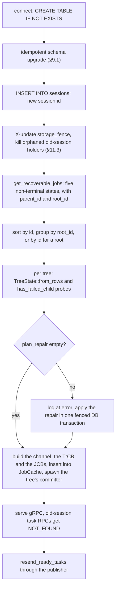

1. **`connect`** (`db/mariadb.rs:60-103`): create the tables; run the idempotent upgrade (§9.1); bump the session with `INSERT INTO sessions () VALUES ()`; then X-update `storage_fence`. The X-update waits for every in-flight old-session DB transaction to finish, and kills the connection of any old-session holder that still blocks it after 1 s (§11.3).
2. **`recover_job_cache`** (`state/runtime.rs:218-249`), extended:

```sql
SELECT `id`, `resource_group_id`, `state`, `parent_id`, `root_id`, `compressed_serialized_task_graph`,
       `compressed_serialized_job_inputs`, `serialized_job_outputs`
FROM `jobs`
WHERE `state` IN ('Ready','Running','CommitReady','CleanupReady','BlockingOnChildren');
```

```rust
let mut rows = db.get_recoverable_jobs().await?;
rows.sort_by_key(|r| r.id);                                          // topological order (I1)
let trees: HashMap<JobId, Vec<Row>> = group_by_key(rows, |r| r.root_id.unwrap_or(r.id));
for (root, rows) in trees {                                          // the root row may be absent (a terminal root)
    let ts = TreeState::from_rows(root, &rows);                      // parents; flags from the decoded graphs; depth
                                                                     // where the parent is loaded; counters (missing → 0)
    let failed_child = probe_blocked_parents(&rows, db).await?;      // has_failed_child per BlockingOnChildren row
    let repair = plan_repair(&ts, &rows, &failed_child);             // pure (§11.4); empty for a consistent tree
    let states = if repair.is_empty() {
        states_of(&rows)
    } else {
        tracing::error!(root_id = ?root, job_ids = ?repair.job_ids(), "Repairing job tree at startup.");
        db.apply_tree_transition(repair.db()).await?;                // fenced; a failure is fatal
        repair.apply_to(states_of(&rows))
    };
    let (tree, rx) = TreeControlBlock::new(root);                    // root id and the tree's event channel
    let mut ts = ts.with_states(&states);
    for r in rows.iter().filter(|r| !states[&r.id].is_terminal()) {
        let jcb = SharedJobControlBlock::recover(r, states[&r.id], tree.clone(), ..).await?;
        // Ready or Running       → a fresh graph (unchanged)
        // CommitReady            → keeps its cleanup TCB (fix)
        // BlockingOnChildren     → TaskGraph::recover_blocked: no regular tasks
        // CleanupReady           → unchanged
        ts.bind(r.id, jcb.clone());                                  // TreeState's strong reference
        job_cache.insert(jcb).await?;
    }
    if !ts.is_quiescent() {                                          // a repair may have ended every job (R5)
        tasks.spawn(run_committer(ts, rx, tree_env.clone()));        // owns TreeState from here on (§7.2)
    }
}
```

3. **Serve gRPC.** Old-session RPCs get NOT_FOUND at `validate_session`, and old-session DB transactions fail at the fence. The scheduler and the EMs flush on the session bump.
4. **`resend_ready_tasks`** (`bin/grpc_server.rs:98-109`), now over a map snapshot (§12):
   - `BlockingOnChildren` JCBs publish nothing: the three state readers at `cache/job.rs:288-316` all fail their validators, and the method falls through;
   - `Running` jobs, children included, publish their ready tasks;
   - `CommitReady` and `CleanupReady` jobs publish their termination task.

Rules:
- No tree-invariant violation stops startup. A repair is logged at `error` level with the job ids.
- Repair finishes before the tree's committer is spawned, and every committer exists before serving starts.
- A repair's DB transaction is fenced, and its failure is fatal, as at runtime. Repairs are idempotent, so the next start finishes them.
- A row whose blobs fail to decode still fails startup, as today, and so does a `BlockingOnChildren` row without outputs, like a `CommitReady` row without outputs today. Those are row corruptions, not tree invariants.

Cost: B4 measured the tree rebuild plus the invariant checks at 1.16 ms per 10,000 rows, 0.9 % of recovery. Recovery stays dominated by decoding, about 20 µs per live row (B4db), and `BlockingOnChildren` rows build no TCBs. Per row, tree recovery costs 0.93-0.96x today's.

### 11.3 The session fence

**Problem.** The session bump is a plain INSERT (`db/mariadb.rs:95-100`), and `validate_session` compares a request's session only with the serving process's own id. A superseded process therefore keeps accepting its old cohort and keeps committing. In the benchmark's `zombie.comp` scenario (A9b: an old process's DB transaction commits after the new process rebuilt its cache), every other mechanism the benchmark emulated (a root-row lock, a parent counter with and without the PK hint, and two probe variants) left the cache stuck behind the DB in 35-42 of 60 trials. This design's SQL had 0 divergent trials, because its exact guards detected the zombie's write and forced a restart. Unfenced, it still converged in only 53-54 of 60 trials; the other 6-7 died at startup (`results-db.md:1011, 1022`). The fence removes both the stuck caches and the startup failures.

**Protocol.**
- **Every DB transaction that writes `jobs`** starts with the fence read, and rolls back with `DbError::Fenced` on a mismatch. This covers `apply_tree_transition`, `register` and the future retention DELETE.

```sql
SELECT `session_id` FROM `storage_fence` WHERE `id` = 0 LOCK IN SHARE MODE;   -- must equal my session id
```

- **`connect`**, after the session INSERT and before `recover_job_cache`, runs on a dedicated connection A:

```sql
SET SESSION innodb_lock_wait_timeout = 5;                                                       -- connection A only
SELECT CONNECTION_ID();                                                                         -- :a
UPDATE `storage_fence` SET `session_id` = GREATEST(`session_id`, :new_session) WHERE `id` = 0;  -- autocommit; X lock
```

- **Orphaned holders are killed, not waited for.** A writing DB transaction holds the fence S lock until COMMIT, across several awaited statements. If the old process dies or is partitioned in the middle of a DB transaction and its FIN is lost, MariaDB keeps that DB transaction and its S lock until `wait_timeout` (28,800 s by default) or TCP keepalive reaps the connection. Waiting would turn one crash into hours of outage. So while A's UPDATE waits, a second connection B starts 1 s after it, and every second until A finishes runs:

```sql
SELECT b.trx_mysql_thread_id
  FROM information_schema.INNODB_LOCK_WAITS w
  JOIN information_schema.INNODB_TRX r ON r.trx_id = w.requesting_trx_id
  JOIN information_schema.INNODB_TRX b ON b.trx_id = w.blocking_trx_id
 WHERE r.trx_mysql_thread_id = :a;
KILL CONNECTION :blocker;                                                                       -- for each row
```

- If A still gets error 1205 (lock-wait timeout), the bump is retried, at most 5 times, before `connect` fails. The 5 s timeout is the backstop; the normal orphan case ends after about 1 s.
- **Privileges.** Reading `INNODB_TRX` and `INNODB_LOCK_WAITS` needs the `PROCESS` privilege. Killing a connection of the same DB user needs nothing more (another user's would need `CONNECTION ADMIN` or `SUPER`). The storage service uses one DB user, so `PROCESS` is the only new grant (Q11).
- **Defence in depth.** Storage connections set a session `wait_timeout` of 15 minutes in the pool's `after_connect` hook. It must stay above the pool's idle timeout (sqlx's default is 10 minutes). The deployment docs recommend server-side TCP keepalive. An orphan is then reaped even without a KILL.
- **Liveness test.** Gate H14 adds a partition in the middle of a DB transaction (iptables DROP between a committer and MariaDB, then a restart). The new process must serve within 10 s.

**Why it is correct.**
- The X request waits for every in-flight DB transaction that holds the S lock. Every old-process DB transaction that passed the fence therefore commits **before** the new process reads the DB in `recover_job_cache`.
- An old-process DB transaction that starts later reads the new value, because a locking read is a current read at any isolation level. It fails with `Fenced`.
- InnoDB queues new S requests behind a waiting X request on a **record**, so a busy zombie cannot starve the bump. A range or gap lock would not have this property: gap locks never wait behind a waiting insert-intention lock, which is why the fence is a dedicated row and not a range read on `sessions`.
- Killing is safe. The new process has served nothing, so every holder of the fence S lock belongs to an older session, and InnoDB rolls the killed DB transaction back. A live old process sees its DB transaction fail, which is fatal for it, just as `Fenced` would be.
- If two new processes start concurrently, which `strategy: Recreate` prevents, the slower one may kill the faster one's DB transactions. That costs a restart, not correctness: a killed DB transaction rolls back and is fatal for its owner, and `GREATEST` keeps the fence monotone.
- The record-lock fence works at REPEATABLE READ and READ COMMITTED alike, so retention and repair may run at READ COMMITTED.

**Cost.**
- Once the committer is in place (PR 3), the fence statement takes the place of today's `SELECT … FOR UPDATE`, so a plain job's DB transaction stays at four statements. Between PR 1 and PR 3 the old path carries both statements.
- The extra statement costs about +0.07 ms here (A1: READ-PK 0.115 ms minus the ping) and about +0.5 ms at production-like latency.
- `register` becomes a four-statement DB transaction (BEGIN, fence, INSERT, COMMIT) instead of one autocommit INSERT. It runs once per root and adds no fsync.
- Gate H12: the plain-job p50 stays within the A1 A/A band.

**Deployment.**
- The Helm chart gets `strategy: type: Recreate`. Today `tools/deployment/spider-helm/templates/storage-deployment.yaml:9` sets only `replicas: 1`, so Kubernetes defaults to RollingUpdate, and every rollout would end in the old pod's fatal `Fenced` exit. The fence makes that exit safe, and Recreate makes it rare (Q5).
- The fatal path exits non-zero (§7.8), so Compose's restart policy restarts it; PR 0 also changes the Compose default to `restart: unless-stopped`.
- `DbError::Fenced` is always fatal in every gRPC error handler, including the non-strict job-orchestration handler that `register_job` uses.

### 11.4 Repair, not refusal

Every transition is atomic, so these predicates are a **safety net** for bugs and manual edits, not a normal recovery mechanism. They are evaluated over the loaded rows of one tree in ascending id order, planned by the normal planner against the overlay of the previous steps, and written in one repair DB transaction per tree before serving.

| Predicate | Repair |
|---|---|
| **R1, orphan:** a `Running`, `BlockingOnChildren` or `Ready` non-root row whose parent is not a loaded `BlockingOnChildren` row | Abort it with `abort_target`: `Cancelled` for a `Ready` row, else `CleanupReady` if it has a cleanup task, else `Cancelled`. Its descendants then become orphans and are aborted in the same pass. A `CommitReady` row under an inactive parent is legal (I3) and is left to finish. |
| **R4, failed child under a blocked parent:** a `BlockingOnChildren` row with a loaded child in `CleanupReady`, or for which `has_failed_child(P)` is true (a `Failed` or `Cancelled` child, violating I2) | `fail_blocked(P)` (§6.4): P and its `BlockingOnChildren` chain become `Failed`, and every other abortable job of the tree is aborted. "Success is earned" can then never be broken by a later sibling success. |
| **R2, stuck parent:** a `BlockingOnChildren` row with 0 active children after R1 and R4 | R4 has already failed every such P that has a failed child, so the remaining ones have only `Succeeded` children: `unblock(P)` (§6.3). It goes to `CommitReady` and stages the commit when P has a commit task, else to `Succeeded`, and continues the climb. `unblock` and `fail_blocked` take no lane check, so neither is a no-op on a `BlockingOnChildren` row. |
| **R3, counter:** `active_children(P)` disagrees with the loaded rows | Impossible after a rebuild, because the counter is computed from the loaded rows. Listed for completeness. |
| **R5, catch-all:** `check_invariants` still fails on the overlay after R1-R4 | Fail the whole tree instead: the repair's DB transaction is replaced by one that moves every non-terminal row from its loaded state to `Failed` with the message "tree invariant violation: …", or to `Cancelled` for a `Ready` row. A tree with every row terminal satisfies I1-I4 trivially. |

The `has_failed_child` probe runs once per loaded `BlockingOnChildren` row, about 0.1 % of the rows in CLP's shapes, with `persistent(false)`, before the pure planner runs.

**Repair is a superset of `check_invariants`.** `check_invariants` checks I1-I4. R1 covers I1 and I3, R4 and R2 cover I2, R3 the counter, and R5 everything else. The planner property test `check_invariants(plan_repair(rows)) == Ok` over arbitrary injected row sets enforces this. The injected sets include an orphan; a stuck parent with and without a failed child; a `BlockingOnChildren` parent with a commit task; and a `BlockingOnChildren` parent with one `Failed` and one `Running` child. So a tree that repair has fixed passes `check_invariants`, and the next start finds nothing to repair: a violation costs at most **one** restart, never a loop that would exhaust Compose's `on-failure:3`. Without a periodic runtime check, a violation that no later write touches is found only at the next start (§17).

### 11.5 DB errors in the middle of a transition

- **Any `DbError` from `apply_tree_transition` is fatal**, except the deterministic payload errors of a tree state transaction that contains a registration (§6.2, step 5), which roll the DB transaction back and leave the parent's failure to the next tree state transaction:
  - the committer's guard drops the receiver, so every waiter queued on the tree wakes with a closed oneshot and gets `TreePoisoned`;
  - every other RPC wait returns UNAVAILABLE once the token fires;
  - the service token is cancelled with the fatal flag set (`grpc.rs:396-445`, §7.8);
  - the process exits non-zero after a graceful shutdown or at `SHUTDOWN_DEADLINE`, whichever comes first;
  - the restart reads the truth from the DB.
- **Ambiguous COMMIT.** Each tree state transaction has one DB transaction, so a lost COMMIT acknowledgement needs no special handling: the restart sees one of the two outcomes, and both satisfy I1-I4.
- **Deadlocks (1213) and lock-wait timeouts (1205)** are excluded by construction (§10.7). A10 measured none for this addressing. No retry loop is added: a retry would be safe only for errors whose rollback the server reports, never for a failed COMMIT, and it would hide divergence.
- **Pool-acquire timeout.** A committer holds at most one connection. With more hot trees than pool connections, committers wait in `pool.acquire()` just as RPCs do today. A timeout is fatal, as today.
- **Read-only paths.** The only DB reads outside a tree state transaction are the repair probes at startup. They are fatal, because nothing is served yet and a retry is a restart.

---

## 12. Retention and cache GC

- **Multi-job GC enqueue.** `plan.terminated` lists every job that became terminal in the tree state transaction: the event's own job, cascaded ancestors, aborted or cancelled descendants, and skipped commits that finish. All of them are GC-enqueued. Today only the RPC's own job is enqueued (`state/service.rs:812-818`).
- **Active jobs are never enqueued**, so I5 holds. Evicting a terminal job is safe: it has already left `TreeState`, and the planner reads an absent node as inactive and not `BlockingOnChildren` (§7.4). That matters on one path: a skipped `CommitReady` job whose aborted parent was evicted still reads its parent when its commit finishes, sees "not `BlockingOnChildren`", and stops.
- **`JobCache::resend_ready_tasks` takes a snapshot.** It copies the `Arc`s under the map read lock, releases the lock, then iterates (`state/job_cache.rs:133-138`). Per JCB, `resend_ready_tasks` collects the indices under the read guard, drops it, and stages them with the publisher (`cache/job.rs:288-316`). This removes the map-read-across-JCB-locks pattern and every lane send under a guard. It applies to the startup resend and to the resend after a scheduler re-registration (`state/service.rs:763`).
- **DB retention stays unwired**, as today: `delete_expired_terminated_jobs` (`db/mariadb.rs:345-408`) has no production caller. When it is wired, it must be tree-granular:
  - **Candidates:** roots that are terminal, whose `ended_at` is older than the retention period, and whose tree is quiescent (no non-terminal row with `root_id = R`), on a state-free `job_root(root_id)` index that this later PR adds.
  - **Delete:** per group of roots, one fenced READ COMMITTED DB transaction (`run_read_committed_tx`, `db/mariadb.rs:1015-1031`) that deletes by `root_id IN (…)` and then the roots by primary key. READ COMMITTED takes no gap locks; in A7c a range-locking DB transaction at REPEATABLE READ caused 1-3 lock waits per trial for neighbours registering children, and none at READ COMMITTED.
  - **Stability:** a quiescent tree cannot gain rows, because registration needs a `Running` parent. Child rows live as long as their tree, which the lazy child-output fetch needs.

---

## 13. Limits and configuration

All values are compile-time constants unless the "Home" column says otherwise; any of them can become a config field later without a design change.

| Name | Default | Home, enforced at | Reason |
|---|---|---|---|
| `MAX_DEPTH` | 8 | constant; service layer, before any cache mutation | Bounds the cascade recursion and the failure chain. CLP shapes need at most 3 levels. |
| `MAX_CHILDREN_PER_JOB` | 10,000 | constant; service layer per report, planner as the total over all reports of a job | The largest tree measured: a 10,000-job cancel is one 369 ms DB transaction (A7a). Registration was measured up to 1,000 children (A6), so gate H16 also covers a 10,000-child registration. |
| `max_child_bytes` | min(4 MiB, `max_allowed_packet` / 2) | derived at connect; service layer per child | A child row must fit in one INSERT statement. |
| Per-report child budget | 16 MiB | constant; TDL and service layer | Keeps a report within the decode limit. |
| Per-report outputs | 4 MiB | constant; service layer | Today's effective limit, unchanged. |
| gRPC decode limit (task-instance service) | 32 MiB | `bin/grpc_server.rs` | 16 MiB of children plus the outputs. tonic's 4 MiB default would reject reports with children. |
| `MAX_JOB_CHILD_BYTES` | 16 MiB | constant; planner, total per job | The largest registration measured (A6: 1,000 × 16 KiB in 74.7 ms). A registration holds the tree's committer, and a cancel cannot pre-empt it. |
| Events per tree state transaction | 256 | constant; the `recv_many` limit and `take_events` | Bounds the DB transaction and the apply of one tree state transaction. |
| Registering parents per tree state transaction | 1 | constant; `take_events` and the planner | The parent's whole child set, up to `MAX_CHILDREN_PER_JOB` jobs and `MAX_JOB_CHILD_BYTES`, is inserted at once and never split. Bounds head-of-line delay, isolates payload errors. |
| Tree state transaction payload | 16 MiB | constant; planner | Child blobs plus outputs; the first event is always admitted. |
| IN-list length | 500 ids | constant; `apply_tree_transition` | Below `in_predicate_conversion_threshold` (1,000). |
| Statement payload | min(4 MiB, `max_allowed_packet` / 2) | derived at connect | Same bound as a child row. |
| `SHUTDOWN_DEADLINE` | 10 s | constant; `main` | tonic's graceful shutdown otherwise waits for every connection, and no client sets a deadline on its reports (Q12). |
| Runtime stop timeout | 30 s | existing `STOP_BACKGROUND_TASKS_TIMEOUT_SEC` (`state/runtime.rs:203`) | Unchanged; now also covers the `TaskTracker`. |
| Fence bump | lock-wait timeout 5 s; blocker check after 1 s, then every 1 s; 5 attempts | constants; `connect` | The normal orphan case ends after about 1 s. |
| Session `wait_timeout` | 15 min | constant; pool `after_connect` | Above sqlx's default 10-minute idle timeout. |
| `job_tree.enabled` | `false` until PR 8, then `true` | runtime config (`RuntimeConfig`) | Keeps partial tree support unreachable in production (§16.2). |

Memory: a prepared child holds its prebuilt graph from the report until registration, after which the same graph becomes the child's JCB. B2 measured a child JCB at 8.5 KiB with 10 tasks and 79 KiB with 100 tasks. At the default limits the 16 MiB per-job byte cap binds before the child count does, so one parent holds on the order of 80 MB of prebuilt graphs at most (an estimate from B2's per-child sizes, not a measurement). Each live tree also costs one parked committer task and one channel, a few hundred bytes, plus its `TreeState` nodes.

---

## 14. Performance

Experiment labels used in this document (details in `claude/job-tree/04-bench/results-db.md` and `results-cache.md`):

| Label | Experiment | Label | Experiment |
|---|---|---|---|
| A0 | Server facts, round trip, query plans | A7a-c | Root cancel: isolated, under load, gap locks |
| A1 | Single-row DB transaction baseline and A/A control | A8 | Recovery queries |
| A2 | Per-completion cost vs fan-out | A9a, A9b | Exactly-once fan-in; SQL-level crash points |
| A3 | One tree's fan-in throughput at C concurrent reporters | A10 | Mixed stress, deadlock count |
| A4a, A4b | Cross-tree scaling; hot trees above the pool size | B1 | Cache apply of a cancel |
| A5 | Cascade and failure vs depth D | B2 | Child construction (decode, build) |
| A6 | Registration of F children | B3, B4, B5 | In-process primitives; recovery; in-process fan-in |

Mechanism labels: MEM, MEM-GC and MEM-PK are this design's SQL emulated without group commit, with group commit (one DB transaction per tree state transaction), and with the PK hint; the other `-GC` labels likewise mean group commit; "today's path" is today's single-row DB transaction (BASE in the results files).

### 14.1 Expected cost per operation

r is a round trip and c a COMMIT with fsync. On the benchmark host r = 0.072 ms and c = 0.718 ms (A0, A1); the production-like estimate uses r = 0.5 ms and c = 2 ms (`results-db.md` §5).

| Operation | Statements per DB transaction | Expected or measured cost | Basis |
|---|---|---|---|
| Plain-job transition (tree of size 1) | 4 + 2 pings | ≈ today's single-row DB transaction: 1.007 [0.997, 1.045] ms p50 at C = 1 here | Same statement count; gates H11, H12 |
| Non-last sibling completion, without group commit | 4; the parent row untouched | ≈ today's single-row DB transaction | The emulation measured 1.45-1.52 ms vs today's 1.55-1.67 ms (A2, F = 10-1,000), but with 3 unfenced statements; the fence spends that edge (§14.5) |
| Completions of one tree, with group commit | 1 DB transaction per tree state transaction | 23,186 [22,339, 24,860] completions/s at C = 64 (A3); 62.7 events per tree state transaction on average | §14.3 |
| Success cascade through D ancestors | + at most 2 grouped UPDATEs | 1.97 ms at D = 1, 2.03 ms at D = 6 (A5) | Flat in depth |
| Failure with tree abort | BEGIN, fence, COMMIT, the failing job, the chain, one UPDATE per abort group and 500-id chunk | root `Failed` at 3.43 ms, quiescent at 3.45 ms, D = 6 (A5) | One DB transaction |
| Registration, k ≤ 10 | 4-5 | 5-16 ms (A6) | All INSERT variants within each other's intervals |
| Registration, 1,000 × 4 KiB | 4 + byte chunks | 39.7 [33.4, 50.6] ms (A6) | Multi-row with RETURNING; single-row INSERTs took 192 ms |
| Root cancel, N = 1,000 / 10,000 | BEGIN, fence, COMMIT, one UPDATE per (from, to) group and 500-id chunk | 21.0 / 369 ms in the DB (A7a) + 2.3 / 25 ms of apply at 10 tasks per job (B1) | Acknowledged after the apply |
| Recovery | 1 query, plus repair probes | about 20 µs per live row, decode-bound; tree rebuild 0.9 % (B4, B4db) | 0.93-0.96x today's cost per row |
| In-process serialization | — | 0.63 µs per completion under a tree mutex; caps at 0.72 M/s, 31x the best DB rate (B5) | Not a bottleneck |

In-process primitives are three to four orders of magnitude below a DB transaction (B3): an uncontended tokio mutex 33 ns, an `RwLock` read 29.5 ns, `JobCache::get` 49 ns, an mpsc and oneshot round trip 257 ns, `tokio::spawn` plus join 268 ns. That is why reading JCB states in the planner, keeping one parked committer per live tree and spawning each report handler's body cost nothing that matters.

### 14.2 Measured evidence: what it justified and what it rejected

| Decision | Evidence | Verdict |
|---|---|---|
| Group commit per tree (one tree state transaction per committer round) as the core mechanism | A tree-wide serial section without group commit capped a tree at 0.6-1.1k completions/s here (A3: this design without group commit 1,065/s, the draft 594/s, a root-row lock 786/s). With group commit it reached 23,186/s, the same as plain jobs with group commit (ratio 1.02 [0.98, 1.09]). | justified |
| Waiters queue in process, before `pool.acquire()` | A4b at 256 hot reporters (above the 64-connection pool): background p50 +0.3 ms for this design with group commit, against +18 ms for today's path and +40 ms for a parent-counter design. The background p99 still rose 5.10x [2.06, 5.55] (today's path: 8.76x). Better than today, not undisturbed. | justified |
| Single-DB-transaction cancel and failure abort | A7a: 5.2-7.8x faster to quiescence than per-job sweeps. A5: failure quiescent in 3.45 ms at D = 6. | justified |
| Cascade inside the same DB transaction | A5: flat in depth, ratio D = 6 / D = 1 of 1.01 [0.91, 1.19]. | justified |
| `FORCE INDEX (PRIMARY)` on every guarded statement; IN lists of at most 500 | A0/A2 EXPLAIN planned the guards on `job_state`. A10: 2 deadlocks without the hint, 0 with it. A per-job sweep with an unhinted IN-list guard deadlocked with itself at N = 10,000 (A7a). | justified |
| Multi-row registration with `RETURNING` | A6: 4.8-8.6x faster than single-row INSERTs at F = 1,000; no difference at F ≤ 10. | justified |
| Sequential apply | B1: a 16-way parallel apply was 2.30x [1.58, 2.80] slower per job at 10 tasks. | justified |
| Prebuilt child graphs, outside every lock | B2: building takes 5.3-50 ms per 1,000 children, which would otherwise stall the tree's queued events. | justified |
| Session fence | A9b `zombie.comp`: this design's SQL detected the zombie and restarted, converging in 53-54 of 60 trials, with 6-7 fatal at startup; every other emulated mechanism left the cache stuck in 35-42 of 60. | justified |
| Repair instead of refusing to start | A9b: the 6-7 startup failures above came from refusing to start on a violation. | justified |
| `persistent(false)` for repair reads | A8: the same queries were 10-20x slower (68-108 ms) on a connection whose prepared statement had first been planned on a small table. | justified |
| A tree-wide lock held across each DB transaction without group commit | A3: 786-1,065/s per tree vs 19,925/s for independent plain jobs. | rejected |
| The draft's ancestor-first `FOR UPDATE` of all siblings | A3: 594/s per tree; A2: 7.3x a root-row lock at F = 10,000. | rejected |
| A probe of sibling states per completion | A2/A3/A4b: a second pool checkout, +0.39-0.49 ms (23 % of a completion), about 1.2 ms production-like. A9a: 54-55 no-op advances per 64-sibling burst. | rejected |
| A persistent pending-children counter on the parent row | With group commit (CTR-GC), it dropped to 0.37x on L3(1000), where one group commit touches up to 100 parent rows (A3). Without group commit, the parent row caps fan-in at about 1,765/s production-like (cost model). | rejected |
| Blind UPDATEs as a speed-up | A1: 0.942 [0.921, 0.956] of today's at C = 1 but 1.12x at C = 64. The saved statement is spent on the fence. | rejected |
| Parallel cache apply | B1, above. | rejected |
| `has_commit`/`has_cleanup` columns to skip decoding at recovery | B4/B4db: decoding is about 12-13 µs per row, but the affected rows are parents, about 0.1 % of recovery in CLP's shapes. Revisit if trees become deep and narrow. | rejected |
| A single-DB-transaction cancel that range-locks a secondary index at REPEATABLE READ | A7c: 1-3 lock waits per trial for neighbours registering children. This design locks no ranges. | rejected |

### 14.3 The per-tree cap

- **Without group commit**, one DB transaction per committer hold: 1,065/s here (A3) and about 285/s at production-like latency (cost model).
- **With group commit**: a hold measured 2.40 [2.23, 2.54] ms for a tree state transaction of b ≈ 63 events (A3): about 4 round trips, one COMMIT and 1.4 ms of server work for the 63-row CASE UPDATE. The production-like estimate is 4 · 0.5 + 2 + 1.4 ≈ 5.4 ms per tree state transaction of 63 events, or about 11,000 completions/s per tree. This is an **estimate**; gate H15 measures it with injected latency and requires at least 5,000/s.
- **At low load** b = 1, so a completion costs one DB transaction, about the same as today. Grouping never adds a wait, because the committer wakes as soon as one event arrives. At C = 8 the group-commit emulation reached 6,319 [2,861, 6,708]/s with a 1.2 ms p50 (today's path: 5,633/s).
- **Across trees**, committers share no in-process lock and each uses at most one pool connection, so T busy trees use at most min(T, pool size) connections. With group commit each tree runs near the rate of plain jobs with group commit; the limits are then the pool and the redo log, as for plain jobs.

### 14.4 Worst cases

- **A completion behind a large registration.** It waits for that DB transaction: 40-75 ms for 1,000 children of 4-16 KiB (A6). Prebuilding removes the 5-50 ms graph build from that wait. "One registering parent per tree state transaction, planned last" keeps M queued registrations in one tree from adding up ahead of a completion. Gate H16 bounds the rest, with M up to 100. A registration of 10,000 small children within the 16 MiB cap has more rows than any measured one, so H16 includes it.
- **A cancel of a 10,000-job tree.** One 369 ms DB transaction plus 25 ms of apply. The tree's other events wait and then become `Stale`; they would be cancelled anyway. Other trees are unaffected.
- **Hot trees above the pool size.** Background p99 rose 5.10x (A4b), less than today's path but not zero.
- **Recovery.** About 20 µs per live row, dominated by decoding: about 2 s per 100,000 live jobs (B4).
- **The instance-creation head-of-line source** (§10.8): bounded latency, measured by gate H13.

### 14.5 Caveats

- **The benchmark emulated this design's SQL; it did not run this design's code.** The emulation (MEM without group commit, MEM-GC with group commit, MEM-PK with the PK hint) had no fence statement, used set guards `state IN (…)` and 1,000-id chunks in its abort statements, held the JCB write guard of every job in a group commit across its DB transaction (MEM-GC), and excluded lane sends from the cancel measurements (A7a, B1). This design specifies the fence, exact per-(from, to) guards, chunks of at most 500, no JCB lock across DB I/O, and publication off the serial section. So expect a plain or non-last completion at about today's cost, not below it. Gates H11, H12 and H18 re-measure on the real SQL.
- **One shared host.** All numbers come from a single 16-vCPU WSL2 host. A Kubernetes cluster belonging to another workload ran throughout and was not paused (about 0.4-0.6 cores in the morning runs and about 2 cores in the evening runs). Absolute numbers are host-specific; verdicts use paired ratios within one experiment group.
- **Statistics.** DB-level figures are medians of 10 trials with distribution-free 95 % confidence intervals in brackets, and an A/A control per experiment. B2, B3 and B4 are 5-trial runs reported as median (min-max).
- **Crash tests were SQL-level.** A9b aborted every in-flight future and closed the pool; it did not kill a process. The PK-hinted emulation converged in all 598 fired trials over 8 crash points, a crash during recovery and a stale old-session report. A9b did not exercise the in-process fatal path (poison, waking the waiters, token, deadline, exit code), an orphaned server-side connection holding the fence, or the repair pass, which fired inside a crash in 0 trials. Each is a merge gate (§15).
- **The fence is one hot row.** Every `jobs`-writing DB transaction of every tree takes a shared record lock on the same `storage_fence` row. Shared locks are compatible, but each one still goes through InnoDB's lock system for that record. The emulation had no fence, so this cost under high concurrency is unmeasured until gates H12 (C = 64) and H18.
- **Deadlock results are version-specific.** `mariadb` 13.0.2 planned the guards differently from 10.11.16. PK-first addressing is the version-independent fix.
- **Production-like figures are cost-model estimates** (r = 0.5 ms, c = 2 ms), not measurements.

---

## 15. Testing and validation

**Planner property tests** (PR 4, extended in PRs 5-7):
- Random interleavings of `Start`, `RegularTasksDone` (with and without children), `CommitDone`, `CleanupDone`, `TerminalFailure` in every lane, and `CancelRoot`, over random tree shapes, run against an in-memory row model of the DB.
- After every tree state transaction: I1-I5 hold in the model, `check_invariants` passes, every update's `from` equals the model's row state (no guard miss), no row is changed twice in a tree state transaction, at most one parent registers, and every outcome is either applied or `Stale`. A round whose events are all `Stale` writes nothing.
- `check_invariants(plan_repair(rows)) == Ok` for arbitrary injected row sets, including the named states of §11.4.
- Named cases: the skipped `CommitReady` job whose aborted parent was evicted, before and after a restart; two siblings failing in one tree state transaction; cancel, registration and completion in one tree state transaction; a cancel and a failure in one tree state transaction, with the outcome of §7.5; two registering parents in one round; a registration whose children exceed `MAX_JOB_CHILD_BYTES` across two reports; a deterministic payload error, whose parent then fails in the next tree state transaction.

**Committer lifecycle tests** (PR 3): the committer exits exactly when `TreeState` empties, also when the root became terminal earlier; a submit that races the quiescent exit, and one after it, is answered at once with the job's stale error; a shutdown answers every buffered and queued event `Stopping`; a poisoned committer wakes every waiter with `TreePoisoned`.

**Crash-point and handler-drop regression tests** (PR 7):
- The A9b crash points (before and after COMMIT for registration, completion, failure and cancel; a crash during recovery; a stale old-session report) on the real code.
- A dropped handler future at each await of the report path, including between the TCB flip and `fetch_sub`, and between instance registration in the TCB and the pool send.

**Forced repair states** (PR 7): R1, R2 with and without a commit task, R4 (a `BlockingOnChildren` parent with one failed and one running child) and R5 rows, written into the DB before a restart. One restart must converge, and a second restart must find nothing to repair.

**Benchmark gates:**

| Gate | Hypothesis and pass criterion | PR |
|---|---|---|
| H11 | Plain jobs through size-1 committers: the A1 p50 and the A3 throughput of today's path stay within the A/A band of today's measurements. | 3 |
| H12 | Fence cost: the plain-job p50 stays within the A1 A/A band at C = 1 and C = 64. | 1 |
| H13 | Cancel priority: during a flat(1000) burst at C = 64, `CancelRoot` is acknowledged within 2 × (the duration of the tree state transaction already in flight + that of its own tree state transaction), independent of the queue length. Also for a tree whose 1,000 jobs define cleanup tasks, at the deployed lane sizes (commit and cleanup 256) with a stalled scheduler: neither the acknowledgement nor the tree's next events wait for lane space. | 4, 6 |
| H14 | `zombie.comp` with the fence: 60/60 trials converge, 0 fail at startup, and the zombie's writes fail with `Fenced`. Partition in the middle of a DB transaction (iptables DROP between a committer and MariaDB, then a restart): the new process kills the orphan and serves within 10 s. | 1, 7 |
| H15 | Production-like per-tree throughput with r = 0.5 ms injected (for example with `tc netem`): flat(1000) with group commit at C = 64 reaches at least 5,000/s. | 4 |
| H16 | A completion's p99 while registrations run in the same tree is at most one registration's DB transaction (≤ 75 ms here), with one 1,000 × 4 KiB registration, with one registration of 10,000 children totalling 16 MiB, and with M = 100 concurrent registrations of 1,000 children each. | 5 |
| H17 | Fatal exit: with a fatal `DbError` injected under the A3 burst (40+ waiters queued), a panic injected in apply, and a lost COMMIT acknowledgement, every waiter is answered and the process exits non-zero within `SHUTDOWN_DEADLINE` + 1 s. | 3 |
| H18 | Real SQL with exact per-(from, to) guards, 500-id chunks and the fence: the non-last completion p50 stays within the A1 A/A band of today's single-row DB transaction, and A5 (cascade, failure) and A7a (cancel) reproduce on the real code. | 6 |
| A3 group commit | flat(1000) with group commit at or above the interval of plain jobs with group commit. | 4 |
| A9b + handler drop | Every crash point and every dropped-handler injection converges, 100 %. | 7 |
| Repair states | The forced repair states converge in one restart, and a second restart finds nothing to repair. | 7 |

---

## 16. Rollout and PR plan

### 16.1 PRs

The storage side is about 1,770 handwritten non-test lines; TDL, executor and EM transport add about 300.

| PR | Content | Depends on | Gate |
|---|---|---|---|
| 0 | **Independent prerequisites**, each mergeable alone: non-zero exit on the fatal path; Helm `strategy: Recreate` and Compose `restart: unless-stopped`; the `resend_ready_tasks` map snapshot; the transition-table fixes (`CommitReady → Cancelled`; a `Ready` job is always cancelled to `Cancelled`); the recovered `CommitReady` JCB keeps its cleanup TCB; the job-failure path runs `cancel_non_terminal`; the stale mappings in `ensure_*`. | — | existing tests |
| 1 | **Session fence:** the `storage_fence` table; the connect-time X update with the 1 s blocker KILL and the 5 s backstop; the session `wait_timeout`; the fence statement in every `jobs`-writing DB transaction, including `register`; `DbError::Fenced` always fatal. | 0 | H12, H14 (`zombie.comp` on today's SQL, partition in the middle of a DB transaction); Q5 and Q11 decided |
| — | **Decision point: Q3.** PRs 0-1 are the only work this design shares unchanged with the alternative of §17. From PR 2 on they diverge. | | |
| 2 | **Schema:** `BlockingOnChildren`, `parent_id`, `root_id`, `job_parent`, the idempotent upgrade, proto value 8, the recovery projection, `recover_blocked`. Nothing writes the new columns yet. | 1 | upgrade test against an old DB; Q9 decided |
| 3 | **Committer for trees of size 1:** `apply_tree_transition` (fence, exact guards, PK hint); the TrCB and the per-tree channel; one long-running committer per tree, spawned with the tree and exiting when it is quiescent, that takes one event per tree state transaction; `PoisonOnAbnormalExit`, which drops the receiver; token-raced waits; `SHUTDOWN_DEADLINE`; spawned handler bodies; the per-lane publisher, with every lane send moved out of JCB guards; the `TaskTracker`. The old `DbStorage` methods remain as wrappers. | 2 | H11, H17; Q12 decided |
| 4 | **Grouping:** `recv_many` and `take_events` (several events per tree state transaction), the overlay, deferral, cancel first, one registering parent last, the byte budget; planner property tests. | 3 | A3 group-commit gate, H13, H15 |
| 5 | **Registration, storage side, behind `job_tree.enabled` (default off):** the `children` field (INVALID_ARGUMENT while the flag is off); the explicit decode limit; service validation and limits; prebuilt graphs; prepared children in TCBs; `plan_regular_done`; `INSERT … RETURNING`; the deterministic-error branch. Tests enable the flag. | 4 | H16; Q6 decided |
| 6 | **Propagation and cancel**, still behind the flag: the success cascade with `unblock`; failure abort with `fail_blocked` and the `CommitReady` skip; root-only cancel and root-only external RPCs; multi-job GC enqueue. | 5 | H18, H13 with cleanup trees; Q1, Q2, Q4, Q7, Q8 decided |
| 7 | **Recovery:** tree rebuild; repair R1-R5; a committer per recovered tree; A9b crash points, handler-drop injection and forced repair states as regression tests. | 6 | A9b including `zombie.comp` (H14), repair states |
| 8 | **TDL and transport, flag on:** `create_child_job`; the `children` field through the executor and the EM; Huntsman end-to-end tests; `job_tree.enabled` defaults to on. Only now can a user create a child. | 7 | e2e |
| 9 | Delete the old `DbStorage` methods; convert the tests and the two mock implementors (`state/test_utils.rs`, `tests/scheduling_infra.rs`) mechanically. Remove the `job_tree.enabled` flag. | 8 | CI |
| later | Tree-aware DB retention, with `job_root(root_id)`; WaitJob "tree terminal"; lazy child-output fetch. | 9 | — |

### 16.2 The `job_tree.enabled` flag

Between PR 5 and PR 7 a parent that registered children would go `BlockingOnChildren` with nothing to unblock it (until PR 6), and a restart would recover children with no tree recovery (until PR 7). The flag keeps every such state unreachable in production: while it is off, storage rejects a non-empty `children` field, and no released TDL can produce one before PR 8. Tests enable it from PR 5 on. PR 8 turns it on by default, and PR 9 removes it.

### 16.3 Forward-only upgrade and rollback runbook

The upgrade is forward-only (Q9). An old binary would load `Running` children as roots and never load their `BlockingOnChildren` parents. To roll back:
1. Stop creating trees: disable `job_tree.enabled` or stop submitting jobs whose tasks create children.
2. Cancel every tree that still has non-terminal children.
3. Wait until `SELECT COUNT(*) FROM jobs WHERE parent_id IS NOT NULL AND state NOT IN ('Succeeded','Failed','Cancelled')` returns 0. No row is then `BlockingOnChildren`, since that state is non-terminal.
4. Deploy the old binary. The new columns, index, table and ENUM value can stay: the old binary names its columns explicitly, ignores `storage_fence`, and never sees a `BlockingOnChildren` row. A later roll-forward bumps the fence past every intervening session, because the update uses `GREATEST`.

### 16.4 How this plan replaces the draft's PRs 01-11

| Draft area (Notion implementation table) | Draft approach | This plan |
|---|---|---|
| Job state and schema | `BlockingOnChildren`, indexed `parent_id`, upgrade SQL | PR 2, plus `root_id` and the automatic idempotent upgrade |
| Child registration (draft PR 02) | Extend `commit_outputs`; ancestor-first row locking | PR 5: one DB transaction planned by the committer; no row lock order |
| Storage validation, buffering (draft PR 03) | Buffer submissions in `JobExecutionState`; build and cache children after COMMIT, relying on the fatal path if that fails | PR 5: validate and prebuild before any mutation; prepared children in the TCB; post-COMMIT installation cannot fail |
| Completion and failure (draft PR 04) | One ancestor-transition helper; locking reads of direct-child states; apply durable states to other cached JCBs | PR 6: in-memory counter; cascade and abort inside the tree state transaction's DB transaction; no JCB is ever behind the DB once the committer is idle |
| Cancellation (draft PR 05) | `db::cancel` enumerates descendants under ancestor-first locks | PR 6: the deactivation set comes from `TreeState`; one PK-addressed DB transaction |
| Recovery (draft PR 07) | `get_recoverable_jobs` includes `BlockingOnChildren`; blocked JCB with zero regular tasks | PR 7, plus tree rebuild and repair |
| Retention (draft PR 08) | Tree-aware durable expiry | "later" |
| Child outputs | Load child outputs eagerly into the parent's commit context | Dropped; a lazy fetch stays possible |
| TDL API and completion transport (TDL part of draft PR 02) | `create_child_job`; children carried through executor and EM | PR 8, last, behind the flag |
| (not in the draft) | — | PR 0 prerequisites, PR 1 fencing, PR 3 committer, PR 4 grouping come first |

The draft's other PRs have no one-to-one counterpart; their content is covered by the rows above.

---

## 17. Alternatives considered

| Alternative | What it does | Why this design was chosen over it |
|---|---|---|
| **The original draft:** ancestor-first row locking | Every multi-job transition locks the ancestors root to leaf (`FOR UPDATE`), reads the direct children's states, and applies the durable result to each affected cached JCB. | It serializes each tree on the DB: 594 completions/s per tree (A3), 7.3x a root-row lock at F = 10,000 (A2). It needs a cross-row lock order and its proof, and a "re-read the durable state under each affected JCB" helper whose post-COMMIT failures crash-loop. |
| **A persistent counter** of pending children on the parent row | Each child's success decrements its parent's column in its own DB transaction. | The parent row becomes the fan-in bottleneck: about 1,765 completions/s per parent production-like. Group commit does not rescue it: 0.37x on a 3-level shape, where one group commit touches up to 100 parent rows (A3). A counter that can drift also needs its own repair, and the unhinted form deadlocked 193 times in A10. |
| **Per-completion sibling probes** | Each child's completion checks whether any sibling is still active (`EXISTS`/`COUNT`), and the last one advances the parent. | A second pool checkout per completion, +0.39-0.49 ms here (23 % of a completion) and about 1.2 ms production-like; 54-55 no-op advances per 64-sibling burst (A9a); one probe form is O(F). |
| **Single-job steps with derived debts** | Every state write stays today's single-job step; registration is the only multi-row DB transaction. Multi-job effects in flight are "debts" (monotone predicates over a parent and its children) that later single-job steps pay; a startup pass pays the rest after a restart. | It is the simpler design: about 1,060 LOC against about 1,770 here, and today's single-job path stays untouched. It is slower to quiesce: a cancel is acknowledged in about 4 ms but quiesces in 139 ms at N = 1,000 (21 ms here), and a failure at D = 6 quiesces in about 15 ms (3.45 ms here). Its intermediate states are durable, and its group commit is unmeasured. It also needs the fence and Helm `Recreate`. |

This design is the more complex of the last two. It is chosen because it makes the hard part of the problem, multi-job transitions, atomic by construction, and because its hot path (group commit per tree) is the measured one, in emulation. The price is a rerouted plain-job path, gated by H11 and H12, and a central writer whose fatal and shutdown paths needed the hardening of §7.7-§7.8. The two designs share PR 0 and PR 1 unchanged. If PR 3 fails gate H11, single-job steps with derived debts remain a credible fallback: only PR 3 is lost, and PR 2's schema needs that design's extra columns and indexes added (an additive change). The full comparison is in `claude/job-tree/proposal.md` §11.

**A runtime reconciler was considered and dropped.** It would audit every cached tree periodically, in memory and, for `BlockingOnChildren` jobs, against the DB, and turn a confirmed violation into a restart. Dropping it keeps every event tied to one waiting RPC and removes an event type, a periodic task and a DB read path. What is lost: a bug or a manual DB edit that leaves a `BlockingOnChildren` tree stuck is not detected until the next restart, whose repair (§11.4) then fixes it. A divergence that a later write touches is still detected at once by the exact guards (§9.4).

---

## 18. Open questions

Each question has a default that this document assumes, and a point by which it must be decided.

| # | Question | Default | Decide before |
|---|---|---|---|
| Q1 | **Tree quiescence.** May the root be terminal while descendants' cleanups or skipped commits still run, with "tree terminal" as a derived predicate (§8.5)? The alternative holds the root in `CleanupReady` until every descendant is terminal, so a terminal root certifies a quiescent tree. It costs one more `TreeState` counter, a "`CleanupReady` without a cleanup task" waiting meaning, and one recovery predicate. Which semantics should WaitJob and retention see? | The root does not wait | PR 6 |
| Q2 | **Jobs mid-commit.** A cancel or failure abort skips non-root `CommitReady` jobs, so a cleanup never races a running commit (§6.5). The alternative aborts them and treats their cleanup as the compensation. Is a commit task ever unsafe to let finish after its tree was cancelled? | Skip them | PR 6 |
| Q3 | **This design or single-job steps with derived debts** (§17). A middle path is also open: ship the simpler design first and move to the committer only if H15 or cancel quiescence demand it. | This design | PR 2 |
| Q4 | **Root cleanup ordering.** Should an aborted root publish its own cleanup only after its descendants' cleanups finish, for example so that a CLP compression root does not remove staging state that a child's cleanup still uses? Without preemption this narrows the window but does not close it. | No | PR 6 |
| Q5 | **Fence and deployment.** Accept one fence statement per job DB transaction (H12) and Helm `strategy: Recreate`? Recreate means a short storage outage on every rollout, which is today's practical behaviour anyway. | Accept | PR 1 |
| Q6 | **Limits** (§13): `MAX_DEPTH` 8, `MAX_CHILDREN_PER_JOB` 10,000, `max_child_bytes` min(4 MiB, `max_allowed_packet` / 2), 16 MiB of children per report, a 32 MiB decode limit, and `MAX_JOB_CHILD_BYTES` 16 MiB. A larger per-job total needs gate H16 rerun at the new cap, because one registration holds the tree's committer and a cancel cannot pre-empt it. Are 16 MiB of child payload per job enough for CLP? | As listed | PR 5 |
| Q7 | **Visibility of child ids.** External RPCs reject non-root ids with INVALID_ARGUMENT. Is that right for `GetJobState` and `GetJobError` too, or should children be readable for debugging? | Root-only | PR 6 |
| Q8 | **Failure semantics in a failed tree.** `Failed` jobs run no cleanup, as today, but non-failing jobs aborted by a sibling's failure do run theirs. Confirm. | As stated | PR 6 |
| Q9 | **Forward-only upgrade.** A rollback requires that no non-terminal child rows exist (§16.3). Acceptable? | Accept | PR 2 |
| Q10 | **Volatile retry counters** (pre-existing). A deterministically failing child replays its retries after every restart. Acceptable for now? | Accept | PR 8 at the latest |
| Q11 | **`PROCESS` grant for the fence bump.** Killing an orphaned old-session connection that holds the fence needs `PROCESS` to read `INNODB_TRX` and `INNODB_LOCK_WAITS`. Without it, after a partition in the middle of a DB transaction, the bump can only wait for `wait_timeout` (15 minutes with this design's session setting). Is the grant acceptable for the deployed DB user (Helm and Compose), or should the alternative be built: each pooled connection records `CONNECTION_ID()` under its session id in a small table, and the bump kills the recorded ids of older sessions? | Grant `PROCESS` | PR 1 |
| Q12 | **Shutdown deadline.** After a fatal error the process waits at most `SHUTDOWN_DEADLINE` (10 s) for a graceful shutdown, then exits non-zero. Is 10 s right, given that the waiters are already answered and the restart re-derives everything? | 10 s | PR 3 |

---

## Notes on this document

The design follows `claude/job-tree/proposal.md` §1-§10 and §12, including the late fixes in its Appendix B. Where that source was ambiguous or underspecified, this document chose the most conservative reading consistent with its final decisions:

- **N1. Lane checks for commit and cleanup completion.** Affects [§6.6](#66-commit-and-cleanup-task-completion). The source's `plan_success` has no state check, and `CleanupDone` has no planner. `plan_commit_done` and `plan_cleanup_done` (§6.6) check the lane state and answer `Stale` otherwise, as the source's race tables require.
- **N2. One registering parent per tree state transaction; the byte budget covers outputs.** Affects [§6.2](#62-registration), [§7.5](#75-how-events-are-grouped-into-a-tree-state-transaction), [§13](#13-limits-and-configuration). The source allows several registrations in one group of events when nothing else waits, and gives the per-DB-transaction budget only for child payloads. Here at most one parent registers per tree state transaction, with its whole child set, which keeps every DB transaction within the measured 16 MiB range and makes the culprit of a deterministic payload error unambiguous. The 16 MiB budget of a tree state transaction counts outputs as well as child blobs, so 256 large outputs in one tree state transaction cannot exceed that range either.
- **N3. Deferred events keep their inputs.** Affects [§7.2](#72-submit-and-the-committer-loop), [§7.5](#75-how-events-are-grouped-into-a-tree-state-transaction). Prepared children are taken out of the TCBs when inputs are collected, so a deferred or requeued event keeps its collected inputs in the committer's buffer and carries them into the next tree state transaction.
- **N4. Which states the committer reads.** Affects [§7.3](#73-run_tree_state_transaction). The source says "states" without saying whose. Step (1) reads the events' jobs and their ancestors, and every node when the tree state transaction can touch the whole tree (`CancelRoot`, `TerminalFailure`).
- **N5. Depth stored in the JCB.** Affects [§6.2](#62-registration), [§8.1](#81-sources-of-truth), [§9.5](#95-cache-structure-changes). The service layer must check `MAX_DEPTH` before any mutation, but `TreeState` is owned by the committer task. The JCB therefore stores its immutable depth. Only `Running` jobs report children, and their parents are always loaded (I3), so their depth is always known at recovery.
- **N6. Per-report child count.** Affects [§6.2](#62-registration). The source names a per-report `MAX_CHILDREN` without a value. The per-job default (10,000) is used for the per-report check as well.
- **N7. Report outputs keep today's bound.** Affects [§6.2](#62-registration), [§9.6](#96-proto-and-grpc-changes), [§13](#13-limits-and-configuration). Raising the decode limit to 32 MiB would otherwise admit task outputs that an UPDATE could not carry (`max_allowed_packet` defaults to 16 MiB on MariaDB 10.11), and the resulting fatal error would repeat on every re-execution. Outputs per report stay at today's effective 4 MiB, and the outputs UPDATEs are chunked by bytes (§9.4). A report over the bound is treated like a child-limit violation: a task failure.
- **N8. Repair targets for `Ready` rows, and R5 as a replacement plan.** Affects [§11.4](#114-repair-not-refusal). R1's "`CleanupReady` if it has a cleanup task" would use the invalid edge `Ready → CleanupReady`, and R5's "every non-terminal row becomes `Failed`" would use the invalid edge `Ready → Failed`. Both use `Cancelled` for a `Ready` row. R5 replaces the R1-R4 plan instead of adding to it, so no row is changed twice.
- **N9. Q11 is due before PR 1.** Affects [§18](#18-open-questions). The source dates Q11 before PR 6, but the blocker KILL that needs the `PROCESS` grant lands in PR 1.
- **N10. When the blocker KILL runs.** Affects [§11.3](#113-the-session-fence). The source says both "on error 1205 from the bump" and "1 s later and every second until A finishes". The KILL lookup runs concurrently with the waiting bump from 1 s on; error 1205 only triggers a retry.
- **N11. H12 at PR 1.** Affects [§11.3](#113-the-session-fence), [§15](#15-testing-and-validation). Before the committer (PR 3) exists, the fence is added to today's DB transactions, so a plain job runs five statements, not four. H12 keeps its criterion. If the five-statement path misses the A1 A/A band, PR 1's fence statement lands together with PR 3, where the count returns to four, rather than relaxing the gate.
- **N12. Telling a fatal exit from a graceful one.** Affects [§7.8](#78-graceful-and-bounded-shutdown). The source requires a non-zero exit on the fatal path without saying how `main` knows. A fatal flag is set before the token is cancelled.
- **N13. `Fenced` is always fatal.** Affects [§11.3](#113-the-session-fence). `register_job` goes through the non-strict job-orchestration error handler, which would only log a `DbError::Fenced`. Every handler treats `Fenced` as fatal.
- **N14. Error codes for waiters.** Affects [§7.7](#77-poison-on-abnormal-exit), [§7.8](#78-graceful-and-bounded-shutdown). A waiter that observes the token, or is answered `Stopping`, returns `Stopping`, mapped to UNAVAILABLE. A waiter whose oneshot closes without a reply, because the committer was poisoned, treats it as `TreePoisoned`, an internal error, as today's fatal errors are.
- **N15. Committer lifetime and no periodic runtime check.** Affects [§7.2](#72-submit-and-the-committer-loop), [§7.7](#77-poison-on-abnormal-exit), [§11.4](#114-repair-not-refusal), [§17](#17-alternatives-considered). The source spawns a committer when a tree's queue becomes non-empty, and adds a periodic task that checks every cached tree through an event of its own. This document keeps one committer per tree for the tree's whole life, which removes the `TreeState` mutex and the start-up race, and drops the periodic task and its event type, so that every event comes from one waiting RPC; §17 states what that loses.
- **N16. Repair is not a queued event.** Affects [§7.1](#71-tree-events). The source lists `Repair` among the events but runs it directly in recovery, before any committer exists. This document does the latter.
- **N17. `StartJob` is root-only too.** Affects [§9.6](#96-proto-and-grpc-changes). The source lists four root-only external RPCs. `StartJob` is included for consistency; a child is never `Ready`, so the only change is the error code.
- **N18. Where the decode limit applies.** Affects [§9.6](#96-proto-and-grpc-changes). It is set on the task-instance management service, which receives the reports. Other services keep tonic's default.
- **N19. The A9b headline.** Affects [§14.5](#145-caveats). "0 of 598 at the 8 crash points" counts 8 crash points plus a crash during recovery and a stale-report scenario. §14.5 states it that way.
- **N20. Limits are constants.** Affects [§13](#13-limits-and-configuration). The source does not say which limits are configurable. Only `job_tree.enabled` is a runtime config field.
- **N21. Registration size by row count.** Affects [§13](#13-limits-and-configuration), [§14.4](#144-worst-cases), [§15](#15-testing-and-validation). The source sets `MAX_JOB_CHILD_BYTES` to 16 MiB so that no registration's DB transaction exceeds the measured range, but A6 measured at most 1,000 children, while `MAX_CHILDREN_PER_JOB` allows 10,000 small children within 16 MiB. Gate H16 therefore also covers a 10,000-child registration; if it fails, the child-count cap is lowered rather than the gate.
- **N22. Ordering of the task counter.** Affects [§4.3](#43-walkthrough-a-a-task-success-that-is-not-the-jobs-last), [§9.5](#95-cache-structure-changes), [§10.1](#101-lock-and-synchronization-inventory), [§10.5](#105-lock-sequences-per-operation), [§10.6](#106-race-resolution-worked-examples). The source keeps today's `Relaxed` decrement of `num_incomplete_tasks`. Today that is safe, because the last task's phase B takes the JCB write lock, which orders every sibling's phase A before the outputs are read. This design removes that write lock, so the decrement becomes `AcqRel`: the decrement that reaches 0 then synchronizes with every earlier one, and every sibling's phase A happens before the `submit`. The cost is unchanged (B3: 6.5 ns with either ordering).

Code references were checked against `oss-main @ 278d06f`. Corrections relative to the source:
- The instance-creation send that holds a JCB read lock is `TaskInstancePoolHandle::register_task_instance` (`task_instance_pool.rs:181-197`), awaited at `cache/job.rs:688-690`. `task_instance_pool.rs:521` is where the channel is created; its default capacity of 128 is at line 90. The pool actor also takes TCB mutexes and may re-enqueue into a lane (`task_instance_pool.rs:459-481`); it takes no JCB lock, so §10.8's conclusion (bounded latency, no cycle) holds.
- The per-operation JCB DB calls are at `cache/job.rs:248, 416, 460, 495, 602, 628` (the `commit_outputs` call starts at 416, not 415).
- The retry re-enqueue sends are at `cache/job.rs:550-553, 565-568, 580-583`.
- Phase A of `succeed_task_instance` spans `cache/job.rs:381-409`, and phase B of `fail_task_instance` spans 589-605.
- The session bump executes at `db/mariadb.rs:95-100`.
- `ensure_running` already returns `JobNoLongerRunning` for `BlockingOnChildren`, so it needs no change; only `ensure_commit_ready`, `ensure_cleanup_ready` and `ensure_succeeded` change.
